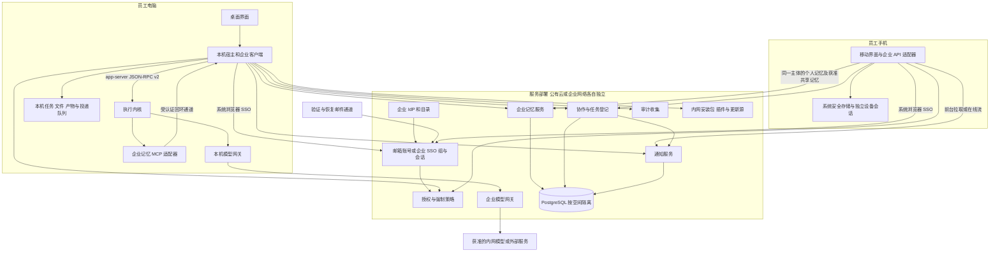

# 18 公有云与企业私有化部署及协作设计方案

版本 v0.3，日期 2026-10-17。状态：设计提案，未实施。面向产品、客户端、服务端、安全与交付团队。本版增加 Gmail 等邮箱注册登录和公有云托管使用，保留企业 SSO/私有部署与 v0.2 的跨端记忆设计，增加 C1–C3 公有云实施分支。

本方案覆盖公有云托管与企业内网部署、邮箱登录与 SSO、人员与部门群组、桌面与移动端共享记忆、任务状态共享和通知。两种部署复用身份、授权、记忆和协作服务契约，由客户端连接所选部署。桌面任务执行、文件解析、完整会话和默认产物仍在员工电脑；服务端仅存明确纳入范围的记忆、协作元数据及获准发布的内容。移动端首版提供记忆与协作入口，不承担桌面执行内核。

本文定义目标行为、模块边界和阶段验收，不将现有个人版自动升级为企业受管模式。总纲中的 [D9、D10、D11](../evowork-on-codex-design.md)、K1–K7 和 Q30–Q37 的企业扩展提案登记在总纲 §10.1.11；实现前按阶段固化具体契约。现状以 [status.md](../status.md) 为准。

## 1 目标与交付范围

### 1.1 企业使用场景

员工从企业分发的安装包启动 EvoWork，在系统浏览器完成企业 SSO 登录。应用按部门和项目角色获得模型、工具及记忆权限。员工可将指定任务的状态共享给群组，群组成员收到完成、失败或协助通知；查看正文、取得产物和接手执行分别授权。

经过确认的工作经验可保存为个人、项目、部门或企业记忆。后续任务按当时有效权限检索并引用，用户可追溯来源、版本和有效期。离职或转岗后，企业能够收回服务访问、共享数据访问和设备授权，并停止相关自动化。

员工在桌面明确保存“报告先给结论，再列风险”为企业内个人记忆，随后在手机登录同一企业主体即可查看和修改，无须桌面在线。项目/部门/企业共享记忆同样按服务端权限对两端开放；桌面内核自动生成的本机记忆不会因此上传到手机。

个人用户选择“使用公有云”，以 Gmail 或其他邮箱完成注册、验证和登录，获得个人空间与已授权模型额度；无需企业 IdP 或企业管理员。桌面和手机连接同一公有云账号/空间后访问中心个人记忆；加入组织后按组织策略访问共享记忆，个人空间内容不自动转入组织。

### 1.2 部署类型

| 类型 | 执行与存储 | 模型与出口 | 交付目标 |
| --- | --- | --- | --- |
| 现有个人形态 | 本机任务和记忆 | BYOK 或既有托管服务 | 保留当前行为，不自动上传历史 |
| 公有云托管 | 桌面执行；EvoWork 运营的云端保存账号、所选中心记忆及协作记录 | 公有云模型网关与公开 HTTPS 服务，按空间配额 | 邮箱自助注册，个人空间先行；组织/移动功能按阶段开放 |
| 企业内网部署 | 本机执行；企业侧集中身份、记忆、协作 | 企业网关转发获准的内网或外部服务 | 第一交付形态 |
| 完全断网部署 | 同上，全部依赖从企业内部获取 | 对话、提取、整理、向量化、图片等已启用模型均在内网 | 完成离线交付专项后开放 |

服务位置使用 `hostingMode=local_only/public_cloud/private`，设备管理使用 `deploymentMode=personal/enterprise_managed`，空间类型使用 `workspaceType=personal/organization`；三者与模型上游 `gateway.mode=local/hosted/private` 分别建模。既有 `deploymentMode=personal` 表示设备未受企业托管，不代表中心空间必定是个人空间。公有云用户可属于组织但使用未受管电脑，企业受管设备也可连接获准公有云组织；不能凭 URL、邮箱域或是否登录推断这些属性。

企业内网部署不等于数据不出企业网络。内容可能经过模型、图片服务、连接器和记忆处理模型；是否允许离开企业由完整出口策略决定，界面显示实际目的地。完全断网形态关闭所有外部依赖，不在故障时切回公网。

### 1.3 首版边界

企业核心内测版 E4a 支持单企业部署、一个生产 IdP、一位员工使用自己的 OS 账号、部门及项目群组、任务状态共享、应用内通知，以及手动保存的个人记忆和审核发布的共享记忆。普通成员无须访问管理后台。E4b 交付一个选定移动平台的首版客户端，支持企业登录、记忆查看/搜索/手动编辑、任务状态和前台通知收件箱。

暂不提供多人同时操作同一个本机任务、会话实时共同编辑、云端代跑、跨企业联合群组、个人云盘、全量聊天归档、移动端远程执行和通用即时聊天。个人记忆的跨设备访问属于 E4a/E4b 基础范围；会话同步、任务接续与移动端独立 Agent 执行分别规划，不由共享记忆隐式引入。

### 1.4 公有云使用范围

本次公有云范围是在线账号、模型网关、中心记忆、协作与通知，以及对应 Web 成员/管理界面。桌面或移动端连接这些公共 HTTPS 服务即可使用各阶段开放的功能，个人用户无需自行部署。原有桌面本地执行继续保留；“公有云可用”不表示浏览器已经能独立运行完整 Agent、解析本机文件或在电脑关机后代跑任务。纯浏览器云端执行需另行设计隔离执行环境、任务存储与费用控制，不纳入本版估算。

Gmail 地址可作为普通注册邮箱，不要求用户连接 Gmail 账户或授权读取邮件。“邮箱 + 密码 + 邮件验证”是首版明确路径；“使用 Google 登录”属于可选联合登录适配，独立排期，不能因支持 Gmail 地址就宣称已经支持 Google 一键登录。首版不新增邮箱验证码登录或 magic link，以免同时维护多套恢复与认证路径。

公有云与私有部署的身份库、会话、密钥和数据命名空间分别独立；相同邮箱不跨部署自动合并账号或复制记忆。每次切换部署都显示当前服务名称和数据目的地，旧请求/令牌不能流入新部署。

## 2 现有基础与差距

下表区分已有实现和本次新增。已有模块存在不代表已通过客户内网、HA 或离职回收验收。

| 领域 | 已有基础 | 本次需要补齐 |
| --- | --- | --- |
| 身份与管理端 | `services/identity` 邮箱密码、邮件验证/重置、种子租户、成员、管理员、设备刷新令牌吊销；`apps/web` 账号和管理页面 | 公有云个人空间开通/多租户、生产发信与滥用防护、OIDC、SSO 强制、组同步、细粒度授权和已有令牌回收 |
| 桌面登录 | `apps/desktop/src/main/account.ts`、`packages/account` 的 PKCE 与令牌协议 | 企业登录入口、可信部署发现、设备注册、员工绑定、租约和失效处理 |
| 移动端 | 当前仓库没有本方案对应的企业移动客户端 | 移动 OAuth 客户端、设备会话、安全存储、跨端 API 适配、记忆与协作界面；不能复用 Electron 主进程作为移动运行时 |
| 模型 | 本机网关常驻，支持托管和私有上游，四层模型目录、配额、safeStorage | 企业统一鉴权、端点允许清单、按组模型授权、流式请求撤权、部门预算 |
| 策略 | ES256 签名策略包、`requirements.toml`、有效期、模型限制及应用开关 | 独立于登录的受管基线、防回退、策略应用证明、员工/设备撤权、内核能力不足时阻断 |
| 记忆 | 内核本机记忆的使用/生成开关、模型选择、状态与清空；宿主不读内核内部存储 | 企业集中个人/共享记忆、两端统一 API、逐条管理、来源、权限、审核、检索与失效传播 |
| 通信 | [17](17-thread-communication.md) 的本机独立会话消息、排队、去重、回复闭环 | 跨员工任务登记、共享权限、跨设备事件同步和人员通知；首版不接远端 Agent 自动唤醒 |
| 通知 | `services/store` 的本机 `notification` 表与自动化通知基础 | 企业收件箱、订阅、离线补发、读状态、去重和撤权检查 |
| 分发与审计 | Hub 验签与离线包、运行时安装器、更新入口、身份审计和本机执行审计 | 全依赖内网分发、集中审计收集、运维监控、备份恢复和分阶段部署验收 |

当前访问 JWT 的有效期为 15 分钟，`jwtAuth` 主要做签名与时效验证，设备吊销主要回收刷新能力；不能据此承诺现有 access token 或在途调用立即失效。当前 `devices.policy_pack_id/policy_pulled_at` 表示设备拉取，不能当作已应用证据。依据见 [claims.ts](../../packages/account/src/claims.ts)、[auth.ts](../../packages/account/src/auth.ts)、[identity HTTP](../../services/identity/src/http.ts) 与 [schema.ts](../../services/identity/src/schema.ts)。

## 3 架构与信任边界

### 3.1 目标部署图

图中服务是逻辑模块，首版可将身份/授权部署为一个控制面进程，记忆/协作/通知部署为一个数据面进程，另设模型网关和后台 worker。采用单仓独立包、明确 API 和数据库 schema，不要求一开始拆成多个微服务。生产企业数据使用 PostgreSQL；现有 identity SQLite 提供一次性导入及回滚工具，个人开发形态仍可保留 SQLite。数据库迁移是 E0/E1 的真实工作，不视为改配置即可完成。

第一版通过 PostgreSQL 事务、outbox 和后台 worker 完成投递，SSE 提供在线通知，游标拉取负责补偿。暂不强制引入 Redis、Kafka 或独立向量数据库；语义检索阶段再验证 PostgreSQL 向量扩展与检索方案。

移动端直接连接所选部署的服务，不通过桌面代理记忆读写；公有云通过获准互联网连接，私有部署通过企业 Wi-Fi/VPN 等获准路径。桌面关机不影响中心记忆可用性。`services/enterprise-client` 保留桌面生命周期适配，共用的 HTTP/记忆契约下沉至无 Electron、Node 文件系统和平台密钥库依赖的客户端核心；手机使用自己的安全存储与登录回调适配。

跨端必须共享的是 API schema、授权和一致性语义。移动技术栈能运行共用核心时直接复用代码；采用独立原生语言时，从同一契约生成/实现适配并运行一致性用例，不强制移植 TypeScript 运行时。实际复用程度由 E0 平台探针确定。

### 3.2 保留的架构约束

1. K1/K2：执行内核保持只读，所有内核操作由 `kernel-adapter` 经 app-server JSON-RPC v2 完成，不读取或同步其 sqlite、rollout 和记忆生成文件。
2. K3：记忆工具由自建 MCP 提供；宿主实施权限和投递，工具入参不得自报可信员工身份。新增上下文注入若当前公开协议无法满足，先用检索工具，不能假设存在远端 `MemoryBackend`。
3. K4/D11：内核模型端点仍为 loopback。企业身份服务、记忆服务和 MCP 不向 renderer 下发服务商密钥，不直连未经网关批准的推理服务。
4. K6：解析与执行继续在本机，中心内容通道逐一登记。私有部署不向 EvoWork 公有云转存内容；公有云部署仅在用户选择使用后保存相应中心记忆/协作内容，不能沿用“仅企业内部存储”的文案。
5. D10/Q31：本机任务库继续不加 `user_id/tenant_id`，企业服务中的数据才按主体归属与授权；同 OS 账号不承诺隔离多位员工的既有任务。
6. Q14/Q35：模型网关不落盘正文；聚合计量不携带任务标识。任务协作另用独立端点、数据模型和留存策略，不能借计量接口上报。

### 3.3 受管部署的信任根

部署清单由企业 IT 通过 MDM 或系统管理员写入受保护位置，包含 `deploymentId`、服务 origin、企业信任根、允许出口、最低企业客户端能力和受管模式。清单不包含模型密钥。用户可见配置文件只作镜像，删除它不能使受管设备回到个人模式。

首次注册需要验证部署清单与 TLS 信任，绑定企业、员工主体和设备密钥。在线获取的签名策略不得自行替换系统信任根。轮换使用旧可信根签署的新密钥及重叠有效期；紧急换根通过企业设备管理执行。禁止首次从任意 URL 获取 JWKS 后立即信任。

企业服务端授权、网络出口和 OS 文件权限共同构成边界。员工拥有本机管理员/root 权限时，不能承诺仅靠应用阻止其运行别的客户端或复制已取得的文件；高管控交付须配套企业端点和网络管理。

## 4 邮箱身份与企业 SSO

### 4.1 登录链路

桌面 → 企业 identity 的授权入口 → 系统浏览器跳转企业 IdP → identity 校验回调并映射内部主体 → 桌面通过自身 PKCE 授权码交换取得本应用令牌。

identity 作为 OIDC 客户端；桌面作为 EvoWork 的 public client，两层授权码与 PKCE 各自独立。桌面不接触 IdP 密码，不直接把 IdP ID token 当作业务 API token。验证 issuer、签名算法、audience、nonce、state、redirect URI、授权码一次性和有效期；系统浏览器使用现有 loopback 模式，禁止任意回调地址。

移动客户端单独注册 public client，使用系统浏览器、授权码和 PKCE，并绑定选定平台验证过的应用链接/回调，不照搬桌面 loopback。两端映射到同一企业内部主体，但各自具有 client ID、设备 ID 和会话；只撤销丢失手机不会默认踢掉桌面，员工停用则撤销全部设备。手机不能取得桌面专用工具/执行 scope。

账号绑定以 `(issuer, subject)` 为稳定外部身份键，email、姓名和部门为可变属性。旧邮箱密码账号迁移必须由管理员确认映射或验证双方身份，不能因邮箱相同自动合并。SSO 成功仍需检查员工是否已开通、是否 active 和是否允许注册此设备。

首版一个生产 IdP，OIDC 优先；SAML 由后续适配或企业统一身份代理转换支持。MFA 在 IdP 强制，企业配置验证所需认证强度；应用内不重复建设密码/MFA 平台。SSO-only 部署关闭普通密码入口、自助注册和旧密码重置旁路；独立应急管理员仅通过受限管理入口使用，操作审计并告警，不取得默认内容读取权。

### 4.2 人员同步与部门

SSO 负责认证，人员同步负责准入和组，授权服务负责能力与资源权限。E1 支持管理员维护和受控目录导入，E2 接 SCIM 用户/组增量及周期对账。若 E1 仅使用登录时 claims，人员停用必须通过管理端操作，不能承诺仅 IdP 停用便完成即时回收。

| 对象 | 权威来源 | 规则 |
| --- | --- | --- |
| 企业用户 | IdP/目录或 E1 管理端 | 稳定 externalId，删除先禁用再按留存清理 |
| 部门群组 | IdP group 或受控部门属性映射 | 同步成员不可在本地手改；改名不改稳定 ID |
| 项目群组 | 应用内项目负责人 | 可跨部门；新增成员仍须是有效企业成员 |
| 部门管理者 | 明确角色映射 | manager 属性不自动赋予所有下属内容权限 |

首版不支持嵌套组自动继承和跨企业成员；未知组映射不授予权限。同步失败显示最近成功时间并告警，保留最后一致快照；停用事件不等待全量同步完成。SCIM 更新需幂等、支持停用/组移除和分页，冲突通过版本检查处理。

部门树只用于组织展示，不自动向上级部门或其他子部门继承资源可见性。一个员工可以加入多个部门/项目组，符合资源授权的任一组可产生许可，但仍受企业上限、内容分类和显式拒绝约束。

### 4.3 会话与设备回收

业务令牌绑定 `iss/aud/sub/sessionId/deviceId` 和授权版本。敏感 API 查询当前主体、会话、设备和组状态；JWT 中的旧角色不能成为持续授权依据。浏览器会话、桌面 refresh token、access token、设备租约和服务账号令牌分别管理。

建议默认目标如下，属于待实现和验收的参数：

| 参数 | 默认目标 | 适用范围 |
| --- | --- | --- |
| 企业 access token | 5 分钟 | 企业新增令牌配置，不静默改个人版 15 分钟基线 |
| 在线撤权 | 服务收到禁用/撤权后 60 秒内拒绝后续访问 | 鉴权缓存不超过 30 秒；在途模型流周期复核；不包含尚未到达的 IdP 同步延迟 |
| 客户端控制心跳 | 30 秒 | 撤权、授权版本和策略变化；断网明确进入离线状态 |
| 离线执行租约 | 默认 0，企业可显式开放至多 4 小时 | 只允许租约列出的桌面本地能力；不开放中心个人/共享记忆的离线缓存、移动离线写入和跨人发送 |
| refresh token | 最长 7 天，滚动轮换并检测复用 | 企业管理员可缩短，停用即作废 |

离职动作先禁用主体并增加授权版本，再撤销会话、refresh、设备及服务凭据；通知客户端停止新回合，在安全边界中断现有回合并暂停该设备自动化。已提交到外部系统的操作不保证撤销。员工关联的共享任务和记忆按资源所有权交接，不转移其私人会话。

### 4.4 邮箱注册 登录与恢复

公有云首版流程：填写邮箱和密码 → 服务端创建待验证账号并发送一次性验证链接 → 验证后幂等开通个人空间 → 登录 Web，或通过系统浏览器授权桌面/移动客户端 → 按空间额度使用云端模型及已开放功能。未验证用户只能完成验证/恢复，不调用付费模型、创建共享资源或触发通知广播；验证链接不包含业务正文，激活后仍完成登录及客户端授权，不把它当作可长期登录的 bearer。

复用现有邮箱密码、邮件验证、重置密码与 PKCE 机制，补齐生产发信配置、退信/投诉处理、发送限额和监控。密码使用现有密码哈希实现及受控参数，不发到桌面/移动进程或日志；登录/注册/验证/重置按账号与网络来源限速，错误响应不泄露账号是否存在。验证与恢复令牌单次使用、限时、服务端只存摘要；邮件链接用固定可信 origin，不采信用户提供的跳转 URL。改邮箱验证新地址并通知旧地址，改密/重置可撤销既有会话。

Gmail 和其他邮箱均由验证邮件证明控制权；不擅自删除 Gmail 地址中的点号或 `+tag` 合并用户，邮箱规范化规则及唯一约束在 E0 固化。更换邮箱不改变稳定 user ID。邮箱账号、未来 Google 身份与企业 SSO 身份显式绑定，需近期重新认证并证明待绑定身份；同 email 不自动合并，也不靠绑定解除组织 SSO 要求。

普通邮箱用户可以访问自己的个人空间；进入组织空间还需有效邀请/成员关系，并满足该组织登录策略。SSO-required 组织要求目标 IdP 的有效认证上下文；本平台邮箱密码重置、普通登录或同域邮箱不能替代它。用户保留个人空间会话不意味着仍可访问已退出/被移除的组织，退出组织只回收该组织权限；整个账号停用则回收全部访问。

公有云账号删除先冻结新写入和额度、撤销全部会话，再依留存清理个人空间与其记忆/通知。共享资源按组织交接规则处理，最后一名组织管理员须先交接；本机任务仍不因删除云端账号自动删除。公网运营/支持账号无默认内容权，调查访问独立审批与审计。

### 4.5 公有云空间与多租户隔离

公有云账号是稳定主体，可拥有一个个人空间并加入多个组织空间；用户通过显式空间切换访问。个人空间只授予本人，组织空间通过邀请及明确组/角色授权。自助邮箱注册不加入当前种子企业，不把新用户设为平台管理员，也不按邮箱域自动创建或认领企业。首版先开通个人空间，组织创建/邀请按 C2 和 E2/E3 的交付能力开放。

现有“单种子租户、自助注册不开租户”的实现保留为私有部署引导；公有云新增个人空间开通事务、唯一约束和幂等恢复流程，不能把共用种子租户当作所有注册人的个人空间。以内部 workspace/tenant ID 作为服务端数据边界，与 external IdP subject、设备和 user ID 分别建模；平台角色与空间管理员角色分开。

令牌只授权选定部署/空间所需 scope；API 从已验证会话和实时 membership 派生主体/空间，并核对请求路径，不能信任 body 中任意 `workspaceId`。数据库查询/行级策略、缓存键、搜索与向量索引、对象引用、worker 队列、通知游标、导出和配额均包含部署与空间边界，后台作业同样执行授权与隔离校验。完整 token 不含全部历史空间及组权限。

个人/组织额度分别累计，模型调用绑定当前空间并执行并发、速率和成本上限，注册不承诺免费额度或支付/充值功能。组织管理员不能因账号邮箱相同读取其个人空间。个人转组织记忆按明确选择、授权和审核新建副本；私有部署和公有云之间不自动搬迁数据。

## 5 权限与强制策略

### 5.1 角色和资源权限

有效权限为企业能力上限、主体/组角色、资源 ACL、设备能力、源系统权限的交集；显式拒绝优先。资源访问不能由客户端传来的组列表决定。管理员变更角色需审计，普通组长不能提升自身全局权限。

| 角色 | 管理能力 | 内容边界 |
| --- | --- | --- |
| 企业管理员 | 身份、部署、组、模型、配额和策略 | 无默认任务正文或记忆内容权限 |
| 安全审计员 | 查阅获准审计、告警及调查导出 | 调查内容访问需独立授权及记录 |
| 部门/项目管理者 | 所辖资源授权、订阅规则、记忆发布审核 | 只读获准资源，不能读取成员全部个人内容 |
| 普通成员 | 创建任务、共享、订阅、提交记忆 | 受资源 ACL 和企业策略约束 |
| 服务身份 | 执行被分配的自动化/API 操作 | 最小 scope、独立生命周期，不继承创建者权限 |

任务权限分别为 `status.read`、`summary.read`、`artifact.read`、`conversation.read`、`task.comment` 和后续 `task.delegate`。首版只实现状态、获准摘要和人工消息；任务全文/产物服务授权和委派不可用时不显示可执行入口。

记忆权限分别为 `memory.read`、`memory.propose`、`memory.publish`、`memory.manage`。订阅通知不是授予权限，获得某个模型也不代表可以对它发送任意密级内容。检索和模型调用均需检查内容分类及出口许可。

### 5.2 策略获取与应用

复用现有签名信封并增加版本化企业契约：`deploymentId`、`policyVersion`、`authorizationEpoch`、`requiredCapabilities`、签发/生效/过期时间和约束。租约单独签发，绑定员工、设备和策略摘要；通用策略包不能充当员工离线授权。

策略分为不可覆盖的 requirements 与可调整的 defaults。前者约束模型/端点、BYOK、工具、审批、网络、记忆读写、共享、运行时安装和更新源；后者仅提供初始值。内核支持的限制写入其 requirements；部署、内容和服务权限在宿主/服务端强制，不能把未知 TOML 键当作已实施。

获取 → 验签及防版本回退 → 校验客户端/内核能力 → 应用 → 读取公开有效配置核对 → 上报结果。需要重启内核时先排空或明确中断，不在旧回合中假装新策略已生效。后台分别显示 `fetched/verified/applied/failed`、设备、客户端/内核版本、策略摘要、时间和错误码；`applied` 是受信客户端报告，不是硬件远程证明。

受管模式下，退出登录不会删除或放松设备基线；未登录、首次策略未就绪、验签失败、策略到期或授权过期时拒绝新执行和企业服务访问，保留本地只读及恢复登录入口。普通用户删缓存不会解锁 BYOK；时钟回拨或不确定时拒绝延长离线租约。个人模式沿用现有无包和未登录行为。

## 6 企业记忆与跨端共享

### 6.1 范围与数据结构

| 范围 | 内容示例 | 默认发布规则 |
| --- | --- | --- |
| 个人 | 写作偏好、个人工作方法 | E4a 由本人手动开启并保存，同一主体跨端可用；不自动迁移本机记忆 |
| 项目 | 项目术语、已确认决策、约定 | 提交到项目，指定管理者确认 |
| 部门 | 业务口径、复用方法、工作流程 | 部门审核后发布 |
| 企业 | 通用规范和流程 | 指定维护者审核发布 |

`memory_items` 保存范围、归属主体/组/项目、内容分类、状态、来源引用、当前版本、有效期、创建与维护人；`memory_versions` 保存不可变修订、正文、内容摘要哈希和修改说明；`memory_acl` 保存访问规则；`memory_reviews` 保存审核；`memory_chunks` 与全文/向量索引为可重建派生数据；`memory_tombstones` 保存删除与失效版本。

来源指向稳定的企业内容引用或明确发布的摘要，不自动暴露本机路径、任务历史或文件。用户无权读取来源时仍不得借记忆看到源正文；默认要求记忆 ACL 不宽于来源许可，发布为更广范围必须显式审核并允许解密级/重新发布，不能由提取模型决定。

### 6.2 写入与发布

共享候选状态为 `draft → pending_review → published → superseded/expired/deleted`；驳回回到可修改草稿。个人记忆由本人确认后直接发布，不经过部门审核，也不产生他人的审核收件项。首版用户选择文本或编辑摘要后提交，预览正文、目标范围、接收群组与模型处理目的地。没有自动读取本机原生记忆正文，也不对全部历史做批量上传。

后续自动提取只处理用户或企业明确纳入的任务范围。提取和整理模型遵守独立模型允许清单及内容出口策略，输入中不得包含未获授权的其他会话。外部网页、邮件及共享消息作为不可信材料，提取结果不作为系统指令，不自动把工具输出提升为企业制度。多模型费用、重试及索引作业有独立预算和幂等标识。

### 6.3 检索与任务使用

执行内核通过企业记忆 MCP 调用 `memory.search/read/propose`，由宿主从真实调用上下文获取身份与任务绑定。服务端检查当前授权，再在许可集合内全文或向量检索；不能先取全库 top-k 后在客户端过滤。`read` 再次检查 ACL、状态、有效期和版本，禁止猜 ID 绕过搜索。

结果携带 ID、版本、范围、内容分类和可见来源。任务界面显示“使用了哪些企业记忆”；引用内容作为数据，不作为高优先级指令。首版以显式检索/读取验证可用性；后续自动检索须验证公开注入接口及调用时机，不承诺所有任务创建后天然具有中心记忆。

宿主在向内核返回任何记忆正文之前，将本机 thread、条目 ID、版本和授权版本写入本机引用账本；即使模型最终没有引用，也记录该内容可能已进入上下文。控制心跳获取失效版本/授权变更，按账本阻断受影响任务，缺失增量游标时重新校验全部引用。服务端不需要接收原始 thread ID；引用账本不可由模型自行声明或删除。

同一事实冲突时呈现差异，已审核企业制度优先作为业务依据，个人偏好不能覆盖它；不以“更新时间最新”无条件决定真伪。发布、审核、修改和删除使用版本前置条件，冲突返回可恢复错误。

### 6.4 删除与撤权

首版中心个人记忆与共享记忆均不持久缓存正文到设备，不启用中心返回内容进入原生自动记忆提取；接入任务要求外部上下文保护有效，无法保证时关闭该任务记忆生成，并通过真实内核验证。远端 MCP 响应仍可能留在任务上下文和历史中，不能声称关闭生成就消除了本地副本。

撤权/删除先阻断查询并写 tombstone，再清理索引、候选缓存和可控副本；引用关系用于标出受影响任务。在线客户端对含失效记忆的任务停止新回合，要求新建不带该历史的任务；本地历史仍按企业保留策略处理，不改写内核内部文件。已进入上下文、已导出的产物、第三方系统副本与离线设备数据不能远程保证收回。

个人跨端记忆从 E4a 起以企业记忆 API 的条目作为真源，单独管理个人所有权与导出；原生本机记忆继续独立。停用/离职后的个人记忆按企业配置封存或删除，不因部门交接自动公开。

### 6.5 个人记忆 共享记忆与本机记忆的边界

“企业记忆服务”描述部署位置，不意味着服务内所有内容都对企业全员共享。“个人记忆”描述访问范围，“本机记忆”描述设备与原生实现边界；界面不将两者混用。

| 类别 | 唯一真源与归属 | 可见范围 | 跨端规则 | 控制与清除 |
| --- | --- | --- | --- | --- |
| 中心个人记忆 | 所选部署的记忆服务，绑定 deployment、workspace 与稳定内部主体 | 默认仅本人；管理员无默认正文访问权 | 同一主体/空间在桌面/移动端在线读写，桌面无须在线；不跨空间或部署自动同步 | 单独控制保存与使用；删除条目影响中心版本；退出登录只清设备凭据与可控缓存 |
| 项目/部门/企业共享记忆 | 企业记忆服务，归属相应项目/组/企业 | 当前获准成员，仍受源许可和分类限制 | 两端各自在线鉴权，不因安装移动端新增权限 | 提交与审核发布分开；变更/撤权/删除按服务端版本传播 |
| 本机记忆 | 桌面执行内核管理的本地状态，以 OS 账号/设备隔离 | 仅当前桌面环境；不提供多员工应用内隔离 | 不上传、不目录同步、不与手机合并；手机读不到这份原生记忆 | 沿用本机使用/生成/清空控制；清空不删除企业服务条目 |

私有部署及组织空间内的个人记忆是相应组织内的私有工作记忆，受其留存、模型出口和调查授权政策约束；公有云个人空间按平台向本人展示的政策管理，不因加入组织而改用该组织政策。两者均不承诺服务运营方不可解密的端到端加密。普通管理员无默认内容权，调查访问按独立角色和审计处理。

界面提供“本机记忆”“我的跨端记忆”“共享记忆”三个清楚标识，分别控制本机使用/生成、跨端个人保存/使用、共享检索/提交。停用跨端个人记忆只停止后续保存/使用，不自动删除已存条目；删除全部中心个人条目必须是单独操作。本机 `memory/reset`、中心个人清除和共享资源删除不能互相代替，退出登录也不等同删除。

### 6.6 统一读写与跨端一致性

两端用同一部署/空间内的稳定主体和服务端授权，不以设备 ID、email 或手机号决定记忆归属。设备 ID 用于会话和审计，不成为个人记忆所有者。列表与全文搜索可查询当前空间内个人及获准共享范围，结果明确返回 `scope/owner/version/status`；跨端列表是同一数据集的在线视图，不是两份本地库互相复制。

所有写入携带 `operationId` 幂等键，修改/删除另带修订前置条件。修改使用 `If-Match`，旧版本返回 409/412 并展示最新正文与本次草稿，由用户合并；不得按设备时钟或最后写入直接覆盖。个人转共享创建新的共享候选条目，经预览和审核后发布，不能仅改 scope 就扩大可见范围。获准扩大范围发布的共享条目是独立快照，发布预览说明删除个人原条目不等于撤回该共享资源；受限共享内容则不得自动复制成个人条目来绕过撤权，相关派生候选继续带来源约束。

服务端在记忆变更与 tombstone 同一事务推进 `changeSequence`。`/memories/changes` 按当前权限返回最小失效/版本通知，游标绑定主体和授权版本，不含已撤权正文。客户端恢复前台、重新登录、重新联网或收到变更信号后刷新；游标失效时重拉有权列表，未收到事件不能被当作旧缓存仍有效的依据。删除与修改竞态以服务器版本和 tombstone 为准，迟到写入不得复活已删除条目。

移动端以直接 API 完成浏览/手动维护，不依赖 MCP 或桌面进程。桌面执行通过现有企业记忆 MCP 使用同一资源；未来移动对话/Agent 使用记忆时，由受信执行侧记录记忆 ID/版本和授权依据，不能只凭手机自报已鉴权。共享记忆不等于共享聊天历史，手机查看条目不使它取得来源桌面任务的完整会话或文件。

### 6.7 移动端安全与离线规则

E4b 支持一个选定平台连接私有或公有云部署，普通公有云个人用户不要求企业 SSO 或 MDM。平台、技术栈、签名分发和网络接入在 E0 固化。令牌保存在系统安全存储（如 Keychain/Keystore），不放到网页 localStorage、日志、分析 SDK 或推送正文；私有 API 地址与企业 CA/受管配置按平台能力验证，不能以关闭 TLS 校验适配内网。

首版只有一个活动部署/账号/空间。公有云允许同一账号显式切换已加入空间；重新激活、切换账号/部署/空间、恢复前台时，在显示记忆正文前复核会话和授权。退出登录或设备撤销后清理内存中的正文、未提交编辑及可控缓存，取消旧请求；迟到响应按会话和空间世代拒绝，不能填回新上下文。不得把原账号/空间编辑草稿带入新上下文或自动上传。

首版不做中心个人/共享记忆的持久正文缓存与离线写队列。服务不可达时按部署显示“无法连接公有云服务”或“需要连接企业网络”，停止新读写；未提交编辑只留在当前有效会话的内存中并提示尚未保存，重连后重新鉴权、核对版本再提交。后台可能被系统挂起，因此不承诺后台即时同步或即时远程擦除；再次激活必须先校验。将来若开放离线模式，须新增加密缓存、独立离线阅读租约、tombstone 和冲突恢复验收，不借用桌面执行租约默认开放。

移动收件箱首版通过前台游标拉取/可用时在线流获取，按企业条件启用 VPN 接入；后台系统推送单独进入 E5。推送平台、令牌和消息目的地需登记，内容只包含通用提示，打开后再鉴权。完全断网交付不依赖 APNs/FCM 或其他公网推送；手机无法访问企业服务时明确不可用，不经桌面或公共服务兜底。

### 6.8 跨端体验与执行边界

E4b 首版包含企业登录/设备管理、我的跨端记忆、获准共享记忆、手动保存/修改/删除、来源/版本查看、任务状态及前台通知。共享发布仍走相同审核规则，移动端不获得额外审批权。手机修改个人偏好后，桌面下一次在线查询即可取得新版本；已经进入旧任务历史的内容按引用账本处理，不能宣称实时替换已有上下文。

“记忆管理两端一致”“在两端对话中使用相同记忆”“从手机接续桌面任务”分别验收。E4a/E4b 首先交付前者，并验证桌面执行实际检索中心记忆；手机浏览条目不能证明移动模型已使用它。移动聊天、完整任务上下文同步、远程工具、电脑唤醒和任务接续需额外执行面与权限设计，保留为后续独立范围。

### 6.9 公有云记忆与私有部署的数据边界

公有云个人空间中的中心个人记忆保存于 EvoWork 运营的公有云记忆服务，默认仅该账号可见；它与私有部署的“企业内个人记忆”使用同一范围模型，但存储位置、运营方、保留政策和部署主体不同。首次启用显示目的地及可上传内容，登录成功不等于授权自动提取/上传既有本机历史。

组织空间内的个人与共享记忆遵守组织策略，公有云个人空间不因加入组织被组织接管或自动共享。客户端按 `(deploymentId, workspaceId, subjectId)` 区分记忆视图、变更游标、草稿和可控缓存；切换空间重新鉴权，搜索不合并不同空间 top-k。两端必须选中相同空间才展示同一组中心条目。

私有部署默认不访问公有云身份/记忆 API，不向公有云发副本；公有云服务也不能凭同 email 访问企业内网。跨部署迁移若未来需要，使用显式导出/导入、目的地预览和企业许可，另行排期。所有形态的本机原生记忆仍独立，不目录同步、不合并、不自动云备份。

## 7 部门群组与任务协作

### 7.1 共享任务与本机任务

用户在任务页选择共享群组、权限和事件类型，预览将上传的标题与可选摘要。默认不共享，企业可预设特定项目的新任务状态共享规则，用户创建任务时明确显示；旧任务不追溯自动上传。

协作服务生成 `enterpriseTaskId`，本机保存它与本机 thread 的映射。服务端不接收原始 thread ID、cwd、完整历史、截图或未选文件。本机映射、出站队列和任务数据仍是设备级数据，不在 `services/store` 增加用户归属列。设备绑定负责确定谁能够上传当前企业任务，不能接受模型自报作者或目标企业。

企业侧共享任务是协作记录，不是可从另一台电脑恢复执行的原生任务。首版网页和同事桌面可查看授权状态及发送人工消息；源电脑离线时仍能看最后上报状态，但无法打开本机文件或继续运行。产物发布后续接独立企业内容引用；本地路径字符串不能当作下载链接。

### 7.2 状态语义

| 字段/状态 | 含义 | 通知规则 |
| --- | --- | --- |
| `queued` | 已排队，尚未执行 | 默认不广播 |
| `running` | 一个执行回合正在运行 | 仅关注者可订阅 |
| `waiting_input` | 需要用户提供信息 | 指定协助人收到通知 |
| `waiting_approval` | 等待原有执行审批 | 提醒负责人；群组成员不会因此获得审批权 |
| `idle` | 回合结束，任务当前空闲 | 不自动等同业务完成 |
| `completed` | 用户或已定义的业务完成条件确认完成 | 通知有效订阅者 |
| `failed/cancelled` | 本次执行失败/取消 | 通知负责人及所选订阅者 |

共享记录另带 `executionRevision`、`lastReportedAt` 和 `devicePresence`。设备离线不把任务改成失败，界面显示“最后同步于……，当前状态待确认”。重跑增加 executionRevision；旧执行的迟到完成不得覆盖新执行的运行状态。状态来自宿主已提交的事件和明确业务动作，不能让模型随意写成已完成。

### 7.3 跨员工消息

人工在共享任务中发送状态说明、协助请求和指定成员提醒。服务端校验发送人与接收人当前资源权限，按允许字段保存。群组内无需广播每一次工具调用；默认聚合完成、失败、阻塞和人工协助请求。

Agent 若发起跨员工消息，确认卡须展示发送目标、正文、共享范围和目的地。用户点击人工发送本身是本次授权，明确订阅只授权范围内的后续状态事件。首版收到消息只进入人员收件箱，不调用本机 [17](17-thread-communication.md) 的“恢复并启动目标回合”。未来自动委派需另建任务操作授权、预算、循环限制和可信主体协议。

## 8 通知与可靠同步

### 8.1 端到端投递

本机任务状态落库时在同一事务写企业出站事件。worker 以 `eventId + enterpriseTaskId + executionRevision + sequence` 上传；服务端事务内做主体/设备/资源授权、幂等入库、状态推进和通知 outbox。确认响应丢失可安全重发，不能只依赖内存事件总线。

每个任务执行实例只有一个登记的权威设备。序号缺口暂存并请求缺失事件或完整状态快照，旧序号不回退状态；设备迁移必须先取得新的写入世代并封禁旧设备写入。首版不开放执行设备迁移；换机不能通过新设备直接续写旧任务状态。

服务端 outbox worker 解析订阅与有效 ACL 后生成收件箱条目，唯一键为 `(recipientId,eventId,channel)`。采用至少一次投递加业务去重，不承诺网络意义的 exactly-once。SSE 用服务端游标在线推送，断线后分页补拉；游标过期触发授权范围内收件箱重同步。

### 8.2 内容与成员变更

收件箱保存资源引用和最小状态；读取通知、SSE 推送、补发和打开详情时都重新检查权限。移出群组后不再收到该资源事件，未投递队列取消，旧通知隐藏受限标题/摘要。历史事件接收人取事件发生时的成员与当下有效访问权的交集；新加入成员默认不补发之前事件，主动读历史由资源授权另行决定。

通知状态区分 `queued/delivered/read/expired/cancelled`；送到客户端不代表员工已读，已读也不代表完成协助或审批。锁屏通知默认“有一条任务更新”，不显示敏感标题或正文。各类通知支持免打扰、合并和个人退订，强制安全通知不由普通订阅开关关闭。

E3 提供内网应用收件箱和桌面通知，E4b 移动端复用收件箱并在前台获取。手机后台系统推送、邮件、企业微信、钉钉等适配后续建设，逐项明确外部目的地与字段；发送外部消息不能借应用内订阅隐式授权。

### 8.3 断网与积压

断网显示未同步计数；共享设置变化和事件在本机持久排队，恢复后重新检查授权，撤权后不补发。outbox 默认上限 10000 条或 50 MiB，先到者停止新增自动共享并提示，不静默丢弃关键事件；中间 running 进度可以合并，完成/失败/人工消息保留。退避重试需上限、告警和死信处理，永久性拒绝不无限重试。

## 9 数据模型与接口契约

### 9.1 服务端实体

| schema/模块 | 关键实体 | 真源与限制 |
| --- | --- | --- |
| identity | external_identities、users、workspaces、workspace_memberships、departments、groups、group_memberships、sessions、devices、service_accounts | 公有云主体/个人或组织空间、私有目录及设备真源；仍不存任务/记忆正文 |
| authorization | roles、role_bindings、policy_versions、device_leases、revocation_epochs、policy_reports | 角色、策略与撤权；资源 ACL 由对应资源服务持有 |
| memory | memory_items、memory_versions、memory_acl、memory_reviews、memory_chunks、memory_tombstones、memory_changes、memory_operations | 条目/版本含 deployment/workspace 边界；变更序号、幂等操作持久化，索引可重建 |
| collaboration | shared_tasks、task_acl、task_subscriptions、task_events、task_messages、outbox | 明确共享的元数据与消息，不存原生 thread 历史 |
| notifications | notification_inbox、delivery_attempts、recipient_cursors、outbox | 持久收件箱、状态和投递去重 |
| enterprise audit | audit_events、export_jobs、retention_rules | 只记录批准事件字段，正文调查导出单独授权 |

企业服务资源使用 deployment/tenant 命名空间，跨企业 ID 猜测必须拒绝。即使首版单租户也禁止省略服务端命名空间检查。建议 PostgreSQL 独立 schema 与最小权限数据库角色；跨模块关系采用受控查询/事件，不允许记忆检索账号任意读身份密钥表。

`workspaceId` 是目标资源空间标识，可在仓储层映射既有 tenant，但不能把它与 user ID 或部署 ID 混成同一个值。私有部署可只有一个组织空间，公有云必须实现多空间隔离；E0 固化兼容映射和索引/FK/RLS 规则，现有单租户 schema 不能直接作为公网多租户验收依据。

### 9.2 本机新增实体

`enterprise_task_links`：本机 thread、企业任务引用、共享配置版本、执行世代与序号。`enterprise_outbox`：事件 ID、最小载荷、重试、确认和过期状态。`enterprise_memory_uses`：本机 thread、已返回记忆 ID/版本和授权版本，属于撤权控制所需权威账本。`enterprise_inbox_projection`：企业通知引用、游标与可重建展示，不把服务端权限判断复制为永久许可。

这些表不加 `user_id/tenant_id`。受管 profile 在系统配置与 safeStorage 中绑定企业/设备/主体指纹；一个 OS 账号只绑定一位员工和一个企业。更换主体需 IT 重新注册并清理企业缓存/投递队列，旧任务映射标记停用且禁止自动认领；本机既有私人任务不迁移也不删除。若未来支持同 OS 多员工，须另立隔离方案并修订 D10/Q31，不能只给表加列。

本节是桌面 `services/store` 的约束。移动端使用独立设备安全存储和单活动账号生命周期，不搬运桌面 sqlite、线程引用账本或内核目录；移动端可控状态按企业/主体命名空间清理。首版记忆正文与编辑草稿仅在有效会话内存中存在，不建设手机上的第二个记忆真源。

### 9.3 API 分组

以下为目标接口，命名与 schema 在 E0 固化为独立版本，不表示当前可调用。

| 模块 | 接口示例 | 授权与一致性 |
| --- | --- | --- |
| identity | `/enterprise/v1/auth/*`、`/devices/register`、`/sessions/revoke`、`/scim/v2/Users`、`/scim/v2/Groups` | OAuth scope、管理员权限；SCIM 独立凭据与限速 |
| 公有云账号/空间 | 注册、验证、登录、重置、`/workspaces`、`/workspaces/select`、组织邀请 | 复用已有账号端点并版本化空间选择；public client、成员关系与组织认证强度复核 |
| authorization | `/enterprise/v1/policy/effective`、`/policy/reports`、`/leases` | 绑定设备，拒绝旧版本回退，报告含摘要 |
| memory | `/enterprise/v1/memories`、`/memories/search`、`/memories/changes`、`/memories/{id}`、`/memories/{id}/reviews` | 两端统一 API；个人 owner 从主体取值，ACL 复核；If-Match、operationId、绑定授权版本的游标 |
| collaboration | `/enterprise/v1/shared-tasks`、`/{id}/events`、`/{id}/subscriptions`、`/{id}/messages` | task scope、幂等键、权威设备世代与序号 |
| notifications | `/enterprise/v1/notifications`、`/notifications/stream`、`/{id}/read` | 当前接收人，游标分页，展示/投递时复核 ACL |
| audit | `/enterprise/v1/audit/events`、`/audit/exports` | 独立审计角色；内容导出另行申请 |

JWT 只含身份和必要 scope，不含标题、记忆或消息。浏览器 cookie 会话配置 Secure/HttpOnly/SameSite 及 CSRF；桌面 bearer 与浏览器 CSRF 不混用。接口限制载荷、分页、搜索复杂度和速率；令牌、正文与完整 URL 查询不得进入通用日志。服务间使用独立短期凭据或 mTLS，不转发用户凭据给任意下游。

## 10 模块新增与改造清单

以下路径均相对仓库根，新增路径是规划，不预创建空包。

| 模块 | 类型 | 工作内容 | 阶段 |
| --- | --- | --- | --- |
| `services/identity` | 改造 | OIDC、邮箱验证/恢复生产化、个人/组织空间与邀请、会话/设备撤权、SCIM、PostgreSQL 仓储 | E1/E2/C1/C2/E5 |
| `packages/account` | 改造 | 版本化令牌 audience/scope、会话标识、策略信封兼容和新旧验证器分离 | E1 |
| `services/authorization` | 新增 | 主体/空间/组角色、组织 SSO 认证强度、有效授权、撤权、策略/租约与应用报告 | E1/E2/C1/C2 |
| `packages/enterprise-protocol` | 新增 | 企业资源/事件/错误/能力契约、个人/共享记忆版本及变更游标；与无内容计量类型分开 | E0/E1/E4a |
| `packages/enterprise-client-core` | 新增 | 两端共用 HTTP、scope、幂等、版本冲突与游标逻辑；通过接口注入网络/凭据，不依赖 Electron/Node 文件 API | E0/E4a/E4b |
| `services/enterprise-client` | 新增本机模块 | 使用共用核心，适配桌面可信部署、同步、SSE/补拉、会话生命周期、租约及记忆失效 | E1–E4a |
| `services/store` | 改造 | 企业任务映射、事务 outbox、记忆引用账本、收件箱投影；保留权威/投影双迁移纪律 | E2–E4a |
| `services/collaboration` | 新增 | 企业任务、ACL、订阅、状态事件、人工消息、权威设备约束 | E2/E3 |
| `services/notifications` | 新增 | 收件箱、路由、去重、免打扰、补发、死信和投递指标 | E2/E3 |
| `services/enterprise-memory` | 新增 | 公有云/私有复用中心记忆、空间隔离、审核、版本、检索、删除/变更游标；后续提取/向量检索 | E4a/C2/E5 |
| `plugins/connectors/enterprise-memory` | 新增 | 桌面 MCP 工具与宿主可信上下文绑定；读同一中心 API，不持长期员工/模型密钥 | E4a |
| `services/policy` 与桌面 `policy-pack.ts` | 改造 | 受管模式、独立设备基线、能力拒绝、策略应用核对和撤权处理 | E1 |
| `services/kernel-adapter` | 改造 | 策略安全应用、记忆工具准入、事件映射与中断；不绕开公开协议 | E1/E3/E4a |
| `services/gateway`、桌面模型管理 | 改造 | 企业鉴权和出口、服务端撤权、模型/内容分类授权、限流与预算 | E1/E2/E5 |
| `apps/desktop` 主进程/preload | 改造 | 企业注册、OS 绑定、可信来源、语义 IPC、事件同步及通知、中心记忆变更核对 | E1–E4a |
| `apps/desktop` renderer | 改造 | 企业登录/状态、共享面板、群组选择、通知中心、本机/我的跨端/共享记忆入口及冲突处理 | E1–E4a |
| `apps/mobile` | 新增规划目录 | 一个选定平台的 SSO/安全存储/设备会话适配、记忆管理、任务状态和前台通知；不移植桌面内核或 Electron | E0 探针/E4b |
| `apps/web` | 改造 | 邮箱注册/验证/恢复、个人/组织空间选择、企业管理配置及独立普通成员协作/记忆入口 | E1–E4a/C1/C2 |
| `services/identity` 邮件适配与运营配置 | 改造 | 真实发信、送达/退信/投诉、限速与滥用监控；邮件不含记忆/任务正文 | C1/C3 |
| `services/catalog`、`hub-client`、`runtime-installer`、更新模块 | 改造 | 内网源、离线依赖清单、签名/吊销、禁公网回退和最低安全能力提示 | E1/E5 |
| `services/enterprise-audit` | 新增 | 身份/策略/内容访问/执行事件收集、跨端记忆修订与设备回收审计、导出、告警、留存 | E1/E3/E4a/E5 |
| `deploy/enterprise`、交付脚本 | 新增 | 镜像/离线包、数据库迁移、配置检查、健康检查、备份恢复/升级回滚 | E0–E5 |
| `deploy/public-cloud` 与平台运维配置 | 新增 | 公共入口、TLS/防滥用、租户隔离检查、密钥/备份、监控及渐进发布 | C1/C3 |

`apps/web` 的新增成员入口与 `/admin` API 分开，复用组件不能扩大管理员角色的内容访问权。新增 IPC 先更新统一动作协议再实现主进程/preload/renderer，并纳入既有边界与密钥检查。界面布局和必要组件变更同步 [01](01-ui-design-system.md)、[02](02-information-architecture.md)、[04](04-task-workspace.md)、[06](06-library.md)、[10](10-security-permissions-ux.md)、[11](11-account-and-models.md) 和 [17](17-thread-communication.md)。

### 10.1 管理端与成员入口

| 界面 | 关键操作及状态 |
| --- | --- |
| 企业登录与连接状态 | 企业名称、可信服务地址、设备注册、策略状态、离线租约及重新登录恢复路径 |
| 公有云注册与空间选择 | 邮箱密码、验证/恢复、个人空间、可加入组织、当前部署/空间及数据目的地；Google 一键登录未接入时不展示为可用 |
| 管理端身份与访问 | IdP 测试、目录同步状态、组映射、角色授权、成员停用、会话/设备回收 |
| 管理端策略与模型 | 策略版本差异、签发/撤销、获取/校验/应用覆盖、失败设备、模型出口和部门配额 |
| 任务共享面板 | 选择群组/人员、各级权限、状态事件订阅、上传字段预览、最后同步与积压、停止共享 |
| 团队任务与通知中心 | 可见任务筛选、离线标记、未读/已读、人工协助请求、无权/已撤销的资源提示 |
| 本机与中心记忆 | 桌面区分本机/我的跨端/共享入口；两端中心记忆按范围浏览、编辑、冲突合并、来源/版本、删除；共享审核单独展示 |
| 移动端连接与收件箱 | 企业网络/登录状态、独立手机设备会话、前台刷新与未保存提示；没有移动远程执行/审批入口 |
| 审计与交付 | 独立审计授权、事件检索/导出、备份/恢复状态、分发源和依赖准备状态 |

停止共享后立即取消新事件订阅并撤销原任务 ACL；此前合法接收的消息和导出副本按留存管理，不能承诺从对方电脑远程抹除。错误文案明确区分未登录、设备被撤销、策略未应用、无资源权限和源设备离线，不能统一显示“网络错误”。

## 11 隐私 留存与运维

### 11.1 新增跨设备数据通道

| 通道 | 上行/下行内容 | 触发与目的地 | 排除内容 |
| --- | --- | --- | --- |
| 注册与管控 | 主体/设备证明、授权状态、策略和应用报告 | 企业注册后后台连接企业控制面 | 无任务正文 |
| 记忆 | 两端明确提交的个人/共享条目修订、查询、授权结果与变更游标 | 用户选择的公有云或企业私有记忆服务，显示实际目的地 | 不批量同步内核记忆/历史，不跨部署/空间自动同步，不通过公共推送带正文 |
| 公有云注册与恢复邮件 | 所填邮箱、验证/恢复所需一次性链接及模板 | 用户发起注册/恢复，经配置的发信服务送达，包括 Gmail 地址 | 不请求 Gmail 读取权限，不附带任务/记忆内容，不将模板令牌写入通用日志 |
| 协作 | 企业任务引用、所选标题/摘要、状态与消息 | 显式共享或可见项目规则，企业协作服务 | 无本机路径、截图、完整会话、未选文件 |
| 通知 | 资源引用、最小状态、游标和读状态 | 企业收件箱及桌面；外部渠道另配 | 不默认推送正文到锁屏/外部系统 |
| 审计 | 事件类型、时间、主体/设备引用、结果、策略版本、内容引用摘要 | 企业收集端，独立审计配置 | 不记录 prompt、命令完整输出、截图正文 |
| 分发 | 内网版本/签名/下载请求 | 企业软件和插件源 | 不向公共 Hub 上报员工活动 |

企业管理员只能配置允许范围内的目的地，不能由模型参数指定 URL。对企业可配置 URL 检查协议、主机、DNS/重定向和凭据转发，允许受控内网地址但禁止任意跨服务 SSRF。企业 CA 正常校验，不使用关闭 TLS 验证作为交付步骤。

### 11.2 留存与删除默认值

| 数据 | 建议默认值 | 删除/恢复语义 |
| --- | --- | --- |
| 共享任务状态/人工消息 | 90 天，可配置 | ACL 立即收紧；按期清理服务端正文与投影 |
| 通知 | 30 天 | 过期删除，不作为合规档案 |
| 企业内个人记忆与共享记忆 | 发布时可选有效期，至少每年复核，个人/共享可分别配置 | 即时 tombstone；索引及可控缓存 24 小时内清理；个人删除不自动删除已审核的独立共享资源 |
| 审计 | 180 天，可按企业政策延长 | 独立权限、防篡改存储和导出；不因删业务资源一并删证据 |
| 数据库备份 | 30 天轮换 | 加密、隔离密钥；恢复必须先重放撤权/删除记录再开放服务 |

以上参数是交付默认建议，不构成法律合规结论。备份周期内可能保留已删除内容，管理员界面必须显示清理与备份到期边界；需要更强删除时采用独立数据密钥及销毁流程。服务禁止在 DB、网关、代理访问日志、APM 和错误上报中重复保存业务正文。

### 11.3 部署与恢复

E1 可用单应用节点加 PostgreSQL 交付试点；采用容器化部署和反向代理 TLS，Kubernetes/Helm 为后续交付选项。内容与控制面使用不同服务凭据；数据库、模型密钥与签发密钥进入企业密钥管理系统或受保护注入配置，日志中脱敏。备份包含数据库、签发/解密密钥恢复材料、策略与分发清单，不能只备份数据文件。

生产目标建议 RPO ≤15 分钟、RTO ≤4 小时，以数据库日志归档和实机恢复演练验证；单机试点未完成演练时不承诺该指标。高可用阶段增加多副本 worker、租约协调、共享数据库和受控索引作业，所有后台任务保留幂等与重入能力。

升级先备份并试迁移，支持 expand/contract；数据库发生不可逆迁移后不能仅回滚旧镜像，须使用已演练的恢复方案。签名密钥新旧重叠轮换、worker 重启和索引重建都进入演练。离线交付清单覆盖桌面、内核、运行时、OCR 语言包、字体、插件、服务端镜像与已选模型，含版本、哈希、许可证和容量检查。

监控包括 SSO 错误率、目录同步延迟、撤权传播、策略应用失败、事件积压、通知端到端延迟、记忆检索/索引延迟、网关费用、数据库备份及恢复验证。诊断包默认只含元数据，内容采集必须独立告知与授权。

### 11.4 服务故障行为

| 故障 | 产品行为 |
| --- | --- |
| identity/授权服务不可用 | 无有效租约则拒绝新企业执行；不能因验签通过跳过撤权状态复核；恢复后重新对账 |
| 模型服务不可用 | 任务显示对应模型错误，保留重试入口，不切换未经批准的公网模型 |
| 记忆服务或检索不可用 | 两端标记中心记忆不可用，手机停止新读写；桌面依赖必需制度/记忆的任务暂停，可选记忆任务经用户确认后继续；不拿本机原生记忆冒充中心结果 |
| 协作/通知服务不可用 | 允许策略范围内本地任务执行；事件持久排队，显示共享未同步；达到队列上限时按 §8.3 处理 |
| 审计收集端不可用 | 本地可记录范围内持久排队；服务端改权/发布等敏感写入与审计 outbox 同事务，不能无审计提交；积压告警 |
| 企业数据库不可用 | 服务端拒绝依赖当前授权的数据访问与写入，不能使用旧 ACL 缓存扩大可见范围 |

### 11.5 公有云运营与隐私

公共入口提供 TLS、请求限速、注册/登录/邮件发送防滥用、数据库和 API 多租户隔离检查。平台控制台与普通空间管理分离，平台运营不默认取得内容权限；公共告警/支持诊断同样不采集记忆、邮件令牌或完整任务正文。

账号注册说明服务运营方，启用中心记忆另行展示存储位置/区域、模型处理路径、留存及删除方式。私有部署的数据边界文案不能复用为公有云隐私承诺。区分账号删除、退出组织、删除个人记忆和撤回共享资源，服务在备份到期前仍可能保存历史副本，遵循 §11.2 的删除/恢复约束；公共服务承诺以实际区域及配置为准。

公有云按个人/组织空间设置已授权模型、预算和速率。注册不自动发放无限模型调用，公有云网关不持久化 prompt 的规则继续适用，但中心记忆服务会持久化明确保存的条目，两者用途与文案分开。支付/充值和免费赠送额度仍未纳入本次设计范围。

`deploy/public-cloud` 复用通用容器、PostgreSQL 迁移和恢复工具；公共域名、DNS/TLS、发信配置与密钥、监控、备份、隔离和灰度回滚由运营环境独立提供，不复用客户私有密钥。C3 逐项验证生产准入，不因已有公网服务器或邮箱表单就宣称正式 SaaS 可用。

## 12 实施阶段与交付验收

### 12.1 阶段计划

人周为工程投入估计，包含对应功能验证，不包含客户等待、采购和模型资源准备；不是上线承诺。核心阶段基于 1 名服务端/平台、1 名桌面/前端、1 名质量/交付协作；E4b 需要具备选定平台经验的移动开发人员。人数不增加时安排转岗/串行，不能假设移动工作可由现有团队无成本并行完成。先完成 E0 后重新估算。

| 阶段 | 范围与交付物 | 依赖 | 估计投入 | 退出条件 |
| --- | --- | --- | --- | --- |
| E0 契约与技术验证 | 固化身份/部署/空间契约、边界、目标 IdP、PG 迁移、受管/MCP 探针；移动平台/回调、安全存储与网络、统一记忆 API | 企业 IdP 测试环境、代表性内网/公有云测试配置和移动真机 | 3–4 人周 | 桌面/手机登录及空间隔离契约明确；PG/策略/记忆边界探针通过，公有云增量由 C1–C3 另计 |
| E1 企业登录与受管执行 | OIDC、企业身份与数据库、设备注册/租约、在线撤权、强制策略、企业网关、基础审计、内网安装和恢复 | E0 | 7–10 人周 | 一位员工完成登录→获准执行→设备/员工禁用；旧令牌和 BYOK 旁路被拒绝，基础备份恢复通过 |
| E2 群组与授权 | 部门/项目组、SCIM、角色/ACL、部门模型/配额、组变更与资源访问收回、组管理界面 | E1 | 4–6 人周 | 两部门及跨部门项目矩阵通过，入转离和重复同步正确，越权 ID/搜索均拒绝 |
| E3 状态共享与通知 | 共享任务登记、状态语义、客户端/服务端 outbox、订阅、SSE/补拉、人工消息、收件箱 | E2 | 6–8 人周 | 两员工两设备完成共享/协助/完成通知，断网重放/去重/乱序/撤权通过 |
| E4a 中心记忆与桌面接入 | 个人/项目/部门/企业条目、个人手动保存、共享审核、版本冲突、全文检索、MCP、引用账本、删除/变更游标和共用客户端核心 | 组织共享依赖 E2，公有云个人空间依赖 C1 的最小授权；通知另需 E3 | 8–10 人周 | 个人与共享权限分离；同主体两客户端读写一致，冲突不覆盖，删除不复活；桌面任务实际检索引用且不污染本机原生记忆 |
| E4b 移动记忆与协作首版 | 一个平台的邮箱/企业登录适配、独立会话、中心记忆管理、已开放任务状态/前台通知和空间切换 | E0、E1 共用身份/E4a；个人路径 C1，组织路径 E2，通知功能 E3 | 4–6 人周 | 真机与桌面双向读写、冲突/撤权/后台恢复通过；桌面关机仍可访问；公有云邮箱/空间适配增量归 C2，不同步原生历史 |
| E5 生产与离线增强 | HA/恢复演练、完整离线依赖、服务身份、SAML、自动提取/语义检索、移动缓存/后台推送及外部通知按需 | 桌面生产依赖 E1–E4a；移动生产另需 E4b | 6–10 人周起，按子范围重估 | 按选定子范围完成压力、故障、安全、升级/回滚与客户环境验收；移动平台签名分发/失窃设备回收通过，逐项开放 |

v0.2 已将个人跨设备记忆前移 E4a，并从原 E4 拆出 E4a/E4b；该企业/跨端基线仍为 E0–E4a 约 28–38 人周，含一个移动平台 E4b 后约 32–44 人周。v0.3 的公有云增量独立计入 §12.4，不能沿用此基线承诺全部双部署上线。第二移动平台不含在 E4b 估算内，需单独验证和估算。

关键依赖为 E0 → E1 → E2 → E3/E4a → E4b，随后进入对应 E5 生产门槛。E4a 在 E2 后可与 E3 并行，移动壳和登录适配在 E0/E1 后可先建设，记忆/收件箱联调必须等待真实服务。团队容量不足时按序推进。

E1 是“企业身份和执行管控试点”，E3 是“团队协作试点”，E4a 是“含个人与共享记忆的桌面企业内测版”，E4b 是“桌面与一个移动平台共享记忆内测版”。正式生产及完全断网交付必须通过 E5 中相应交付门槛；移动聊天和远程任务接续另立方案，不包含在本次工时中。

### 12.2 必测用户旅程

1. 新员工：IdP 分配/目录同步 → 部门组 → 企业登录 → 设备注册 → 获准模型/工具 → 执行与策略应用可见。
2. 转岗：移出旧部门 → 旧记忆/通知/任务访问消失 → 新部门能力生效；已有本机副本的边界明确。
3. 离职/丢设备：管理端停用 → 旧 access/refresh/浏览器会话被拒绝 → 流式调用终止 → 自动化停用；离线设备按租约失效。
4. 任务协作：共享所选状态 → 群组成员收通知 → 有权查看详情；仅状态权限者无法读取摘要和产物。
5. 离线恢复：源设备断网并完成任务 → 其他成员看到旧状态及离线标记 → 恢复后事件按序收敛且通知不重复。
6. 记忆复用：用户提交 → 审核发布 → 另一成员查询并见来源 → 更新/删除 → 旧版本不能新检索，受影响旧任务被阻止继续携带失效上下文。
7. 组撤权竞态：通知已生成未投递、SSE 重连、检索命中到读取之间发生撤权，所有路径复核权限。
8. 完全断网交付：干净受管机器安装运行时/OCR/插件并完成模型任务、记忆和通知，无公网请求或兜底。
9. 跨端个人记忆：桌面手动保存 → 同一主体手机可见 → 手机修订 → 桌面重读取得新版本；另一员工、另一企业和管理角色不能借同名/email 读取。
10. 本机边界：桌面原生生成/清空记忆不改变中心条目；手机看不到原生记忆；退出登录不误删中心记忆，停用跨端开关不自动上传历史或改变共享 ACL。
11. 冲突与删除：手机和桌面对同一版本并发修改 → 后提交方处理冲突；一端删除后另一端迟到写入不能复活，受影响的桌面任务不能继续使用失效上下文。
12. 移动生命周期：桌面关机但手机仍可访问企业记忆；手机后台后撤权 → 恢复前台先鉴权；断网编辑不显示保存成功，重连后先核对权限/版本；切换主体后旧响应不能填回界面，丢失手机单独撤销不影响正常桌面会话。
13. 邮箱公有云：真实 Gmail 和另一邮件服务地址注册/验证 → 仅本人个人空间 → 桌面登录和获准模型调用；验证/重置链接过期、重放、限速及退信均有明确恢复，不访问 Gmail 邮件内容。
14. 多租户隔离：用户 A/B、个人/组织空间及相同 email 的不同部署，在 ID 猜测、搜索/索引、缓存、通知、队列、导出和额度路径均不能跨界；重复验证不创建重复空间。
15. SSO 与邮箱共存：邮箱账号仍可访问个人空间；加入 SSO-required 组织时必须重新完成目标 IdP 登录，改密/恢复不能绕过；组织移除不泄漏其中心记忆，也不误删用户个人空间。

### 12.3 质量与容量门槛

沿用仓库 `pnpm run check` 和真实 Electron + 发货内核专项，不以 Mock-only 验证宣称端到端通过。新增企业集成环境使用真实测试 IdP、PostgreSQL、两位员工和两台逻辑设备；客户实际 IdP 与网络仍需交付验证。

E4a 在双客户端集成测试中验证相同主体的版本与权限，不能把这项称为已完成移动客户端验收。E4b 必须加入选定移动平台真机，覆盖系统浏览器登录/返回、系统安全存储、企业 CA/VPN、进程挂起/重启、退出/撤销和迟到回调；检查应用日志、崩溃报告及系统备份中无令牌/记忆正文泄露。两端可查看同一条目与桌面模型实际使用条目分别验证，不以手机记忆列表展示证明移动 Agent 已接入。

重点覆盖错误 audience/issuer、授权码重放、SSO-only 密码旁路、跨企业 ID、同邮箱不同 subject、旧 JWT 角色、SSRF、记忆提示注入、ACL 竞态、通知标题泄露、重复/乱序事件、进程崩溃窗口、删除重建、备份恢复后的撤权和时钟回拨。每条审计关键事件与实际执行对账，hooks 记录不当作完整操作证据。

E0 先固定容量样例：1000 名成员、100 台在线设备、10 个状态事件/秒、10 万条记忆、100 万条保留事件。建议在线通知 p95 ≤5 秒、授权后全文检索 p95 ≤1 秒、服务收到撤权后 60 秒内生效，在选定硬件和网络下压测并记录。通知延迟从服务端接收事件计时，离线时间不计入；记忆检索指标不含模型生成。未实测前不进入 SLA。

### 12.4 公有云实施分支

公有云首个可用闭环不依赖客户 IdP 或企业部门目录。E1 的共用身份/授权可先交付，再分别完成邮箱 C1 和企业 SSO 适配；邮箱路径无需等待客户 SSO 联调。E0 必须先把空间隔离契约固化，不能等公开注册后再补 tenant 隔离。

| 阶段 | 增量交付 | 依赖 | 增量投入 | 退出条件 |
| --- | --- | --- | --- | --- |
| C1 邮箱公有云试点 | 邮箱验证/登录/恢复生产化、个人空间幂等开通、基础多租户隔离、空间配额、公共入口和真实邮件联调 | E0、E1 共用身份/授权及既有模型网关；不要求完成企业 SSO | 3–5 人周 | Gmail/其他邮箱可完成注册到桌面模型使用；未验证/跨空间/旧令牌访问被拒绝；无需自行部署 |
| C2 公有云跨端与组织接入 | 个人/组织空间 UI、记忆/通知空间隔离、两端邮箱登录及空间切换联调；组织邀请按已开放能力启用 | C1、E4a；移动 E4b，组织共享 E2、通知 E3 | 2–3 人周 | 同一公有云账号/空间两端中心记忆一致；切换/撤权不串数据，SSO-required 组织无邮箱旁路 |
| C3 公有云生产准入 | 公网滥用/邮件风控、租户隔离演练、监控/备份恢复、账号注销/保留、平台运营权限与灰度回滚 | C1；按所发功能验证 C2 和通用 E5 运维能力 | 3–5 人周 | 完成公开范围对应安全/负载/恢复/删除演练和运营值守，才开放正式注册使用 |

C1–C3 在既有企业/跨端基线上增加约 8–13 人周，复用 E1/E4a/E4b 实现，不将其重复计入增量。包含原企业/一个移动平台基线和这条公有云分支的预算约 40–57 人周，仍未包含私有生产/离线 E5、第二移动平台、Google 一键登录、支付和纯浏览器云端执行；按实际发布范围重估并消除与 E5 运维工作的重叠。

公有云个人路径为 E0 → E1 共用身份 → C1 → E4a 个人中心记忆 → E4b/C2 → C3；组织协作再加入 E2/E3。C3 可先验证 C1 的邮箱/模型闭环生产范围，未验收的记忆、移动或组织入口保持不可用，避免把平台上线当作所有功能已上线。

## 13 迁移 风险与后续决策

### 13.1 迁移顺序

先启用企业服务和测试租户，再导入身份映射与群组，在少量专用 OS 账号设备启用受管清单。既有邮箱账号只按验证映射迁移；签发密钥、密文主密钥和 refresh 生命周期在 PG 迁移中一并校验。

先观测策略拉取与应用，演练后再强制；最低能力不足的旧客户端显示恢复路径并拒绝企业新执行，不改变个人本地数据。企业模式不静默开启分享、记忆上传或外部通知。已存在的任务由用户逐项共享，原生本机记忆不导出。

关闭企业功能时先停止新写入，排空/取消 outbox，再撤销令牌；取消设备受管只能由 IT 执行。功能回退不能把企业密钥、缓存或任务授权留给下一位员工。

### 13.2 主要风险与应对

| 风险 | 后果 | 实施约束 |
| --- | --- | --- |
| 本机 OS 隔离与企业账号混淆 | 换账号看到前人本机任务 | 单 OS 单员工绑定；换人重新注册；不承诺应用内多人隔离 |
| 个人记忆被误认成部门共享 | 私人偏好/工作内容泄漏 | 中心 owner 与 scope 服务端校验，个人转共享新建候选并审核 |
| 两端并发修改或迟到写入 | 偏好被覆盖、已删记忆复活 | If-Match、幂等操作、服务端序号和 tombstone，禁止最后写入直接覆盖 |
| 手机挂起或账号切换仍显示旧数据 | 撤权后泄漏或串账号 | 前台先鉴权、会话世代拒绝旧响应、清理内存/可控缓存；首版不离线保存正文 |
| IdP 停用未及时到达应用 | 旧令牌继续访问 | 明确目录延迟与应用撤权两段指标；敏感接口在线状态复核 |
| 策略只下载未生效 | 管理员误判已管控 | fetched/verified/applied 分开，核对有效配置与内核能力 |
| 共享记忆泄漏或污染 | 跨部门内容泄露、错误规范传播 | 服务端检索前授权、发布审核、来源分类、版本及有效期 |
| 已进入历史的记忆被当作可远程收回 | 删除承诺无法兑现 | 阻止受影响任务新回合，显示本地历史/导出边界 |
| 状态通知驱动 Agent 循环执行 | 费用失控及权限升级 | 首版仅通知人员；自动委派独立设计 |
| 新服务侵蚀身份库和计量隐私边界 | 后台可重建私人工作轨迹 | 独立内容 schema/协议，保留原 identity/计量守卫 |
| 依赖缺失导致公网回退 | 完全断网部署失效 | 完整物料清单、禁公网环境实测和可恢复错误 |

### 13.3 E0 需要固化的参数

本方案使用的默认值可直接作为技术验证输入。E0 与首个客户确认生产 IdP/协议、目录属性和同步延迟、外部模型许可与内容分类、离线租约、记忆审核责任人、数据留存/备份政策、通知渠道及容量目标；同时选择首发移动平台/技术栈、企业签名分发方式、Wi-Fi/VPN/CA 接入条件和私有个人记忆政策。这些配置未定不阻碍独立的协议和受管基线探针。

SAML、外部 IM 通知、服务账号自动化、向量模型和数据库扩展按真实客户范围进入 E5 子计划，不把它们全部捆成首版前置。私有部署许可如有需要以企业内授权实现，不引入必须访问 EvoWork 公网的激活步骤；公有云服务本身要求连接所选公网部署。Google 一键登录独立于邮箱首版，后续实施时单独核对身份提供方要求。

## 14 与 ChatGPT 和 Codex 机制的对应

本方案借鉴治理分层，不把商业服务能力视作开源执行内核自带的服务端。以下依据为 2026-10-16 官方资料复核。

| 官方机制 | 可借鉴内容 | EvoWork 落点 |
| --- | --- | --- |
| [人员生命周期与组管理](https://learn.chatgpt.com/docs/enterprise/user-lifecycle) | 认证、开通、角色、令牌回收和源系统权限分别管理 | identity、authorization 和目录适配 |
| [受管配置](https://learn.chatgpt.com/docs/enterprise/managed-configuration) | 不可覆盖的 requirements 与 defaults 分离，按客户端/环境验证支持 | 企业签名策略、设备基线及内核应用核对 |
| [模型网关部署](https://learn.chatgpt.com/docs/enterprise/roll-out-a-gateway) | 统一鉴权、上游凭据、模型目录及 Responses/工具流式契约 | 现有本机网关加企业网关治理 |
| [Compliance API](https://learn.chatgpt.com/docs/enterprise/compliance-api) | 审计与使用统计分开，事件覆盖需对账 | 企业审计服务，不宣称覆盖全部本地操作 |

企业集中记忆、部门协作任务和群组通知是本方案自建能力，不能通过配置原生记忆开关或复用本机会话通信直接获得。公开企业治理文档也不等同一套可在客户机房完全离线部署的完整 ChatGPT Enterprise 服务端。
