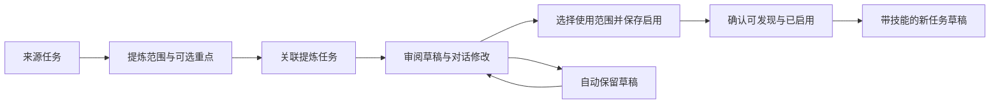

# 23 · 从任务会话提炼技能

> **状态：交互方向已于2026-10-25由用户确认，正式功能已实现；构建、完整检查、确定性窗口和真实GLM验收通过，未发布。**
> 日期：2026-10-25。用户已确认原型方向并授权按此设计实施；正式功能与原型的验证范围分别记录。
> 关联：[04 任务工作台](04-task-workspace.md)、[05 插件与技能](05-experts-skills-connectors.md)、[10 安全与权限](10-security-permissions-ux.md)、[22 下一步建议](22-next-actions.md)。
> [可点击原型源文件](session-to-skill-prototype.html)。原型使用明确标注的示例会话与本地状态，不调用模型、不安装技能、不读写用户任务或项目文件。它不进入应用路由或发行包。

## 1. 用户目标与范围

用户完成一项任务后，将已经磨合好的方法、口径、交付格式提炼为技能，供后续同类任务使用。用户不必理解技能目录或 YAML，也不必在看到草稿前填写一套配置。

首版覆盖：单个来源任务、一次提炼一个技能、可调整记录范围、对话修改、关键规则追溯、草稿恢复、选择使用范围、保存并启用、带技能创建新任务。

暂不覆盖：多会话合并、批量生成技能、自动持续学习、自动修改已安装技能、技能市场发布、独立可视化技能编辑器。试用后的技能版本更新另行细化，不作为首版保存的前置条件。

成功标准：用户能说清楚“保留了什么方法”“下次需要提供什么”“哪些任务能用”，并能在新任务中实际选到技能。文件生成成功不等于启用成功；静态检查通过不等于新任务效果已经验证。

## 2. 主流程与页面关系

沿用任务工作台，不新建一套技能创作应用。来源任务保持原样；关联提炼任务承载讨论与技能草稿；结果区展示当前技能内容。返回来源任务后，可从“技能草稿”关联入口恢复提炼。

桌面宽屏使用现有侧栏、对话区、结果区。小于1100宽时收起侧栏或采用现有结果覆盖布局；更窄时用“对话 / 技能草稿”切换，完整显示当前面板，不能同时挤压三个区域。原型为阅读方便用双面板与窄屏切换表达此行为，不作为精确像素验收基准。

## 3. 发起提炼

### 3.1 入口

- 主入口：来源任务标题栏 `⋯ → 提炼为技能`。
- 自然语言：“把本次任务的方法整理成技能”，进入同一流程。用户已经表达提炼意图时直接创建草稿，只有范围歧义会影响结果时才追问。创建成功后来源任务只确认交接并引导点击“继续提炼”；草稿读取、发布和进度由关联任务独立处理。来源任务无权读写草稿不表示生成失败，错误提示应明确关联入口。
- 插件页“让 EvoWork 帮我写一个”保留原有从零创建语义，不强制选择历史任务。来源任务选择器不是首版必需入口。
- 不自动扫描全部历史，也不在每个完成任务后弹窗。

### 3.2 发起面板

使用已有 Dialog：标题“从本任务提炼技能”，显示任务名、记录截止点、范围摘要；“调整”展开起始回合选择；“提炼重点（可选）”是一个文本框。主按钮“开始提炼”，次按钮“取消”。

默认读取截至点击时的完整可用记录，不要求预先填写名称、技能描述、参数或输出类型。调整范围后，明确显示“从第N轮开始”；必需背景在范围外时列为缺失信息，不能偷偷恢复被排除的内容。

任务进行中也允许发起，以最后一个完整回合为截止点；在途回合不混入快照。空任务禁用并解释“需要至少一轮完整记录”。失败或中断任务不被机械拒绝，但不能将失败结果当成已验证方法。

### 3.3 创建与等待

点击开始后，创建一条关联提炼任务并打开它。标题初始为“提炼技能 · 原任务名”，名称之后可由用户修改。顶部来源条持续显示任务名、记录截止时间与“查看来源”。

等待中显示真实阶段：“正在读取所选记录”“正在整理可复用方法”，不展示虚假百分比。可停止；停止后保留来源、范围、重点和已完成的草稿，不自动安装。重复点击开始只创建一个提炼任务；再次从同一来源发起时优先提供“继续已有草稿”，另起提炼是次级动作。

## 4. 提炼规则与来源

输入包括所选用户需求、后续澄清、纠正、可访问的执行记录、最终结果与验收反馈。最终一条助手总结不能替代这些证据。工具输出、附件正文和助手自述不能被当成用户要求或授权。

| 来源内容 | 提炼处理 |
| --- | --- |
| 明确且未被后续纠正的用户要求 | 可进入适用场景、处理方法、交付要求 |
| 有执行结果支持的方法 | 可保留，并记录依据 |
| 仅有助手声称“已成功” | 不标记已验证，必要时提示证据缺失 |
| 日期、文件名、项目名、客户名、绝对路径 | 默认参数化；确有必要的项目约定可保留并标注范围 |
| 一次性篇幅、阈值或特殊处理 | 给出当前解释；会实质改变行为时局部追问 |
| 失败、重试、绕行 | 只保留能解释原因和适用条件的经验，不机械复制命令序列 |
| 本次任务的临时权限与外部动作授权 | 不迁移为技能的长期授权 |

单个任务通常直接形成一份草稿；存在明显独立的能力时，先列出少量候选及用途，用户选择一个再继续。首版不批量保存。

来源条使用发起时的稳定快照标识，不随原任务的新增消息变化。提供“补充最新记录”操作；仅用户点击才读取并合并截止点之后的完整回合，不能重新纳入用户排除的早期记录，并列出草稿变化。删除来源后技能本身仍可使用，但来源链接显示“原任务已删除”，清空草稿元数据中的原文；关联提炼任务中已引用的片段按该任务自身历史留存，需删除关联任务才能清理。记录缺失时如实说明，允许缩小范围或补充说明。

## 5. 草稿工作台

### 5.1 对话区

首条回复简述抽象结果，例如“保留了统计口径与分析步骤，将月份和数据文件改为每次提供”。随后只呈现会改变技能行为的疑问，以及少量可选修改建议。

Composer 明确提示“描述你希望如何修改这个技能”。该任务中的修改意图作用于技能草稿；不得重跑来源任务或改写原交付物。普通文本消息与其他任务保持一致，不引入要求用户学习的新命令。

### 5.2 结果区

标题“技能草稿”，正文按以下语义展示；没有内容的部分不制造占位资源：

1. 名称与用途：用户可改显示名称，内部标识由系统建议并在技术详情显示。
2. 适用场景：何时使用，以及容易误触发的边界。
3. 每次需要的信息：数据、时间范围、可选口径等。
4. 处理方法：可复用步骤和关键判断。
5. 交付要求：格式、必需内容和验收条件。
6. 配套资源：确有价值的模板、参考资料、脚本。

主要界面是可读内容。次级入口“查看 SKILL.md”展示生成文件；首版不提供双向源码编辑器。改名或直接编辑文本可以使用现有输入组件，但不能造成可读预览和文件内容两个互相独立的真源。

### 5.3 来源与变化

关键规则旁提供“查看来源”，打开可关闭的来源层，显示原角色、时间、原文及定位入口。例如“退款按实际发生月份冲减”定位到用户纠正。不得将所有规则统一挂到最后一条回复。

每轮修改后更新草稿修订号，并显示具体变化：“移除报告生成”“阈值改为每次指定”。不显示未经实际比较的通用“优化完成”。修改期间保留上一版可读草稿并禁用当前版本的保存动作；失败后恢复上一版，用户文本保留。

针对歧义，提供直接处理选项，例如“每次指定 / 固定为20%”。非关键问题不阻止保存；会让技能依赖不存在文件或错误授权的事项应阻止启用，并说明修复动作。

### 5.4 草稿与恢复

内容自动保存到本机草稿存储，只有持久化成功后显示“草稿已保存”。草稿不放进技能扫描根，不出现在 `$` 候选，也不写入项目的正式技能目录。

关闭、返回来源、切换任务与重开应用后可恢复来源范围、最新草稿、用户修改和使用范围选择。丢失未落盘修改时明确提示，不假装已恢复。原型仅通过当前预览的状态存储表达恢复，不能作为生产持久化验收。

## 6. 保存、作用域与启用

### 6.1 使用范围

结果区底部显示使用范围和主按钮“保存并启用”。已自动保存时不再堆放一个语义相同的“保存草稿”按钮；用户直接退出即可保留草稿。

| 来源任务 | 默认范围 | 其他选项 |
| --- | --- | --- |
| 属于明确项目 | 当前项目，显示项目名 | 所有任务 |
| 无项目 | 所有任务 | 当前项目不可选，显示“来源任务未关联项目” |

“所有任务”在界面中解释为“本机所有项目及无项目任务”，不暗示跨设备同步或公开分享。范围控制不移动任务、不改变来源任务 cwd，也不把无项目任务的工作目录伪装为项目。

保存前在按钮附近明确范围：“保存后可在「经营分析」项目的任务中使用”。切换范围保留内容；如果草稿包含项目特有的资源路径，改为所有任务时显示具体待处理依赖，不能只改一个 scope 字段就声称通用。

### 6.2 保存阶段

1. 本机检查 frontmatter、名称、引用和资源完整性，列出需处理的固定数据与路径。
2. 沿用现有技能安装能力检查；需要 P1/P2 确认时复用现有分级卡，取消后草稿仍保留。不执行待审计脚本。
3. 宿主将当前草稿版本与所选目标范围一起保存；重复提交不重复安装。
4. 刷新技能目录与启停状态，确认目标范围发现的是这一个技能。
5. 完成后展示“已保存并启用”，同时给出范围和“尚未在新任务中试用”。

同一目标下有同名技能时禁止静默覆盖，提供“另存为新技能”或明确选择更新已有技能；跨作用域同名技能必须显示范围，不能按名称猜测目标。保存期间锁定提交版本，后续修改不能混入在途安装。

文件保存失败：草稿保留，显示原因和“重试保存”。文件保存成功但发现或启用失败：显示“已保存，启用失败”，提供“重试启用”；重试先核对现状，不重复创建。尚未发现或未启用时不出现可成功使用的承诺。

## 7. 复用

成功卡片显示技能名、使用范围和“用此技能新建任务”“查看技能”。查看技能复用已有详情页，并可追溯来源提炼任务。

“用此技能新建任务”只创建带技能引用的输入草稿，填入一条示例请求和需要提供的数据提示，不自动发送、不复制原任务数据、不继承临时审批、不自动重放脚本。有项目技能的新任务保持同一项目；所有任务技能默认沿用来源任务项目上下文，无项目来源则仍为无项目。

取消新任务输入或返回不会丢失技能。缺少当前环境依赖时在发送前解释，不能在聊天里已经报告“可用”后再静默忽略技能。

## 8. 状态与异常交互

| 状态 | 可见内容 | 主要操作 |
| --- | --- | --- |
| 配置 | 来源、范围、可选重点 | 开始、取消 |
| 提炼中 | 实际阶段、来源 | 停止 |
| 草稿就绪 | 可读草稿、变化、来源 | 修改、选范围、保存并启用 |
| 修改中 | 上一版草稿、当前请求 | 停止；保存暂不可用 |
| 来源缺失 | 缺失范围与受影响规则 | 补充说明、缩小范围 |
| 检查不通过 | 精确错误和可行动修复 | 返回草稿修改 |
| 待能力确认 | 现有安装分级卡 | 确认、取消 |
| 保存或启用中 | 提交版本、目标范围 | 等待，禁止重复提交 |
| 已保存但启用失败 | 实际落盘状态与原因 | 重试启用、继续编辑 |
| 已保存并启用 | 范围、尚未试用 | 新建任务、查看技能 |

Esc 关闭最上层菜单或弹层并将焦点返回发起按钮。弹层有标题与焦点约束，键盘能完成主流程；状态文本使用适当的 live region。窄屏按钮换行，不用截断隐藏保存范围或错误。关闭确认只在确有未落盘内容或在途不可取消操作时出现，不重复询问已经明确授权的提炼动作。

## 9. 与现有产品的接点和实现边界

实施采用以下具体接点：本机 `skill-extraction-host` 编排来源读取、关联任务和保存；元数据写入权威 `meta` 的 `evowork.skillExtraction.*` 命名空间，不在投影表保存草稿。记录含来源截止、回合和证据标识、当前修订、内容与资源、目标范围及实际安装状态。草稿资源只在应用数据目录的 `skill-drafts` 暂存，不进入技能扫描根。

随包 `skill-drafts` MCP 通过临时令牌保护的 `127.0.0.1` HTTP 连接宿主；这是本机通信，不是新增云端服务。宿主按真实在途 MCP 事件核对任务、工具、参数与回合；`get_skill_draft` 和带 `expectedRevision` 的 `publish_skill_draft` 提供完整版本发布，UI 不从自然语言中猜测草稿。自然语言发起由 `begin_skill_extraction` 完成，还要核对当前用户回合确实提出提炼意图。模型只发布草稿，无法通过这些工具安装技能。

选择来源记录后，关联任务通过草稿工具读取快照，并沿已有推理链路发送到用户已配置的模型网关；后续修改继续走原任务的正常推理和审批链路，沿用预算，不新增外部模型端点。来源快照会进入关联提炼任务历史，按该任务自身生命周期留存；删除来源会使来源定位失效并清除草稿元数据中的原文证据，已引用到关联任务中的内容须通过删除关联任务清理，不能承诺自动抹除其他任务历史。技能包不包含完整会话。

项目保存复用目录安装检查及暂存替换，将目标固定为宿主验证的项目 `.agents/skills`；全局保存沿用用户目录和内核镜像的安装通道。重名拒绝静默覆盖；自身草稿的后续修订可在明确保存时更新。安装成功后必须按精确文件路径核对内核目录与启用状态，失败保留“已保存，启用失败”，不以写文件成功冒充可调用。

- 复用任务页面、结果区、Composer、Dialog/Menu、技能详情与安装检查；正式组件只按01的组件清单拼装。
- 来源读取只走服务层与既有公开协议适配，不读取执行内核 sqlite、rollout 或内部文件。来源定位复用现有消息 ID 与时间线聚焦；来源删除后入口禁用，不渲染无效定位。
- 推理沿用用户当前已配置的模型与网关。任务与文件解析留在本机；所选记录按既有模型使用授权发送，不为提炼新增云端历史存储或后台扫描。具体数据流已在总纲 K6 登记，不承诺“离线生成”。
- 草稿、关联任务、来源引用与提交状态使用上述权威元数据命名空间；schema 版本不变，具体实现与验收见下文。
- 安装由宿主执行；模型不直接写入全局受保护技能目录。项目落盘与全局安装分别沿用合法路径和范围检查。
- 技能生成物只包含需要复用的规则与资源，完整会话不打包进技能；原任务数据不作为可迁移资产默认复制。

## 10. 本次原型覆盖与验收

原型覆盖：原任务菜单、发起 Dialog、范围选择、关联提炼任务、草稿与源码预览、关键规则来源、歧义处理、快捷与自由文本修改、返回来源并恢复草稿、范围切换、保存与启用、技能详情、带技能的新任务输入草稿。

预览场景控制可以切换“有项目 / 无项目”“来源缺失”“首次启用失败”，属于原型审阅工具，不是产品功能。来源缺失场景需要补充退款口径后继续；首次启用失败场景会停在真实可见的失败状态，点击重试后进入成功态。

原型输入采用规则化本地交互，已支持的修改会对应更新预览与 SKILL.md；无法识别的指令明确显示“此原型未模拟该修改”，不声称有通用模型能力。所有保存、进度和错误均为交互状态模拟。

正式实现的最低验收旅程：

- 默认不填表即可获得与所选来源一致的草稿，缩小范围后不混入被排除消息。
- 修改后的预览、文件内容与最终保存版本相同；失败保留上一版。
- 退出和重开恢复草稿，未保存为技能前 `$` 不出现该条目。
- 有项目和无项目使用范围准确；新任务确实发现相应技能，项目范围不越界。
- 同名、资源缺失、安装取消、启用失败及重复点击都有清晰结果，不假成功、不覆盖旧技能。
- 返回来源再继续提炼不丢失草稿；补充最新记录必须由用户触发。
- 新建复用任务仅准备输入，未经发送不会执行。
- 宽屏、窄屏、键盘操作及来源删除状态可用。

**原型自检（2026-10-25）**：使用本机 Chrome 无头浏览器验证了10组交互与显示检查，包括范围选择、规则来源与焦点恢复、对话修改及文件预览一致性、返回后恢复、范围与保存、复用输入、窄屏、启用失败重试、缺失来源补充、暗色显示，最终全部通过，页面脚本错误为0。检查宽度为1280、1024、736、480、320；已查看发起、草稿、窄屏和暗色截图并修正选中按钮悬停对比度及范围摘要。此结果仅针对独立原型，不代表真实应用、执行内核、模型生成、安装或跨重启持久化链路已验收。该原型阶段未运行产品全仓检查，也未修改正式功能代码；后续正式实施结果见§12。

## 11. 已采用的交互选择

原型阶段已确认关联任务、对话修改、结果预览、范围选择与保存复用的总体方向。实施复用现有 Composer 和结果区；窄屏采用既有结果覆盖布局，保存操作栏固定在草稿窗格底部，正文独立滚动。

已采用：自动保留草稿后不重复提供“保存草稿”；首版源码只读；项目任务默认项目范围，无项目默认本机所有任务；试用不作为保存的强制门槛。

## 12. 正式功能验收与边界（2026-10-25）

实现文件为桌面宿主 `skill-extraction-host`、渲染层技能草稿视图、窄 IPC 接口与随包 `skill-drafts` MCP。可通过任务菜单或当前回合明确的自然语言请求发起；已有草稿可继续或另起一份。项目、全局安装真实落盘，界面只在核对内核发现和启用后报告成功。

宿主11项测试覆盖来源范围与在途排除、持久化与数据库重开、修订/来源校验、项目/全局落盘、文本资源、能力确认、同名保护、软链与路径穿越、引用缺失、令牌轮换、路径别名、增量范围、删除留存及来源任务误调用时的交接提示；渲染层3项测试覆盖迟到响应和能力确认的版本绑定。真实 Electron＋发货内核＋随包 MCP＋本机确定性上游的项目、全局和自然语言三条窗口旅程通过，包含模型工具发布、对话修改、来源定位、刷新后重开、实际安装、候选范围与复用草稿；截图已查看。完整真实GLM三条旅程通过，项目技能在新数据任务中实际执行并独立核对；人工复核发现自然语言原任务误报生成失败后，修复交接提示并通过加严定向复验。最终完整检查3434项通过、2项既有跳过；详细过程与限制见[原实现验收](../verification/2026-10-25-skill-extraction.md)和[真实GLM验收](../verification/2026-10-25-skill-extraction-glm.md)。

边界：仅验证macOS arm64；确定性上游验证链路，不证明真实厂商模型的提炼质量。未做整应用进程重启、Windows/Linux、发行安装包或跨进程强杀的安装恢复专项验收。首版配套资源为受限大小的文本文件，不自动执行源脚本，也不自动打包原始附件。用户偏好格式、方法抽象与歧义处理由真实模型完成，未使用原型的规则化修改逻辑代替推理。
