# 从 DeepSeek 获取 API Key 并加到 EvoWork

按这个顺序做完两件事：在 [DeepSeek 开放平台](https://platform.deepseek.com/) 拿到一把 API Key，再把它加进 EvoWork 的「设置 → 模型」。

截图取自 2026-11-23 的开放平台页面，以及本机 EvoWork 0.6.4。控制台截图里的余额、已有密钥和账号已打码。EvoWork 截图里的密钥是占位文字 `sk-粘贴你刚复制的密钥`，不是一把能用的密钥。

官方文档：[首次调用 API](https://api-docs.deepseek.com/zh-cn/)、[模型 & 价格](https://api-docs.deepseek.com/zh-cn/quick_start/pricing/)。

## 1. 打开开放平台并登录

浏览器打开 <https://platform.deepseek.com/>。未登录时会停在登录页。

三种方式都可以：

- 手机号 + 短信验证码。未注册的手机号登录后会自动注册。
- 手机号或邮箱 + 密码。点登录按钮下面的「密码登录」。
- 右侧微信扫码。

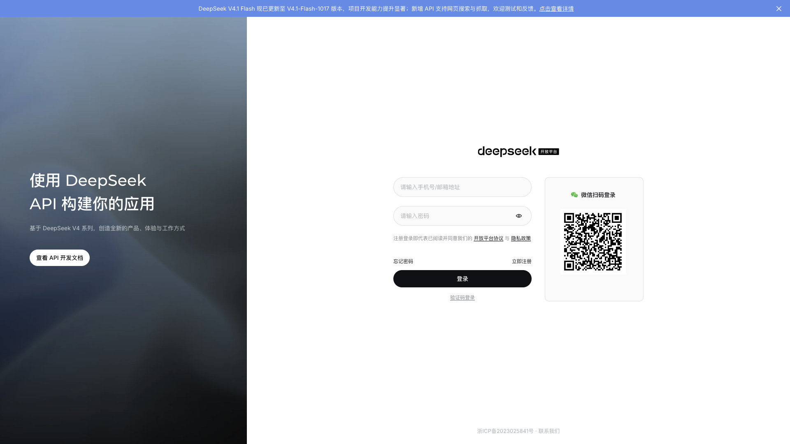

## 2. 对照文档确认模型名

登录后也可以先看文档，确认要填进 EvoWork 的模型名。打开 [首次调用 API](https://api-docs.deepseek.com/zh-cn/)。

这一页写明：

- OpenAI 兼容的 `base_url` 是 `https://api.deepseek.com`
- 申请 API Key 的入口是 <https://platform.deepseek.com/api_keys>
- 模型名使用 `deepseek-flash` 或 `deepseek-v4-pro`

`deepseek-flash` 当前对应 DeepSeek-V4.1-Flash-1017。旧名 `deepseek-v4-flash`、`deepseek-v4-flash-vision-exp` 仍能调用，请求由 Flash 处理，并按 Flash 价格计费。

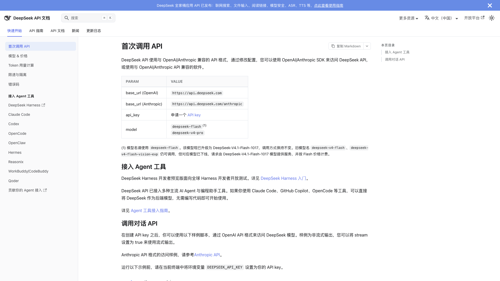

[模型 & 价格](https://api-docs.deepseek.com/zh-cn/quick_start/pricing/) 上，两个型号都支持思考模式和工具调用，上下文 1M，输出最长 384K。图像理解这一行：`deepseek-flash` 支持，`deepseek-v4-pro` 不支持。日常使用、需要读图时选 `deepseek-flash`。

价格按百万 token 计，空闲时段是高峰时段的一半。北京时间周一至周五 9:00–12:00、14:00–18:00 为高峰，其余时间（含周末和法定节假日）为空闲。费用从充值余额或赠送余额扣除，两者都有时先扣赠送余额。

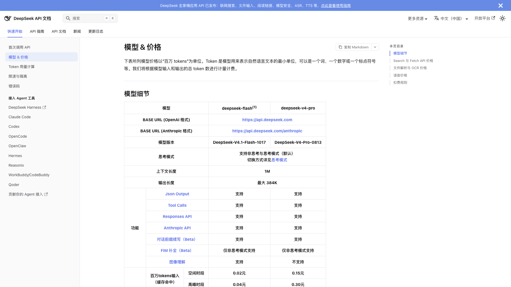

## 3. 确认账户里有余额

登录后默认进入「用量信息」。左上角是充值余额。余额为 0 时，后面的 API 调用会失败。

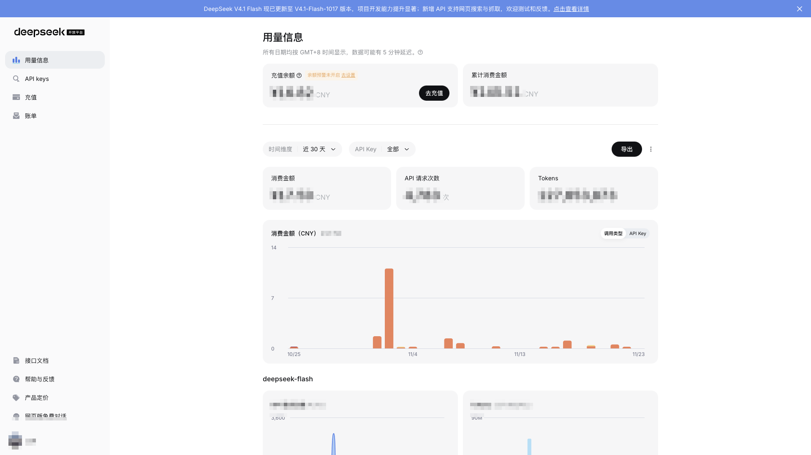

余额不够时，左侧点「充值」，或在用量页点「去充值」。可选金额，用支付宝或微信支付。充值只用于 API，网页版和 App 对话免费，不用在这里充值。

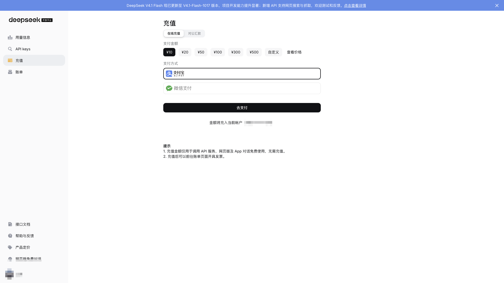

## 4. 创建 API Key

左侧点「API keys」，或直接打开 <https://platform.deepseek.com/api_keys>。

页面上写着：API Key 只在创建时可以复制，请自己保存。不要发给别人，也不要写进网页或客户端代码。单个账号最多 300 个。列表里已经建过的密钥只显示后几位，回不来全文。

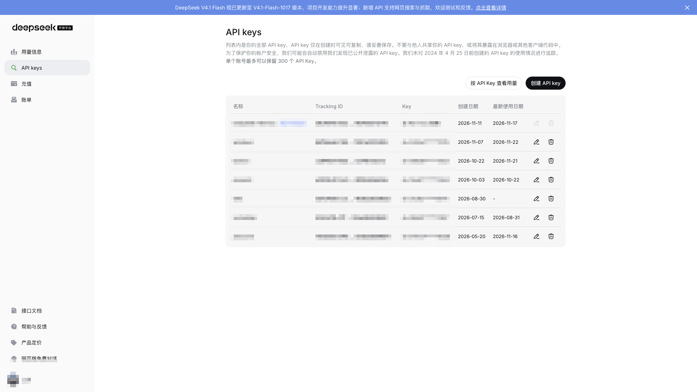

点右上角「创建 API key」。名称随便起，例如 `evowork`，用来以后在列表里认出这一把。点「创建」。

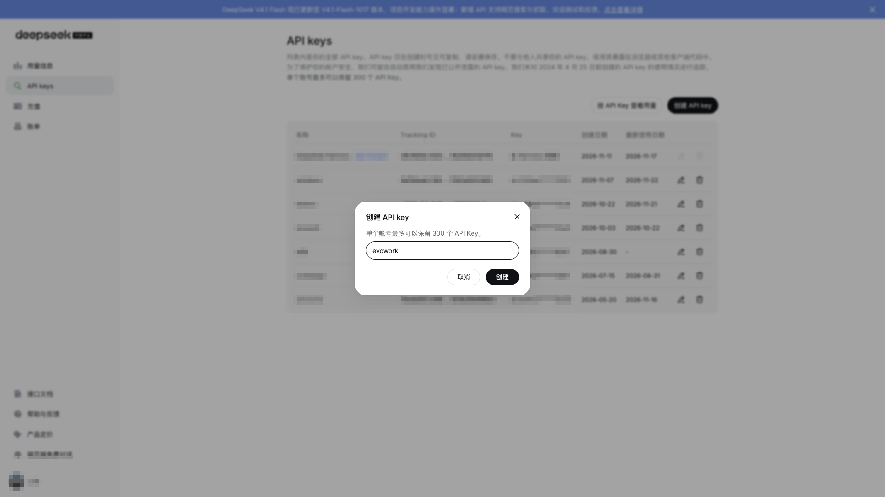

创建成功后，完整密钥只出现这一次。立刻复制，粘贴到 EvoWork，或先记到你自己的密码管理器。关掉对话框之后，开放平台不再显示全文。这张图没有拍下真实密钥。

## 5. 打开 EvoWork

打开 EvoWork。一台还没配过模型的电脑，新建任务页会提示本机网关没有可用模型，任务发不出去。可以点横幅上的「去设置添加模型」，也可以走下面的菜单。

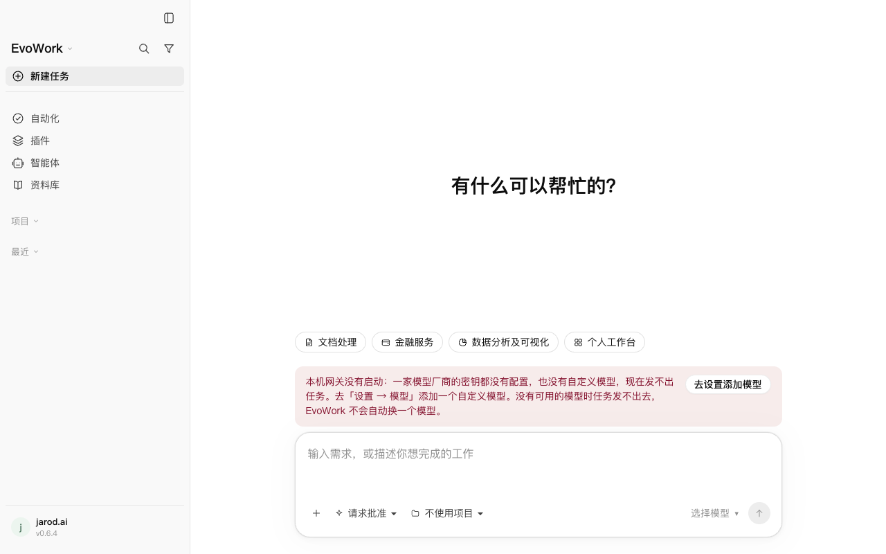

点左下角头像，在菜单里选「设置」。这一项直接打开模型设置。

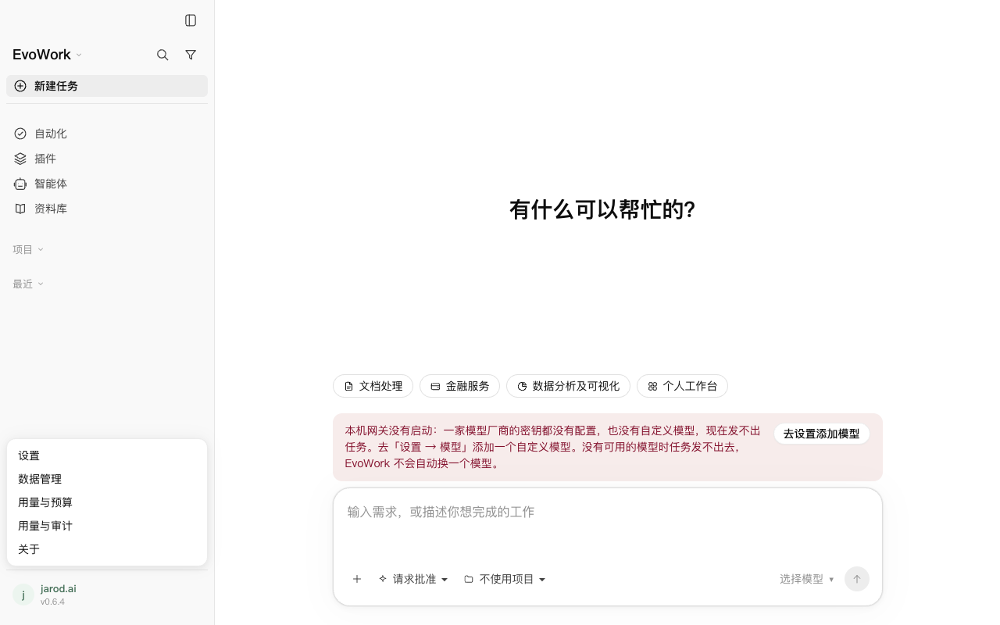

## 6. 添加 DeepSeek 模型

设置左侧确认停在「模型」，上面的标签是「对话模型」。点右侧「添加模型」。

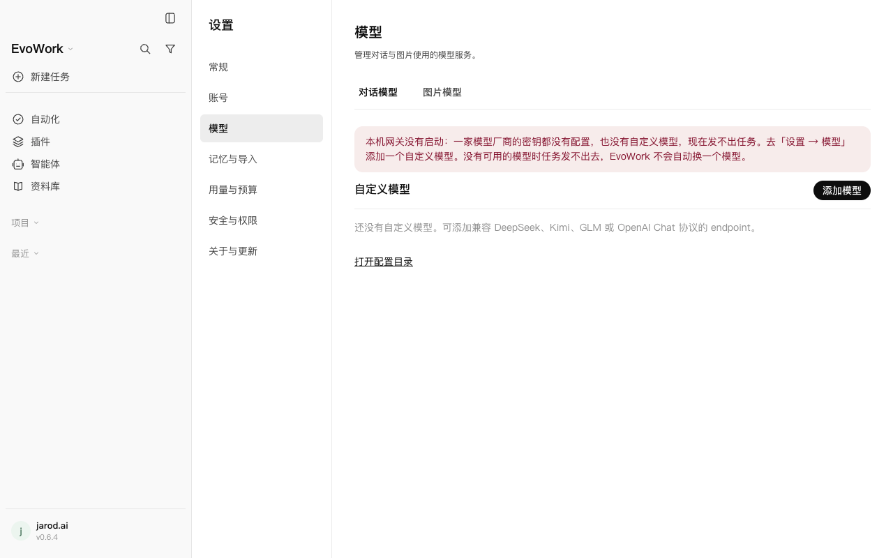

弹出「添加模型」。供应商一行写着只支持 OpenAI 兼容协议。

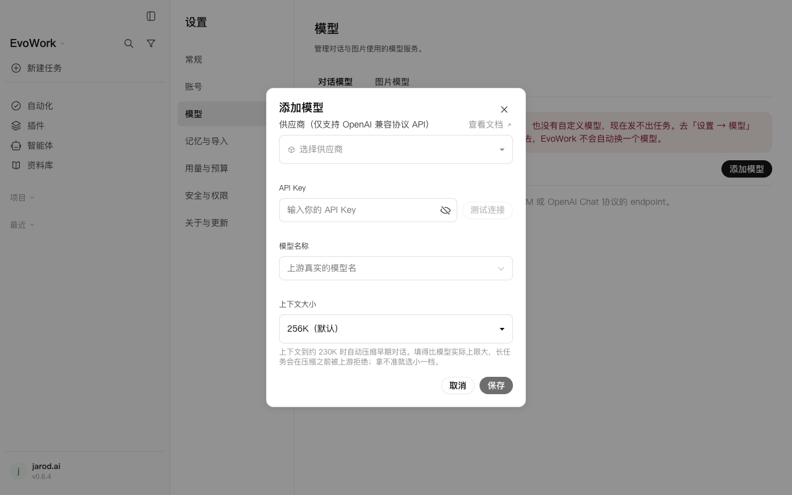

打开「供应商」，选「DeepSeek API」。选这一项之后不用填 endpoint，EvoWork 使用官方地址 `https://api.deepseek.com/v1`。只有选「其他 OpenAI 兼容 API」时才需要自己填地址。

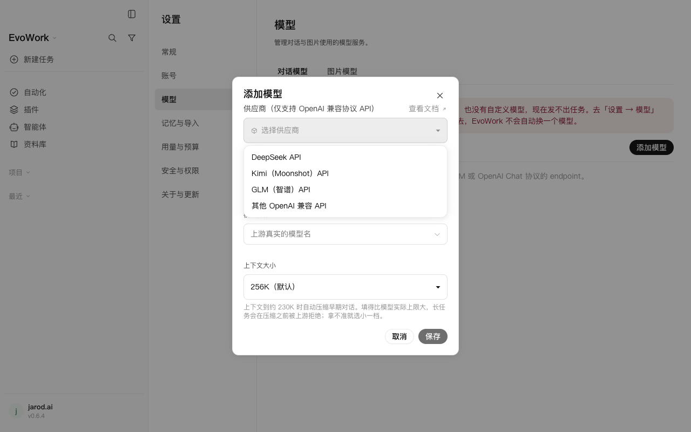

然后填这三项：

1. **API Key**：粘贴第 4 步复制的密钥。旁边的眼睛只显示你正在输入的内容，方便核对粘贴。已保存的密钥不会再被读出来。
2. **测试连接**（建议先点）：用这把密钥向 DeepSeek 拉取模型名单。通了之后，模型名称右侧的箭头可以展开名单，从里面点选。密钥不对、或网络不通，这里会写出原因。
3. **模型名称**：填上游的真实名字。日常用 `deepseek-flash`。需要 Pro、并且不读图时填 `deepseek-v4-pro`。名字必须和文档里的一致，大小写也要一致。

`deepseek-flash` 在能力表里，上下文会锁成 `1,048,576`（1M），不能手改。对话到大约 256K 时，EvoWork 会压缩早期内容。

填完后「保存」变成可点。下面这张图里的密钥是占位文字。

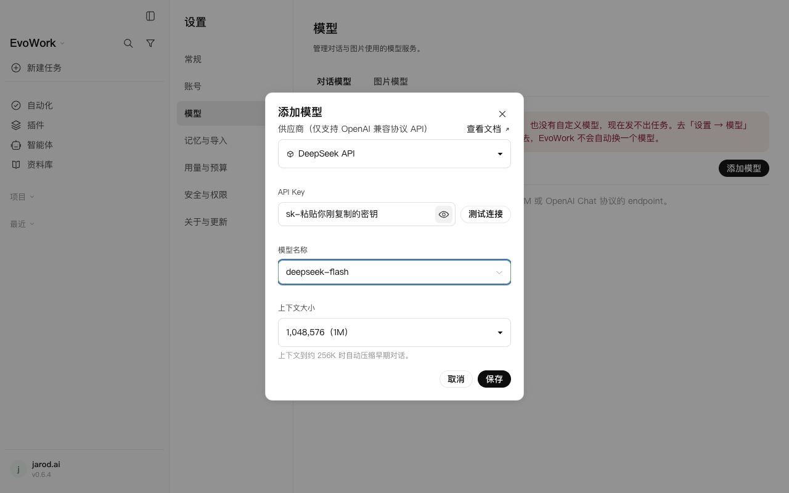

点「保存」。列表里出现这一条：名称 `deepseek-flash`，供应商 DeepSeek，上下文 1M，并注明来自能力表。下面一行是「模型已保存。」

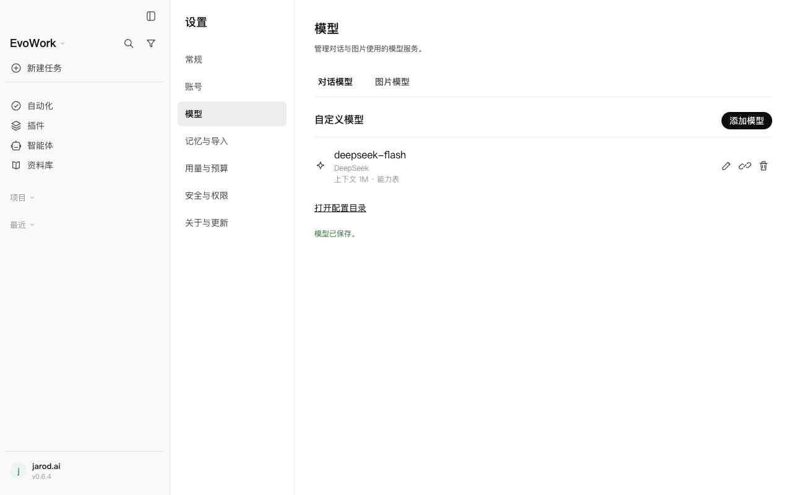

密钥进本机系统钥匙串。界面之后只显示后四位。要换一把密钥，点这一行的铅笔，把新密钥整段贴进去再保存；API Key 留空表示继续用原来那把。

## 7. 在新建任务里选用

回到「新建任务」。输入框右下角的「选择模型」里会出现 `deepseek/deepseek-flash`。点它。

这一行上的标记：

- **自有密钥**：这次调用花的是你自己的 DeepSeek 余额。
- **推理**、**读图**、**并行工具**：这个型号具备的能力。灰色划掉的是它不具备的。`deepseek-v4-pro` 的「读图」会是划掉的。

选中后再输入需求、发送。没有配模型时的红条会消失。

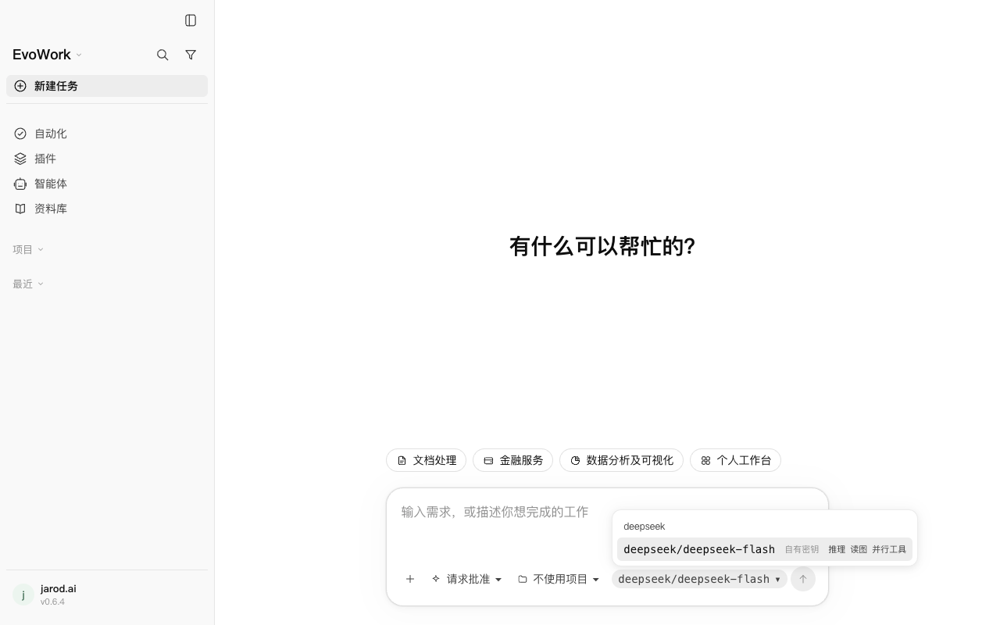

## 对不上时看这里

| 现象 | 原因 |
| --- | --- |
| 测试连接说密钥不对 | 粘贴少了字符，或用的是已经删掉的旧密钥。回开放平台再创建一把。 |
| 保存成功，发出去却失败 | 充值余额为 0。回到开放平台「充值」。 |
| 模型名下拉里是空的 | 还没点「测试连接」，或上游没有返回 `/models`。可以直接手填 `deepseek-flash`。 |
| 发图片被拒绝 | 当前选的是 `deepseek-v4-pro`。换 `deepseek-flash`。 |
| 列表里有模型，新建任务里没有 | 输入框右下角仍停在「选择模型」。点开后选 `deepseek/deepseek-flash`。 |
