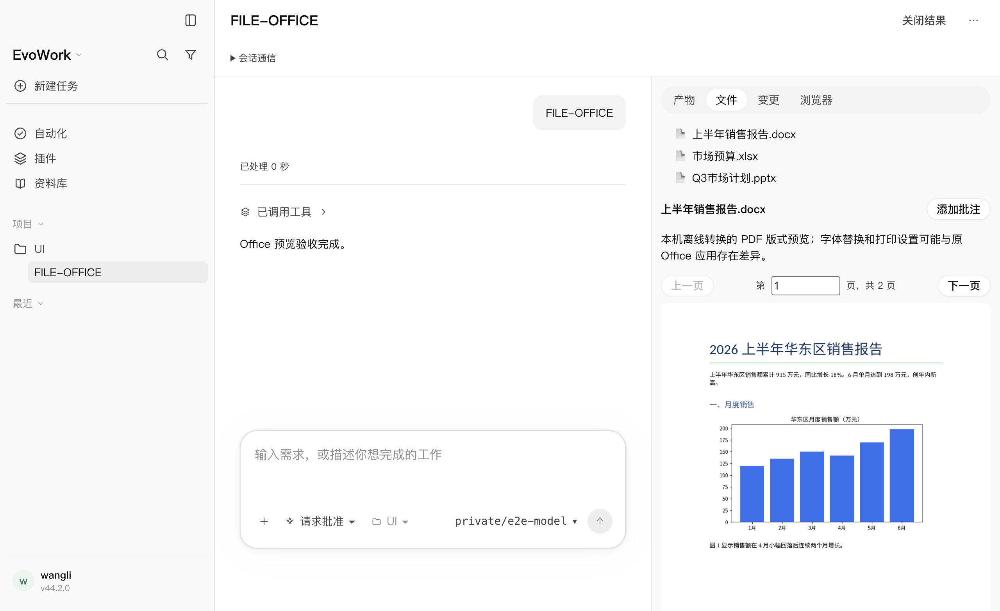
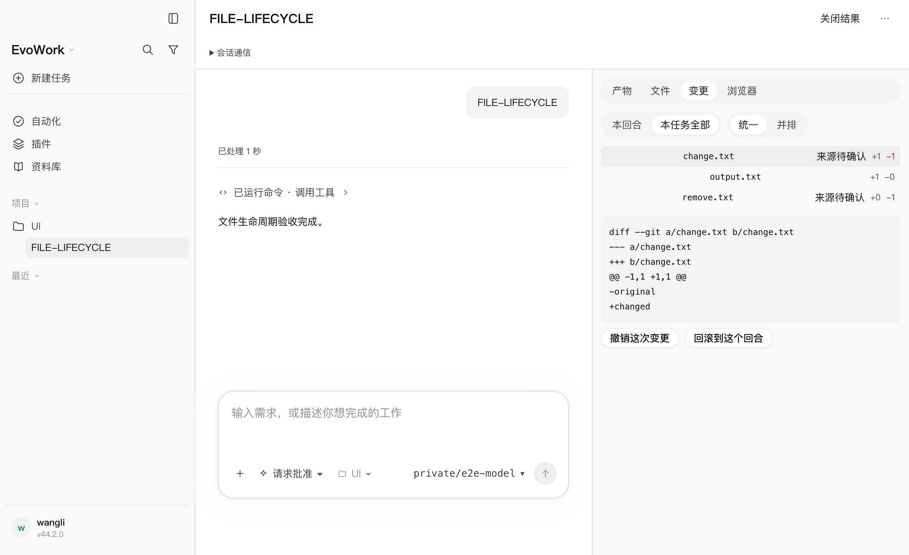

# 2026-10-17 · 文件交付与 Office 版式预览验收

本轮补齐用户要求的文件归属/发现、明确打开事件、完整差异与实际磁盘撤销，并提升 Office 预览。实现与容量限制见 [设计 19](../design/19-file-lifecycle.md)。以下均为本轮实际执行结果。

## 正式门禁

- `pnpm run check` 退出 0：格式、eslint、生产/测试类型、2875 项通过 / 2 项既有跳过、内核补丁预算、协议形状、第三方许可证均通过。
- `node scripts/build.mjs` 退出 0：主进程、preload、桌面渲染层、网关、原生辅助程序完整构建通过。
- `git diff --check` 退出 0。
- 日志：`/private/tmp/evowork-files-check.log`、`/private/tmp/evowork-files-build.log`。

受限沙箱不允许宿主监听回环端口和 Swift 临时构建缓存写入；完整门禁及桌面构建使用允许的沙箱外入口。未修改内核签出、依赖和许可证清单，未提交、发布或替换正在运行的应用。

## 真实窗口和发货内核

入口：

```bash
EVOWORK_OFFICE_CONVERTER=/absolute/path/to/LibreOffice.app/Contents/MacOS/soffice \
  node node_modules/@playwright/test/cli.js test file-results.spec.mjs --project=fake --retries=0
```

结果：**4/4，27.7 秒**。真实 Electron、发货内核、原生 shell/MCP 与本机合成模型响应；未使用真实厂商模型或外部付费服务。

| 旅程 | 核对的实际后果 |
|---|---|
| shell 写文件 → 列出 → 登记 → 明确打开 → 撤销 | 新建/修改/删除均出现在差异；扫描文件显示来源待确认，显式登记文件为本任务文件；原生 MCP 事件打开正文；界面逐项确认后原文件字节恢复、新文件删除、删掉的文件复原。回合结束后新增的用户文件由监听刷新，不能撤销覆盖。 |
| Office 版式 | 合成 DOCX/XLSX/PPTX 经真实本机 LibreOffice + 隔离 PDFium 转换，三者都有可解码的 PNG 页面；DOCX 实际显示中文与图表，前后翻页切换页面，未使用 PDF 插件 iframe。 |
| 同文件反复改写和恢复历史 | 同回合 before → middle → after 展示完整净差异；再追加一回合后任务范围为 before → final；关闭状态保持、重开及刷新恢复正确。 |
| 两任务共用 cwd 并发输出 | 共用技能上报脚本携带各自原生任务身份，最终各任务只出现自己的产物，不受任务活动顺序影响。 |

日志：`/private/tmp/evowork-files-ui.log`。截图已检查：





## 关键回归

- 文件记录：多回合起点、创建/修改/删除/二进制字节恢复、重建宿主后副本仍可用、超过 64 KB 的等长修改、缺少末尾换行、缓存超限、过期版本、外部修改、运行任务、软链/路径穿越、伪造隐藏路径拒绝。
- 不覆盖用户的新工作：撤销一个文件不改变另一个文件的后态；回合之间外部编辑只允许撤销本回合，不能覆盖为任务开始时的旧内容。
- 文件服务：错误凭据/任务/参数/过期调用不能打开，令牌轮换失效；真实适配层核对唯一在途调用；发现列表分页覆盖 105 项且不返回正文或大段 diff。
- 归属：生成前上报等待落盘、不提前写 MISSING 首版；同路径待生成声明有歧义时不猜作者；编辑前上报后的最新内容保留运行回合归属，回合结束后不认领外部编辑。
- UI：明确事件可打开尚未索引的文件；迟到的打开请求和用户已关闭的预览不覆盖新选择；撤销确认固定用户看到的版本与范围，宿主拒绝过期状态。
- Office：工作副本隔离、禁宏/活动内容、中文字体复制、不跟随字体软链、临时文件清理、无转换器/伪 PDF/页面渲染失败明确回退；页面渲染与翻页单测及实际窗口图像解码均通过。

视觉检查曾发现“转换成功但 PDF iframe 空白”和中文缺字；最终已改为页面图像显示并使用已安装中文字体。验收新增了实际图像解码与翻页断言，不能只凭返回 PDF 字节认定预览完成。

## 实际限制

文件记录限任务 cwd 内未忽略的普通文件；隐藏文件、依赖/缓存及软链不纳入扫描，工作区外输出仍走产物索引。最多扫描 5000 项/256 MiB，每文件副本最多 32 MiB，总内容缓存 256 MiB；超限/无法读取会显示警告并关闭撤销，较大文本/二进制以摘要代替全文差异。旧任务没有开始快照时沿用原生历史，没有补造副本。旧缓存尚无自动清理。

Office 版式预览需要本机 LibreOffice 和已安装办公扩展；当前隔离运行仅验收 macOS arm64。DOCX 样本 2 页、PPTX 3 页、XLSX 1 页，不能据此保证所有复杂 Office 文件完全保真。字体替换、打印区域及分页仍可能与原 Office 应用不同。页面最多 20 页、PNG 合计 16 MB、单页不超过 1600×2000 像素，截断明确显示；不执行宏、OLE/DDE 或 PDF 脚本链接。没有 Windows/Linux 实机、真实厂商模型或安装包发布验收。
