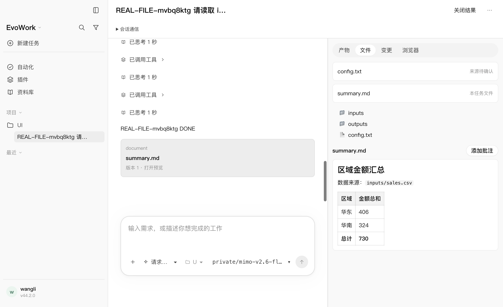
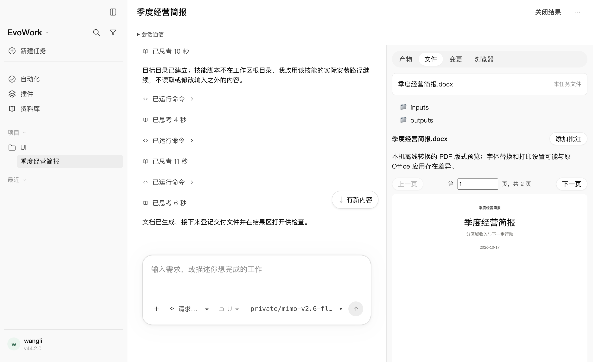

# 2026-10-17 · 文件功能扩展 Playwright 验收

用户要求对新补齐的文件功能做完整 Playwright 测试，并提供 MiMo 模型用于必要的真实执行验证。本轮没有更改业务源码，新增 18 条用例，复用 6 条既有用例；补充可控组件缺失环境及整个应用重启夹具。

## 最终结果

**24 项全部通过，零跳过，均使用 `--retries=0`。** 确定性测试使用真实 Electron、当前发货内核、原生 shell/MCP、真实本机文件和 Office 转换器，仅模型响应由本机网关脚本控制；真实模型两项走产品宿主网关和用户指定的 MiMo API。

| 文件/范围 | 数量 | 验证内容 |
|---|---:|---|
| `file-results.spec.mjs` | 4 | shell 创建/修改/删除，明确登记和打开，磁盘恢复，外部变化刷新，代码默认页签，多次修改净差异，关闭/刷新，共享 cwd 双任务并发归属。 |
| `file-lifecycle.spec.mjs` | 10 | 撤销取消、任务/回合起点、回合间用户编辑、105 项原生分页且不回正文、技能先上报后创建/编辑、确认期间外部修改、其他文件撤销不洗掉冲突、二进制和 64KB 之后修改、会话回滚不动磁盘、运行中保护、后台打开不抢前台、缺失/目录/穿越/软链拒绝、33MiB 文件限制提示。 |
| `file-office.spec.mjs` | 5 | DOCX/XLSX/PPTX/RTF 逐个在 UI 显示可解码页面与翻页；21 页只显示前 20 页并限制页码；缺转换器、转换失败、缺办公扩展三种实际环境回退。 |
| `file-restart.spec.mjs` | 1 | 关闭整个 Electron/App/内核，使用同一测试 home 启动新进程，恢复任务差异、确认撤销并核对原始磁盘字节。 |
| `destructive-approval.spec.mjs` 相关两项 | 2 | 拒绝纯删除及拒绝覆盖已有文件，审批原因可见、磁盘字节不变。 |
| `file-lifecycle.real.spec.mjs` | 2 | MiMo 自主计算与交付、中文 Word 生成、原生登记/打开、可见 Office 页面及 UI 磁盘撤销。 |

主矩阵 20/20，1.3 分钟；相关审批 2/2，7.6 秒；实模型 2/2，3.9 分钟。全仓正式 `pnpm run check` 通过，2875 项通过 / 2 项既有跳过，格式、lint、类型、内核补丁/协议及许可证检查通过。本轮没有重建未改动的业务源码，测试使用上一轮完整构建及核验过来源的发货内核。

## 真实模型

模型 `mimo-v2.6-flash`，API 根地址 `https://api.xiaomimimo.com/v1`。模型按测试夹具已有的自定义模型入口登记，经过宿主网关翻译为厂商请求。

1. 从合成 CSV 计算华东 `137+269=406`、华南 `211+113=324`，总计 `730`，写入 Markdown；修改配置、删除废弃文件；模型自主调用本机 `register_file` 和 `open_file`。测试核对真实输出、归属、UI 预览和公开工具历史，再逐项点击确认撤销，恢复配置/被删文件并删除新产物。
2. 根据合成资料使用已安装办公技能生成中文 Word，产物归属正确，原生明确打开事件可追溯；实际本机版式页面显示并完成图像解码。此项没有预置模型工具调用序列。

密钥通过关闭回显的 stdin 注入，仅存在于测试进程环境；未放入命令行参数、源码、配置或日志。实模型完成后对 81 项测试产物/日志逐字节扫描，无凭据命中。成功测试 home 自动清理；没有读取内核内部数据库或执行历史文件。





其他已检查截图：[重启后恢复](assets/2026-10-17-file-playwright/app-restarted.png)、[外部修改保护](assets/2026-10-17-file-playwright/external-protected.png)、[21 页截断提示](assets/2026-10-17-file-playwright/office-limit.png)、[缺转换器回退](assets/2026-10-17-file-playwright/office-fallback.png)。

## 测试夹具修正

补跑既有覆盖审批用例时出现“没有审批”的失败，但公开界面中也没有执行命令。旧用例使用 `scriptNext`，可被预热请求提前消费；该用例不能据此判定覆盖行为。现改为唯一需求标记绑定的 `scriptWhen`，并断言脚本确实被本次需求认领。重测后覆盖审批出现，拒绝后原文件字节保持不变。首次失败日志保留，未将失败改写为预期或开启重试。

新增重启夹具只允许重开系统临时目录下本测试创建的 `evowork-ui-*` home；不使用真实用户数据目录。组件缺失由 `desktopEnv` 显式构造，不根据当前是否安装组件跳过用例。

## 复跑入口与证据

```bash
EVOWORK_OFFICE_CONVERTER=/absolute/path/to/LibreOffice.app/Contents/MacOS/soffice \
  node node_modules/@playwright/test/cli.js test \
  file-results.spec.mjs file-lifecycle.spec.mjs file-office.spec.mjs file-restart.spec.mjs \
  --project=fake --retries=0 --output=/private/tmp/evowork-playwright-files/final

node node_modules/@playwright/test/cli.js test destructive-approval.spec.mjs \
  --project=fake --retries=0 --grep '纯删除命令要先问|覆盖已有文件要先问'

# 先通过隐藏 stdin 或现有安全环境提供 EVOWORK_UI_MODEL_KEY，不要把密钥写入此命令。
EVOWORK_UI_MODEL_PRESET=mimo-v2.6-flash \
EVOWORK_OFFICE_CONVERTER=/absolute/path/to/LibreOffice.app/Contents/MacOS/soffice \
  node node_modules/@playwright/test/cli.js test file-lifecycle.real.spec.mjs \
  --project=real --retries=0 --output=/private/tmp/evowork-playwright-files/real

pnpm run check
```

日志 `/private/tmp/evowork-playwright-files-{final,real,approval-final,check}.log`；首次审批测试失败 `/private/tmp/evowork-playwright-files-approval.log`。原始截图与每项 Electron 日志在 `/private/tmp/evowork-playwright-files/{final,real,approval-final}/`。

## 验收范围

环境为 macOS arm64，实际安装办公扩展与本机 LibreOffice。完整覆盖的是本轮定义的文件生命周期及预览交互矩阵，不是整个产品的权限审计或所有 Office 文件保真保证。没有 Windows/Linux 实机验收，没有任意模型任务成功率评估；大文件、隐藏/忽略文件、缓存及工作区外路径等实现限制仍按[设计 19](../design/19-file-lifecycle.md)。未提交、发布安装包或替换用户正在运行的应用。
