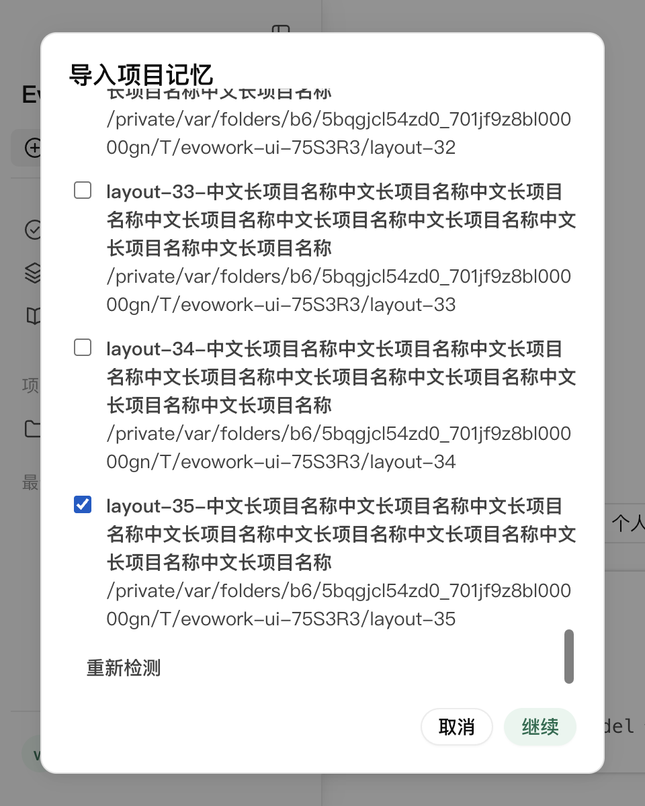
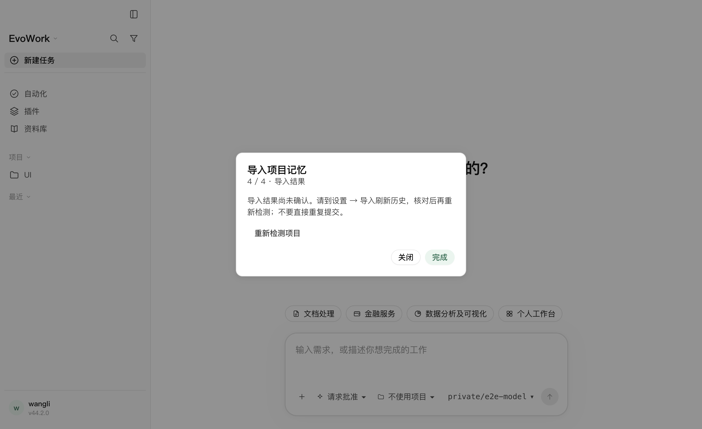
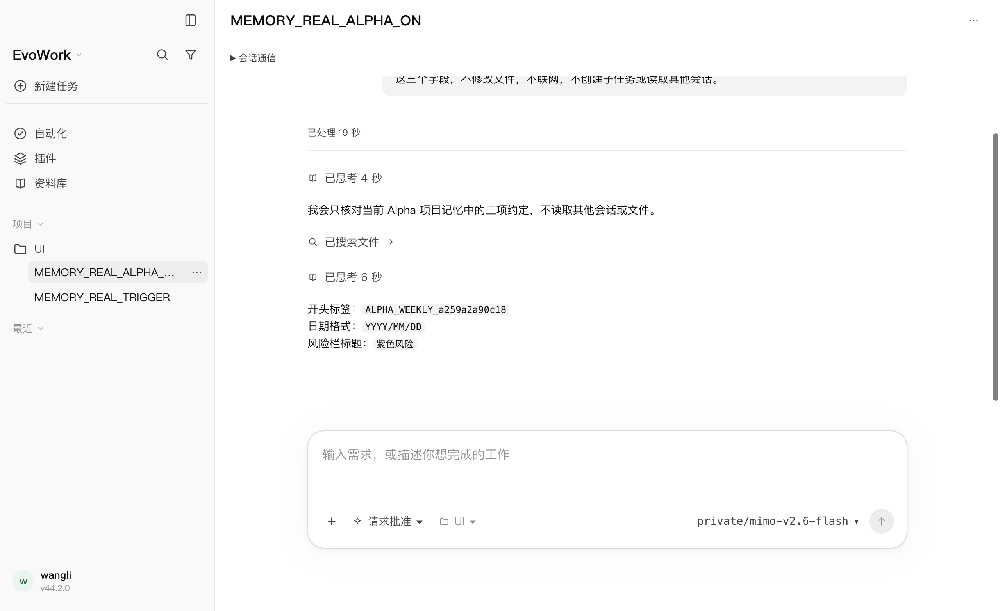
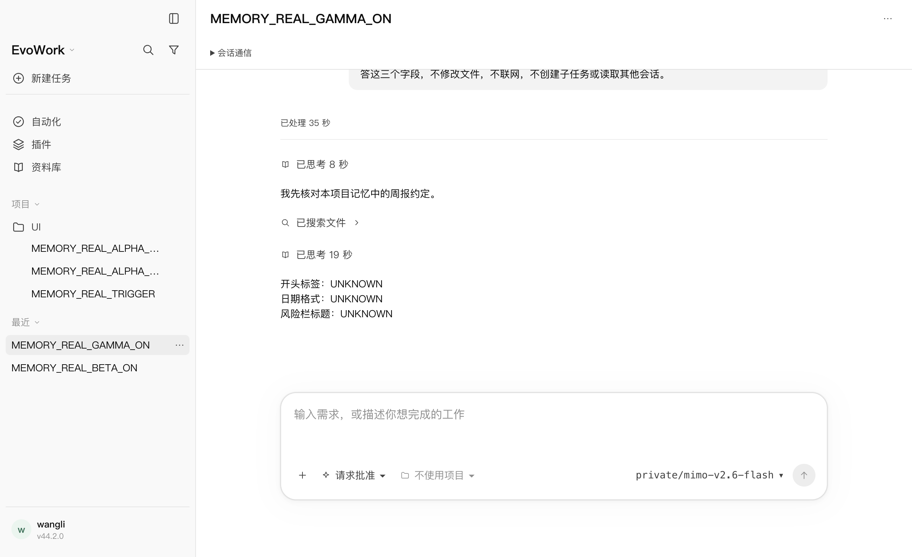

# 2026-10-17 · 记忆导入 Playwright 扩展验收

范围为 Claude Code 项目记忆导入、设置与 `/import` / `/memories` 入口，以及公共弹窗修改的关联回归。使用当前源码的完整构建、真实 Electron、preload/IPC、适配层及经 provenance 核对的发货内核；不替换用户正在运行的应用，不发布安装包。平台 macOS arm64。

## 本机确定性矩阵

```bash
node node_modules/@playwright/test/cli.js test memory-import.spec.mjs memory-import-restart.spec.mjs memories.spec.mjs views.spec.mjs layout.spec.mjs skill-install-layout.spec.mjs file-restart.spec.mjs destructive-approval.spec.mjs --project=fake --retries=0
```

最终 **32/32 通过、零跳过、重试关闭，1.6 分钟**，分布于 9 个文件。包含 14 项记忆功能旅程，以及 18 项设置、窗口/表格/技能弹窗、整应用文件恢复和审批相关回归。`layout.spec.mjs` 参数也匹配 `table-layout.spec.mjs`。本机合成模型负责确定性后台整理和工具调用，不用于声称真实模型的知识使用质量。

| 范围 | 实际核对 |
|---|---|
| 入口 | `/import` 手输与补全、设置 → 导入、设置 → 个性化、`/memories` 链接共用向导；命令不成为模型需求。 |
| 空来源与选择 | 空目录及无可靠 cwd 的孤立记忆不可选；零选择禁用继续；取消勾选、返回修改选择和确认前取消无写入；重新检测发现新项目。 |
| 导入与设置 | 只复制选中项目、scope 保留、源文件不变；不迁移会话；读取/生成/提取和整理模型设置保持；显式开启读取不打开生成；读取已开启时不重复显示开启按钮。 |
| 更新 | 来源改变不会自动同步；确认后更新正文、删除来源已移除的附属文件；历史保留两次独立记录；未改变项目不重复提供。 |
| 来源消失 | 检测后删除来源，确认前复核拒绝、零写入；重新检测仍能导入剩余项目。 |
| 原生部分失败 | 以真实目录权限导致一个项目失败，同批其他项目成功；界面分别展示结果，恢复权限后可重新检测。 |
| 内核与应用恢复 | 确认前内核重启使旧选择失效，零写入；重新检测可恢复。完成后的历史经页面刷新、内核恢复和整个应用关闭重开仍保持；关闭的读取/生成设置保持，重开去重有效。 |
| 网关离线 | 真正关闭本机模型网关，页面显示不可用；`/import` 仍可完成本地复制，不创建模型任务，清楚区分导入与整理就绪。 |
| 丢失响应 | 内核真实执行写入并保存原生历史，测试传输接缝仅丢弃该次成功 RPC 响应；请求等待期间主动作禁用、Escape 不关闭，超时后明确提示未知；写入计数始终 1，没有自动重放；手动历史刷新可核对成功、检测去重。 |
| 后台与禁读 | 原生模型工具实际读取所选资料、生成索引，新任务注入索引，禁读任务不注入，未选项目不进入整理结果。 |
| 布局与键盘 | 36 个超长项目名，1200×760 / 900×600 / 480×560 窗口均可滚动到末项、主动作可见、模态不越界；Tab 连续切换不进入背景，Escape 可取消。 |
| 关闭开关 | 显式 false 经启动仍保持，入口说明原因，检测禁用。 |

完整本机产物 `/private/tmp/evowork-memory-playwright-final`；[最终日志](assets/2026-10-17-memory-import/playwright/playwright-fake.log)。已查看长列表、未知结果和整个应用重开截图。





## MiMo 真模型与任务页面复验

```bash
# 密钥通过隐藏 stdin 注入 EVOWORK_UI_MODEL_KEY，不写在命令或配置中。
EVOWORK_UI_MODEL_PRESET=mimo-v2.6-flash node node_modules/@playwright/test/cli.js test memory-import.real.spec.mjs --project=real --retries=0
```

最终 **1/1 完整旅程通过，4.8 分钟，包含 6 个独立新任务**。模型为用户指定的 `mimo-v2.6-flash`，地址 `https://api.xiaomimimo.com/v1`，经产品宿主网关，不直连厂商绕过产品链路。通过 UI 导入两组随机来源，发送走真实 preload/IPC；每个任务完成后逐个点击侧栏、断言实际页面回答并截图。未预写整理结果，没有脚本化模型回答。

| 任务 | 实际后果 |
|---|---|
| 触发整理 | 回复 READY；MiMo 自主整理作业最终 `done`、`last_error = null`。 |
| Alpha 读取 | 页面显示 `ALPHA_WEEKLY_a259a2a90c18`、`YYYY/MM/DD`、`紫色风险`；2 次请求注入索引。 |
| Beta 读取 | 页面显示 `BETA_WEEKLY_a259a2a90c18`、`DD-MM-YYYY`、`橙色风险`；2 次请求注入索引。两项目约定没有混用。 |
| Alpha 单任务禁读 | 三个字段全部 UNKNOWN；3 次请求均无记忆上下文或来源标签，没有读取记忆目录。 |
| Gamma 未导入项目 | 索引注入开启、检索共享正文后，三个字段仍全部 UNKNOWN；没有套用其他项目约定。 |
| Beta 全局禁读 | 新任务跟随关闭的全局读取；三个字段全部 UNKNOWN；4 次请求均无记忆上下文或来源标签。 |

全部 **19 次请求**均使用登记的 `xiaomi/mimo-v2.6-flash`：14 次任务请求、5 次后台整理。随机标签不在提问或项目文件中；实际命令的 cwd 分别对应 Alpha / Beta / Gamma 的独立目录。完整临时产物 `/private/tmp/evowork-memory-playwright-real-results-2`，[最终日志](assets/2026-10-17-memory-import/playwright/playwright-real.log)及[持久证据 JSON](assets/2026-10-17-memory-import/playwright/memory-real-evidence.json)包含回答、scope、原生工具返回、整理产物与请求注入布尔值，省略推理条目。最终日志与 10 份产物合计 **11 个文件，精确密钥扫描 0 命中**，测试网关随应用退出。

**仍不提供严格项目隔离**：三个读取项目的 developer 上下文都能看到 Alpha/Beta 的具体约定；Gamma 能检索共享登记文件。本轮验证的是没有误用，不能将它称为跨项目不可见、机密隔离或任意文件读取 ACL。

本轮第一次真模型补跑在后台整理的 240 秒等待上限内未完成；当时两组来源已读入、作业仍 running、未返回错误，后续任务尚未开始，不能计作通过。失败及 0 凭据命中产物保留在 `/private/tmp/evowork-memory-playwright-real-{1.log,results-1}`。考虑单次上游请求自身允许 300 秒，将整理等待改为 600 秒、整旅程上限 1200 秒，答案/禁读/范围判据保持不变；重新完整运行得到上述通过结果。没有以预置索引、跳过或放宽内容断言消除失败。





## 发现与修复

第一次扩展矩阵 **14 通过 / 1 失败**，真实键盘复现确认页按 Tab 后焦点进入背景。公共 `Dialog` 已增加动态可见/可操作焦点目标和 Tab / Shift+Tab 循环，步骤容器焦点也能回到操作按钮；保留 Escape 及关闭后还焦点。组件回归先在旧实现上 **1 失败 / 8 通过**，修复后 **9/9**。首次失败和修复记录分别位于 `/private/tmp/evowork-memory-full-expanded.log`、`/private/tmp/evowork-memory-dialog-{red,green}.log`。

整应用重开测试另发现测试启动器每次重写配置，导致保存的 false 被测试自身覆盖。已修正为复用原配置，只更新临时网关 URL。该问题属于夹具，没有改产品设置持久化；失败矩阵 **22 通过 / 1 失败** 的记录位于 `/private/tmp/evowork-memory-full-final.log`。最终上述 32 项全部通过，不以自动重试掩盖失败。

原生 RPC 丢响应与内部文件核对只在 `services/kernel-adapter/test-support`；前者由明确测试环境变量启用，不进入产品逻辑。临时 HOME 与原生子进程 HOME 同时隔离；没有读取用户既有 Claude 项目或修改上游内核。

## 构建与门禁

完整 `pnpm run build` 通过；最终 `pnpm run check` 退出 0，格式、lint、生产/测试类型、**2885 项通过 / 2 项既有跳过**、内核补丁预算/协议与许可证检查均通过。新增 Dialog 回归计入全仓测试，Playwright 单独执行。最终测试脚本及 README 的格式/lint、`git diff --check` 也通过。

构建日志 `/private/tmp/evowork-memory-playwright-build.log`，门禁日志 `/private/tmp/evowork-memory-playwright-check-final.log`。本轮产品修改仅为公共 Dialog 的焦点修复；没有改记忆正文存储、导入协议或上游内核。

## 边界

本机矩阵并不代表每个页面或所有平台均已验收。缺失方法的旧内核降级仍由适配层测试覆盖，本轮未切换旧二进制。审批关联回归保留原有 D1-4 已知缺口用例，不能据其通过声称该缺口已修复。严格跨项目不可见也不由 scope 指令保证，真实模型和范围结论见[前轮记录](2026-10-17-memory-import.md)。
