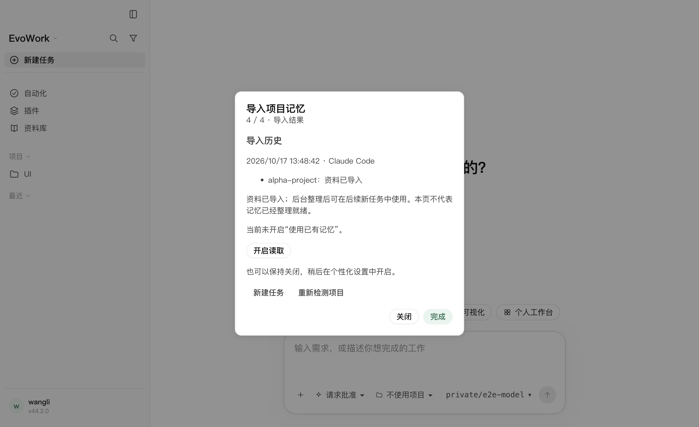

# 2026-10-17 · Claude Code 项目记忆导入首版验收

入口为「设置 → 导入」、个性化及 `/memories` 弹窗的导入链接、本地 `/import`。实现及产品边界见 [20](../design/20-memory-import.md)。仅修改源码及开发构建，没有发布安装包或替换正在运行的用户应用。

后续已补齐 **32 项本机 Playwright + 1 项 MiMo 完整旅程（6 个新任务）**，并修复 Tab 焦点离开弹窗的问题；最新矩阵、失败记录及截图见[扩展 Playwright 验收](2026-10-17-memory-import-playwright.md)。

## 发货内核能力

使用 `build/kernel/mac-arm64/codex-app-server`，探针及 Playwright 都先校验发货 provenance。基线 `d583e73c4d1204f1e9f654ef87065e9f0dd07ac7`，带 P6，二进制 SHA-256 `d4e0b99dd4622f5f32b45f5f92a5b20c7bbdff7c31c3e817f9956a09842f375d`。

```bash
node scripts/verify-memory-import.mjs
```

隔离 HOME、内核目录及合成 `.claude/projects`：开启迁移能力后能够检测 MEMORY 项、导入、收到完成通知并读回原生历史；相同来源再次检测不重复提供。启动完整任务回合后，原生后台整理调用合成模型，模型发出真实 `exec_command` 读取导入证据并生成记忆文件，后续模型请求确实带回来源内容。后续新任务注入整理出的索引，禁读任务不注入。未直接预写整理结果冒充后台整理。

## 桌面端到端

```bash
node node_modules/@playwright/test/cli.js test memory-import.spec.mjs memories.spec.mjs views.spec.mjs --project=fake --retries=0
```

最终 **8/8，39.0 秒，零重试**。真实 Electron、IPC、适配层、发货内核、本机合成模型网关。

| 用例 | 核对的实际后果 |
|---|---|
| 导入向导 | `/import` 补全及手输打开本地向导；确认前取消无记忆写入、不创建任务；只选 alpha 时 beta 不复制；scope 保留原项目目录、来源文件不变。 |
| 设置与开关 | 导入不打开读取/生成；显式开启读取不改变关闭的生成设置；`/memories` 链接切换到同一向导；从设置直接导入后历史自动刷新。 |
| 历史与去重 | 未变化项目不重复提供；渲染页刷新、强制终止并恢复测试内核后历史仍可读；没有把 `/import` 发给模型。 |
| 后台整理与读取 | 模型实际执行原生工具读取所选来源、生成索引；新任务请求包含索引，禁读请求不含索引；未选择的来源标记不进入整理结果。 |
| 部分失败 | 在一次性内核目录中以真实权限制造 alpha 同步失败；同批 beta 成功，界面显示各自结果及权限原因；解除权限后重新检测仅提供仍需更新的 alpha。 |
| 关闭与既有回归 | 明确 false 的迁移开关经产品迁移仍保留；按钮禁用并说明原因；既有 `/memories` 读/贡献开关和所有设置分类、资料库/自动化入口回归通过。 |

截图已查看，无文本/控件遮挡；步骤切换导致焦点元素消失时，焦点保留在模态内，Escape 可关闭。



## 正式门禁

- 完整 `pnpm run build`、最终 `pnpm run build:renderer` 通过。
- `pnpm run check` 退出 0：格式、lint、生产与测试类型、**2884 项通过 / 2 项既有跳过**（179 个测试文件通过、1 个既有跳过）、内核补丁预算/协议及许可证校验均通过。
- 导入适配层专项 7 项覆盖伪造/空/过期选择、重启失效、提交前来源变化、不支持/关闭、部分成功与失败原因过滤、未知写入不重放和超时。
- 日志：`/private/tmp/evowork-import-{native-verified,ui-verified,check-final,build-release,renderer}.log`。

受限沙箱内本机监听被 EPERM 拒绝、Swift 缓存写入受限，完整构建及带回环服务的测试经允许的沙箱外执行入口完成。初次桌面测试发现 hostEnv 不会自动成为原生子进程环境，已在捕获内核进程的测试接缝中明确隔离 HOME；最终用例仅选择合成项目。

## MiMo 真实模型补验

使用用户指定的 `mimo-v2.6-flash`、`https://api.xiaomimimo.com/v1`，通过真实 Electron、产品宿主管理的本机 Responses 网关、发货内核完成验证。来源 HOME、工作区和内核目录均隔离，只读取人工构造的 Claude 项目记忆。密钥通过隐藏 stdin 进入进程，再由环境变量传递，没有写入配置或源码。

```bash
# EVOWORK_UI_MODEL_KEY 通过隐藏输入注入，不在命令中填写值。
EVOWORK_UI_MODEL_PRESET=mimo-v2.6-flash node node_modules/@playwright/test/cli.js test memory-import.real.spec.mjs --project=real --retries=0
```

最终 **1 项完整旅程通过，含 6 个独立新任务回合，4.4 分钟，Playwright 重试关闭**。通过真实 `/import` 勾选两个项目；MiMo 自主调用原生工具读取资料、生成索引，后台作业进入 `done`，`last_error = null`。没有脚本化模型回答或预写整理结果。21 次原生请求均使用 `xiaomi/mimo-v2.6-flash`；其中 16 次属于以下任务，另 5 次为后台整理。

| 新任务 | 回答与请求证据 |
|---|---|
| 整理触发 | 普通真实回合完成，回复 `READY`；此时尚无索引。 |
| Alpha 读取 | 返回来源独有的随机标签 `ALPHA_WEEKLY_49fb7273999d`、`YYYY/MM/DD`、`紫色风险`；实际检索并读取记忆登记文件；3 次请求均带记忆上下文。 |
| Beta 读取 | 返回 `BETA_WEEKLY_49fb7273999d`、`DD-MM-YYYY`、`橙色风险`；实际检索登记文件；2 次请求均带记忆上下文。两个项目未混用约定。 |
| Alpha 单任务禁读 | 三个字段全部 `UNKNOWN`。5 次请求均无记忆上下文、无来源标签；只查当前项目文件及可用资源，没有读取记忆目录。 |
| Gamma 未导入项目 | 检索共享登记文件后仍回答三个 `UNKNOWN`，没有借用 Alpha/Beta 的标签、日期或风险标题。2 次请求均带记忆上下文。 |
| Beta 全局禁读 | 功能开启、全局读取关闭，新任务跟随全局；三个字段全部 `UNKNOWN`。3 次请求均无记忆上下文、无来源标签；仅查项目目录。 |

随机标签只存在于导入来源，提问不包含答案。测试观测器只保存模型 ID、场景标记及上下文/标签布尔值，不记录请求正文或请求头；被动观察流事件，不改变读取模式。另以延迟读取的本机 HTTP 服务核对请求正文逐字节不变。[证据 JSON](assets/2026-10-17-memory-import/memory-real-evidence.json)保留回答、工具命令与返回、实际整理结果、请求布尔值及后台作业状态，省略推理条目。完整临时产物 `/private/tmp/evowork-memory-real-results-3`，日志 `/private/tmp/evowork-memory-real-3.log`；最终日志与 5 份产物合计 6 个文件的精确凭据扫描 **0 命中**。

**范围结论：本轮普通使用没有误用，但严格跨项目不可见不成立。** 全局索引保留了两个项目的具体标签与约定；Alpha、Beta、Gamma 读取任务的 developer 上下文均可看到两组内容。Gamma 也能检索共享正文，只是本轮遵守 scope 后没有采用其他项目约定。不能将此结果描述为按项目 ACL、机密隔离或永不误用。禁读本轮验证的是不注入、不自动检索及回答行为，没有测试用户显式要求任意文件读取时的权限阻断。

最终完整 `pnpm run check` 再次退出 0，**2884 项通过、2 项既有跳过**；日志 `/private/tmp/evowork-memory-real-check-final.log`。本轮只增加真实模型测试及测试专用观测/只读诊断，没有修改产品执行逻辑或内核。

首轮因测试包装入口未显式调用网关 `main()` 而预检失败；第二轮观测器的数据监听改变了流时序，普通回合失败、后台报 `failed_agent`。两轮测试接线问题修正后，最终完整旅程通过；未计为模型质量失败，也未静默重试失败断言。失败日志保留在 `/private/tmp/evowork-memory-real.log`、`/private/tmp/evowork-memory-real-2.log`。

## 限制

本次为 macOS arm64，未做 Windows/Linux 实机。真实模型补验仅覆盖单一模型、两组人工来源的一轮普通行为，没有做多模型、重复采样或对抗性泄露评估。项目范围由原生 scope 和整理指令维护，不是独立 ACL；跨项目索引及共享正文可见性已由真实请求证实。后台整理按原生调度执行，导入完成通知不证明该批记忆已经整理就绪；V1 无整理进度，既有任务不承诺热更新。

不提供任意文件/Cursor 记忆、自动更新、逐条编辑、批次撤销或中心记忆同步。导入历史是操作记录，不代表相关内容尚未清空。手动更新按来源现状同步副本，包括源文件删减；未增加自动删除传播。缺失方法的降级通过适配层模拟核验，本轮没有切换旧二进制声称旧版本端到端已验收。上游内核签出、补丁、依赖和许可证清单均未修改，未提交 Git 或发布。
