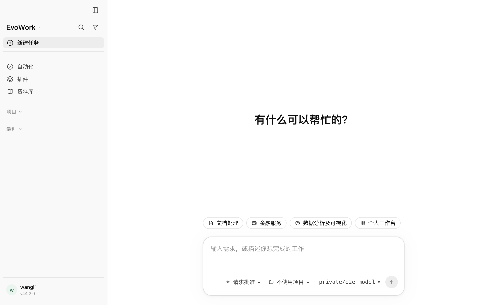

# 2026-10-24 · 删除首次引导，直接进入主界面

## 最终行为

首次启动不再经过欢迎、隐私确认、保存位置、组件安装或完成向导，直接显示任务输入区。旧版 `onboarded` 标记即便为 false 也不会挡住界面；保留旧协议和元数据兼容读取，不再调用完成引导。

保存位置使用既有默认值，无项目任务各有独立目录，不创建或默认选择项目；在「设置 → 常规」修改。模型配置仍在模型设置中，未配置时沿用输入区的明确提示。执行在本机与模型调用会联网的隐私说明移入「关于与更新」。

启动时在内核开始接受任务前，从随包成品自动部署缺失办公组件，零网络、零 pip。保留已有可用运行时与管理员解释器覆盖；失败不阻止文本功能，原因可由设置读取并手动修复。部署位置尊重 `EVOWORK_HOME`，与探针、内核技能、预览解析共用解释器；避免测试或自定义数据目录写入系统默认用户运行时。

## 验证

- 最终 `pnpm run check` **退出 0，3405 项通过、2 项既有跳过**；格式、lint、类型、内核预算、协议、许可清单通过。数量减少包含删除过时引导组件及旧流程测试，并以首次直达、初始化、路径隔离和设置修复回归替代。
- 完整构建和最终渲染层构建通过；生成 DMG 295.2 MiB、ZIP 300.1 MiB，预算通过。
- 真实 Electron + 发货内核 + 本机确定性网关 UI **2/2 通过，零重试、零跳过**：全新状态直达主界面、没有欢迎/安装/完成入口、刷新后仍可用、默认目录实际任务 cwd、零默认项目，以及常规设置修改/恢复目录与旧任务目录保留。
- 最终实际 `.app` 冒烟退出 0。明确清除管理员解释器覆盖，在全新隔离应用数据目录启动，**自动准备后运行时探针为 installed，主界面输入区可见**。另验证随包成品向新临时目录复制时零下载/零 pip，以及既有 argv 深链、协议注册、单实例转发。临时应用数据随冒烟清理。
- 图片已查看，主界面无首次引导覆盖层，任务输入区和“无项目”状态可见。

```bash
pnpm run check
pnpm run build
node node_modules/@playwright/test/cli.js test onboarding.spec.mjs working-directory.spec.mjs --project=fake --retries=0
pnpm run package
node scripts/verify-packaged-app.mjs
```

本机完整检查使用既有 pnpm 10/store，并将 Vitest 并发限制为 2；Swift、回环 HTTP、Electron 检查在沙箱外完成。

## 过程与边界

用户补充删除整个首次引导后，先前“保留三步”的中间实现已全部撤销。首轮全量发现验证代码的类型/lint 问题，修正后完整检查通过；未修改测试超时。首轮最终 UI 的目录断言遇到 macOS `/var` 与 `/private/var` 别名差异，改为 realpath 对比后整组复验 2/2。

仅验 macOS arm64。未升级版本、发布或替换已安装应用；验证包仍为 ad-hoc 签名，正式 Developer ID/公证（U4）未关闭。未验证 macOS `open-url` 系统派发、其他平台或真实厂商模型质量。

[检查摘要](assets/2026-10-24-first-launch/check-summary.txt) · [UI 日志](assets/2026-10-24-first-launch/ui.txt) · [实际包冒烟](assets/2026-10-24-first-launch/packaged-smoke.txt)


