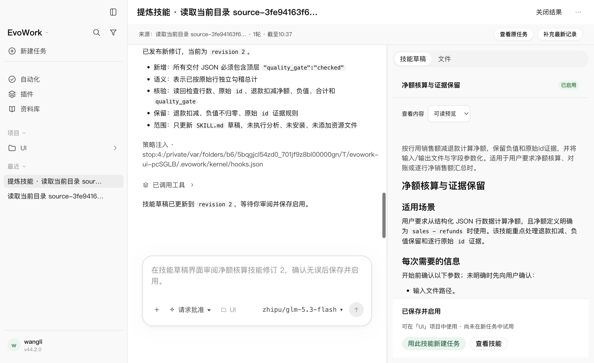
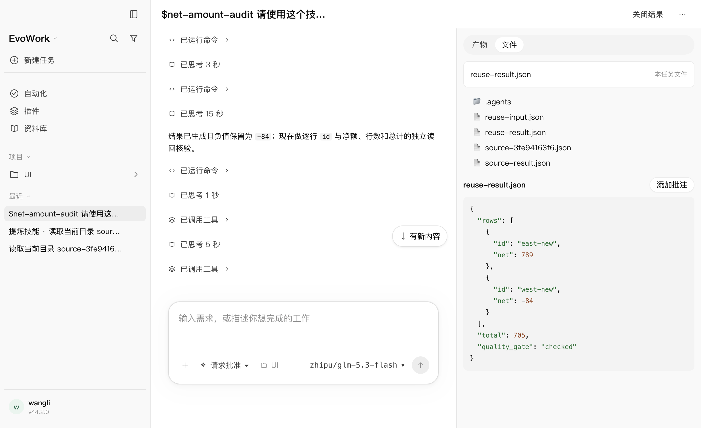
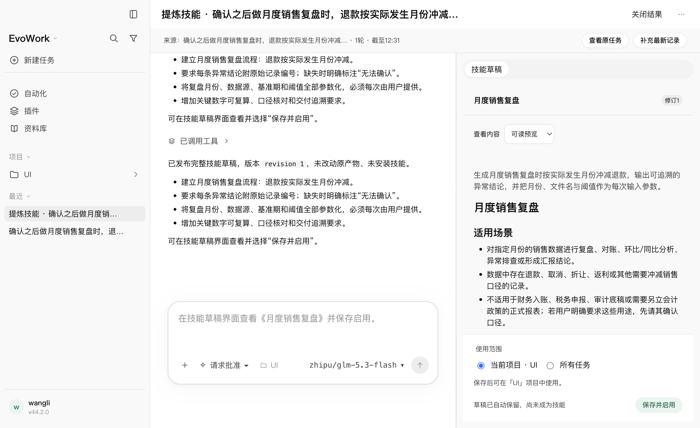

# 会话提炼技能：GLM 真实模型 Playwright 验收

日期：2026-10-25。范围为[设计23](../design/23-session-to-skill.md)的任务会话提炼技能；接续[实现与确定性验收](2026-10-25-skill-extraction.md)。测试使用用户指定的 `glm-5.3-flash`，上游地址为 `https://open.bigmodel.cn/api/paas/v4`。

## 1. 结果与范围

真实 Electron、发货内核、宿主网关和随包 `skill-drafts` MCP 的完整三条旅程 **3/3 通过，429.84秒，零 Playwright 重试、零跳过**。随后人工复核原任务回复，发现自然语言入口误报草稿生成失败；修复任务交接提示并加严断言后，自然语言旅程 **1/1 通过，85.71秒，零重试、零跳过**。后一次为定向复验，没有声称交接修复后又完整跑过三条真实模型旅程。

| 旅程 | 实际核对 |
| --- | --- |
| 项目内菜单提炼与复用 | 随机数据真实计算、来源引用可定位、文件名参数化、对话发布修订2、补充要求有来源、刷新后重开、项目目录落盘与启用、新任务原生技能引用和新数据实际执行；无项目候选不包含该项目技能 |
| 无项目来源保存为全局 | 默认“所有任务”、项目范围不可选、保存前不可发现、保存后用户级候选可发现、刷新保持安装版本、返回来源继续提炼 |
| 自然语言发起 | 原任务真实调用创建工具、关联提炼任务读取快照并发布草稿、来源只包含发起前的完整回合、未保存不安装；加严复验进一步要求原任务不读写草稿、关联任务不重复创建、原任务不误报失败 |

第二轮完整旅程共记录 **63次指定 GLM 请求、63次 HTTP 200 响应、零传输错误**；交接修复后定向旅程 **13次请求、13次 HTTP 200**。逐条核对型号与精确 `/chat/completions` 端点，观测器不改写请求或响应。各次窗口验收均无非预期内核退出；通过用例的隔离 HOME 已按夹具清理。

[完整逐项结果](assets/2026-10-25-skill-extraction-glm/final-results.json) · [完整运行日志](assets/2026-10-25-skill-extraction-glm/final.log) · [交接修复后结果](assets/2026-10-25-skill-extraction-glm/handoff-results.json) · [交接修复后对话与工具记录](assets/2026-10-25-skill-extraction-glm/handoff-evidence.json) · [环境与源码哈希](assets/2026-10-25-skill-extraction-glm/environment.json)。

## 2. 新任务复用的独立校验

来源任务与复用任务使用不同数据。复用请求只指定技能和新文件，没有重复退款扣减、负值规则或新增质量门字段。新任务历史包含指向已安装 `SKILL.md` 的原生 `skill` 内容块，核对了名称和完整文件路径。

新输入为 `850-61` 与 `20-104`。实际交付逐行净额 **789、-84**，总额 **705**，并包含只在对话修订中新增的 `quality_gate: checked`。测试独立计算并比较完整 JSON，不以模型回复“已完成”判定通过。

[独立计算结果](assets/2026-10-25-skill-extraction-glm/reuse-check.json) · [原生技能引用校验](assets/2026-10-25-skill-extraction-glm/native-skill-reference-check.json) · [项目技能实际文件](assets/2026-10-25-skill-extraction-glm/project-SKILL.md) · [全局技能实际文件](assets/2026-10-25-skill-extraction-glm/global-SKILL.md)。`natural-SKILL.md` 只是按宿主格式从未安装草稿生成的审阅副本，不表示已安装。

## 3. 发现、修正与复验

首轮真实模型为 **1通过、2失败，475.30秒**。失败现场与结果保留，没有通过重试隐藏。

1. **刷新定位使用了旧任务名。** 创建时的临时标题稍后会被宿主更新，测试刷新后仍点旧名称。改为按稳定任务 ID 取得最新标题，再通过侧边栏重开，保留刷新恢复的原断言。
2. **保存等待把中间状态当成失败。** 元数据中的“文件已保存，正在核对启用状态”被测试立即抛出；现场确认随后已经启用。改为在原期限内等待最终 `{state: saved, error: null}`，继续核对安装修订和真实文件。
3. **模型将 SKILL.md 重复作为资源提交。** 宿主拒绝不合法资源路径，模型读取错误后修正。工具定义补充正文自动生成 `SKILL.md`、无额外资源传空数组，以及资源路径前缀约束。后续项目与全局旅程发布均成功。
4. **人工复核发现原任务误报生成失败。** 完整三条自动断言通过后，原任务仍曾调用仅限关联任务的读取/发布工具；宿主正确拒绝，但模型将其解释成草稿丢失。修正模式指令、工具说明和创建返回指令，明确原任务只交接；错误信息也指向已有的关联任务，不再用“没有草稿”描述上下文错误。新增宿主回归在旧实现上 **10通过、1失败**，修复后 **11/11**；真实 GLM 加严复验中，原任务只有创建调用，关联任务只有读取与发布，全部成功。原任务回复为“已创建关联提炼任务。请点击「继续提炼」查看草稿”。
5. **确定性窗口等待竞态。** 交接修复后的窗口回归首次 **2通过、1失败**：发送后界面短暂空闲，但来源首轮尚未完成，测试就点击提炼。改为在原60秒期限内等待内核权威回合完成；完整复跑 **3/3，12.2秒，零重试、零跳过**。

[首轮结果](assets/2026-10-25-skill-extraction-glm/initial-results.json) · [首轮日志](assets/2026-10-25-skill-extraction-glm/initial.log) · [宿主修复前](assets/2026-10-25-skill-extraction-glm/handoff-unit-before.log) · [宿主修复后](assets/2026-10-25-skill-extraction-glm/handoff-unit-after.log) · [确定性首次回归](assets/2026-10-25-skill-extraction-glm/fake-before.log) · [确定性最终回归](assets/2026-10-25-skill-extraction-glm/fake-final.log)。

## 4. 构建与仓库检查

交接修复后完整构建通过；指定随包办公解释器，完整 `pnpm run check` 退出0，**3434项通过、2项既有跳过，210个测试文件通过、1个既有跳过**。格式、lint、类型、K1预算、K2协议与许可检查通过。之后只修改确定性窗口等待辅助函数，单文件格式/lint及上述完整窗口回归通过。

[构建日志](assets/2026-10-25-skill-extraction-glm/handoff-build.log) · [完整检查日志](assets/2026-10-25-skill-extraction-glm/handoff-check.log)。本机MCP单测需要允许监听回环地址；受限环境首次返回 EPERM 后，在允许本机端口的环境执行同一断言，未放宽期限。

复现入口：先经隐藏输入将厂商密钥置于测试启动器内存，以进程环境传给夹具，不在命令参数或文件中填写密钥。

```bash
EVOWORK_UI_MODEL_PRESET=glm-5.3-flash node node_modules/@playwright/test/cli.js test skill-extraction.real.spec.mjs --project=real --retries=0
# 交接修复后的加严定向复验
EVOWORK_UI_MODEL_PRESET=glm-5.3-flash node node_modules/@playwright/test/cli.js test skill-extraction.real.spec.mjs --project=real --retries=0 --grep '明确自然语言'
node node_modules/@playwright/test/cli.js test skill-extraction.spec.mjs --project=fake --retries=0
```

## 5. 截图、凭据与边界

已查看项目保存、复用结果、全局来源返回及自然语言草稿截图；保存栏和草稿正文正常展示。最终45个原始测试证据文件及54个待留存证据/源码副本的精确凭据扫描为 **99个文件、0命中**；构建/检查日志未接收厂商密钥，持有凭据的测试启动器已退出。见[扫描记录](assets/2026-10-25-skill-extraction-glm/credential-scan.json)。







只覆盖 macOS arm64、此 GLM 型号和上述输入。真实模型单轮成功不等于稳定性保证；本轮的恢复检查为页面刷新重开，不代表整个应用进程重启。全局覆盖发现与启用，真实新数据执行覆盖项目技能。未扩大为所有功能的真实模型回归，未覆盖恶意来源全集、跨平台、安装中强杀或发行安装包。截图仍可见既有“策略注入”路径提示，本轮未重做该历史展示。来源删除的引用留存边界仍按设计23执行。未修改内核、升级版本、发布或替换已安装应用。
