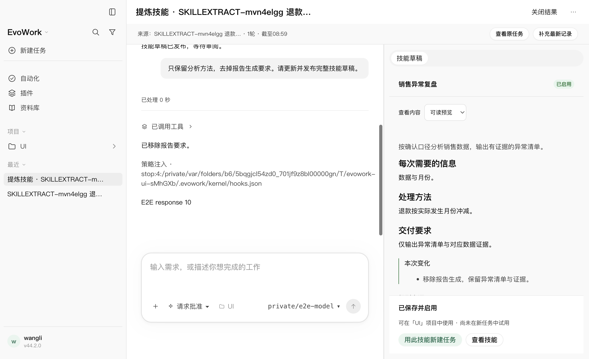
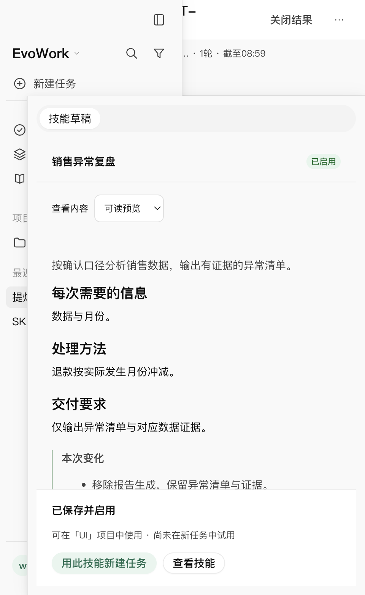

# 从任务会话提炼技能：实现与验收

日期：2026-10-25。需求与用户已确认的交互见 [设计23](../design/23-session-to-skill.md)。本轮不升级版本、不发布或替换已安装的应用。

## 1. 实现结果

- 任务 `⋯ → 提炼为技能` 和当前用户回合明确的自然语言要求共用宿主流程；默认继续已有草稿，可选择另起一份。
- 从公开协议读取完整回合，固定记录范围与截止点，排除在途回合；补充新记录只接纳原截止点之后的回合，不重新纳入被排除的早期内容。
- 关联提炼任务通过真实随包 MCP 读取来源和发布结构化草稿；修订、来源、规则、文本资源与范围写入本机权威元数据。未保存前不进入技能扫描目录。
- 正常对话和快捷修改走任务原有推理链路，预览、文件内容和安装版本一致；规则来源可定位到原消息。草稿保存可跨数据库重开恢复，页面刷新后从任务列表重开亦可恢复。
- 项目技能落在宿主验证过的 `.agents/skills`；全局沿用用户技能及内核镜像。复用既有静态检查、P1/P2 确认与暂存替换。能力确认绑定审阅版本，修订或范围变化后必须重新审查。
- 重名、路径穿越、软链、缺失资源、版本过期、目录发现失败均有明确结果；全局目录比较先解析真实路径，兼容macOS路径别名。
- 只有按精确路径核对发现与启用后才显示成功。“用此技能新建任务”仅准备带结构化技能引用的输入，不自动发送或重放旧操作。
- 草稿正文独立滚动，范围与保存操作栏保持在窗格底部；使用现有结果覆盖布局，窄窗操作可用。迟到响应不打开旧任务弹窗或覆盖新任务输入。

## 2. 运行与结果

| 检查 | 结果 | 验证范围 |
| --- | --- | --- |
| `pnpm run build` 与最后的 `pnpm run build:renderer` | 通过 | 主进程、preload、服务层、随包入口、最终渲染层 |
| 新增宿主测试 | 10/10 | 真实sqlite与文件系统，来源范围、草稿恢复、修订、资源、两种安装、失败恢复、同名与路径保护、令牌、增量和删除 |
| 新增渲染层测试 | 3/3 | 迟到候选、迟到来源与能力确认的版本绑定 |
| 定向既有回归 | 通过 | 技能安装、任务工作台、preload、宿主接线；统一订阅修正后 App 136/136 |
| 真实 Electron＋发货内核＋随包 MCP＋本机确定性模型上游 | 3/3，13.3秒 | 项目、全局、自然语言；零Playwright重试、零跳过 |
| 第一轮完整 `pnpm run check` | 退出0，3415通过、20跳过 | 格式、lint、33包类型检查、所有测试、K1、K2、许可证 |
| 指定随包办公解释器后的最终完整 `pnpm run check` | **退出0，3433通过、2项既有跳过** | 210个测试文件通过；117.18秒，格式/lint/类型/K1/K2/许可证全通过 |

第一轮完整检查的跳过来自既有条件：PPT生成与版式17项、办公依赖判定自检1项，以及运行时安装E2E2项；并非本轮新增测试跳过。随后指定已构建的办公解释器补跑同一完整检查，18项全部执行并通过，最终只保留运行时安装E2E的2项既有跳过。

命令：

```bash
pnpm run build
pnpm run build:renderer
pnpm exec vitest run --project desktop apps/desktop/test/skill-extraction-host.test.ts apps/desktop/test/skill-extraction.test.tsx
pnpm exec playwright test skill-extraction.spec.mjs --project=fake --retries=0 --output=/private/tmp/evowork-skill-ui-results
VITEST_MAX_FORKS=2 VITEST_MIN_FORKS=1 VITEST_MAX_THREADS=2 VITEST_MIN_THREADS=1 pnpm run check
EVOWORK_OFFICE_PYTHON="$PWD/build/office/mac-arm64/runtime/bin/python3" VITEST_MAX_FORKS=2 VITEST_MIN_FORKS=1 VITEST_MAX_THREADS=2 VITEST_MIN_THREADS=1 pnpm run check
```

受限执行环境中的Homebrew包管理器自动切换会挂起，按[已记录的构建说明](../build-and-deploy.md)在允许启动包管理器的环境运行锁定的pnpm10.30.3。未修改版本、锁文件或门禁脚本以绕过检查。

## 3. 过程中发现和修正的问题

1. 新视图单独订阅事件会与既有测试和主界面的单通道接线冲突。改为通过主界面统一分发刷新，既有App136项回归通过；没有改变这些用例的断言或时限。
2. 全局技能文件确已保存，但内核返回规范路径，安装镜像可能使用路径别名。最初按字符串比较误报“未发现”；改为真实目录比较，增加别名回归，最终真实全局旅程通过。
3. 初轮窗口用例误把刷新等同于保留当前选中任务，且无项目用例在创建完成前读任务列表。按真实用户操作重开任务，并等待任务出现再读终态；恢复与实际安装的原断言保留。
4. 窄窗截图首次调用错了已有窗口调整辅助函数的参数；按其签名修正。截图检查后将草稿正文和底部操作栏分别布局，避免长内容把保存按钮推走。

完整窗口旅程从发货内核的工具事件进入真实stdio MCP和本机HTTP，再到真实sqlite、技能目录、原生技能发现与启用；没有用原型状态、预置界面或替代安装实现通过。模型上游是确定性剧本，因此不能据此宣称真实模型稳定完成方法抽象。

## 4. 截图

已查看最终宽屏和480宽截图；长正文可滚动，底部操作可用，几何检查无横向溢出。





## 5. 留存与未验边界

删除来源会清空草稿元数据中的原文证据并停用原消息定位；已经进入关联提炼任务历史的引用按该任务自身生命周期留存，需要另行删除关联任务。删除提炼任务清除其草稿及暂存资源，已经明确安装的技能文件保留。此边界已同步设计与总纲，不能承诺自动抹除其他会话历史。

仅macOS arm64；未专项验Windows/Linux、整应用进程重启、安装中强杀恢复、发行安装包或真实厂商模型的提炼质量。资源目前为受限大小的文本文件，不自动打包原附件或执行来源脚本。没有发布、上传用户会话或新增云端内容服务。
