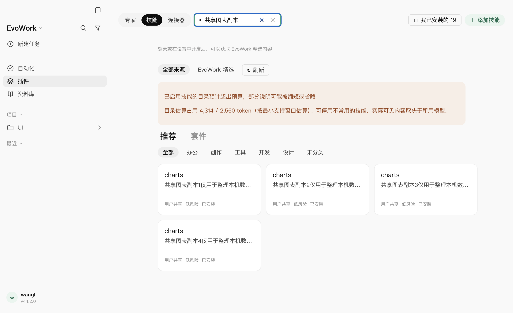
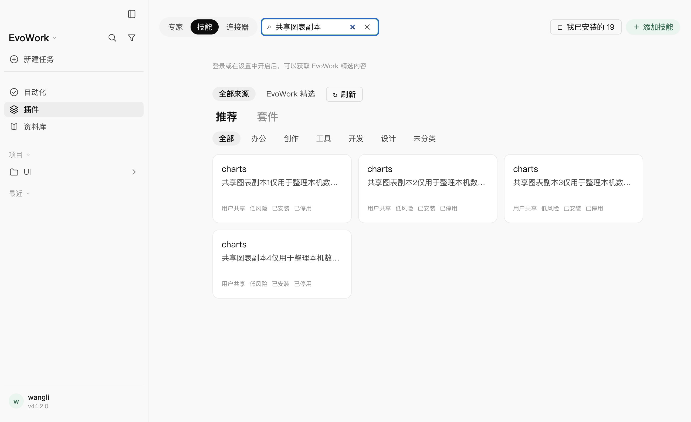

# 2026-10-29：技能目录与预算范围对齐

## 问题与修复

本机安装包的 15 个内置技能描述与源码一致，每条 50–157 字符；名称、描述与安装路径合计约 1,135 token，低于页面固定的 2,560 token 基线。真实内核在隔离配置下还发现了本机用户共享目录中的 18 个启用技能，总估算 4,825 token。原页面只合并本应用安装目录中的条目，预算却统计全部原生发现结果，形成「显示 15 个、计入 33 个」的差异。

- 页面合并内核返回的共享、项目、系统、管理员与套件技能，显示可判定的来源、文件位置与启停状态。
- 按规范化文件路径匹配、选择与启停，同名副本分别管理；本应用的安装副本与内核镜像仍合并。共享副本不能覆盖内置技能或应用模板的启停状态；被精选版本替代的旧内置副本仍标为官方内置。
- 非本应用管理的文件只提供启停，不提供按名称卸载；未修改用户共享目录的文件，也未自动停用技能。
- 告警改为「已启用技能的目录预计超出预算，部分说明可能被缩短或省略」，展示占用与预算，并明确按最小支持窗口估算。未把它当作当前模型实际发生截断的证明。
- 保留 15 个内置技能的原有描述与内核实现。

## 验收

- 修复前新增宿主回归失败：预算中有 5 个技能，页面只返回 1 个；新增渲染层的同名选择与估算提示用例也失败。
- 相关宿主、目录与渲染层回归：193/193 通过，包含同名副本独立启停、应用模板状态与旧内置来源标注。
- 最终完整构建退出 0。
- 最终真实 Electron + 发货内核 + 随包 MCP 的确定性窗口回归：2/2，10.5 秒，零重试。覆盖 15 个内置技能加 4 个共享同名图表副本的计数、预算告警、逐个停用、内置技能保持启用、刷新后保留停用状态、共享文件仍存在，以及原有技能安装/更新/卸载生命周期。两次内核启动，无意外退出。
- 最终固定源码与测试的完整 `pnpm run check` 退出 0：210 个测试文件通过、1 个既有跳过；3437 项通过、2 项既有跳过。格式、lint、全部类型检查、内核补丁预算、协议形状与许可清单全部通过。

复验命令（从仓库根执行，`pnpm` 使用本机已安装的 10.30.3）：

```bash
pnpm run build
node node_modules/@playwright/test/cli.js test skill-install.spec.mjs --project=fake --grep '共享目录技能|带引号和多行描述' --retries=0
EVOWORK_OFFICE_PYTHON=/Applications/EvoWork.app/Contents/Resources/office/runtime/bin/python3 VITEST_MAX_FORKS=2 VITEST_MIN_FORKS=1 VITEST_MAX_THREADS=2 VITEST_MIN_THREADS=1 pnpm run check
```

## 过程与边界

初次沙箱阻止本机 HTTP 监听（EPERM）及 Swift 用户缓存写入，放开对应执行限制后继续。窗口首轮因 macOS `/var` 与 `/private/var` 别名的字面路径断言失败，改为核对真实文件身份与内核返回路径后通过，未放宽功能断言。

早期全仓运行出现既有文档/图表/PPT 渲染用例超时；PPT 原时限定向复验通过。另一次全仓运行期间追加了同名应用模板断言，该轮不能作为固定版本的最终验收。最后停止修改代码，按构建、窗口测试、全仓检查的顺序复验；保留原测试断言与时限。

固定代码后的全仓运行中，3436 项通过，仅一项既有图片设置测试因异步表单状态通知晚于错误文案出现而失败。测试改为等待原有回调断言满足，再点击取消；未修改图片设置产品逻辑、断言值或超时。该文件定向 6/6 通过后重新执行全仓检查。

只验证本机 macOS arm64 与确定性模型路径，未调用真实厂商模型、修改内核、替换已安装应用、升级版本或发布。技能预算继续采用最小支持窗口的估算值。

## 页面证据





内核生命周期：[共享技能用例](assets/2026-10-29-skill-budget/kernel-lifecycle.json)、[安装生命周期回归](assets/2026-10-29-skill-budget/install-lifecycle.json)。
