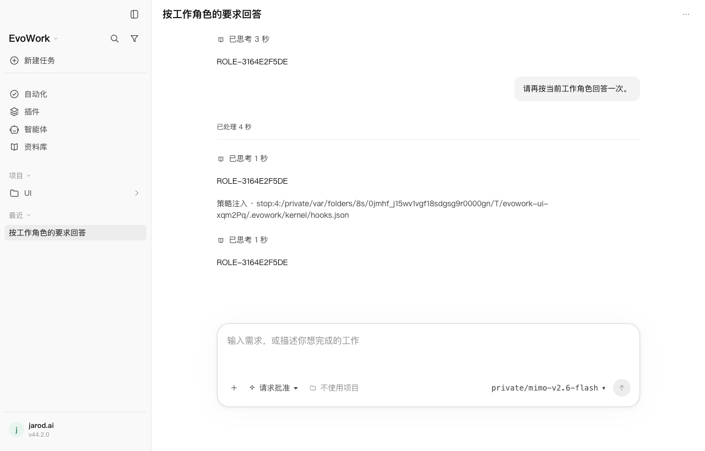
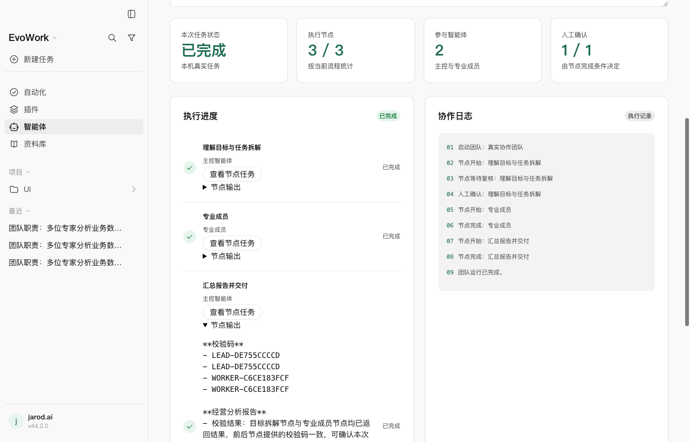
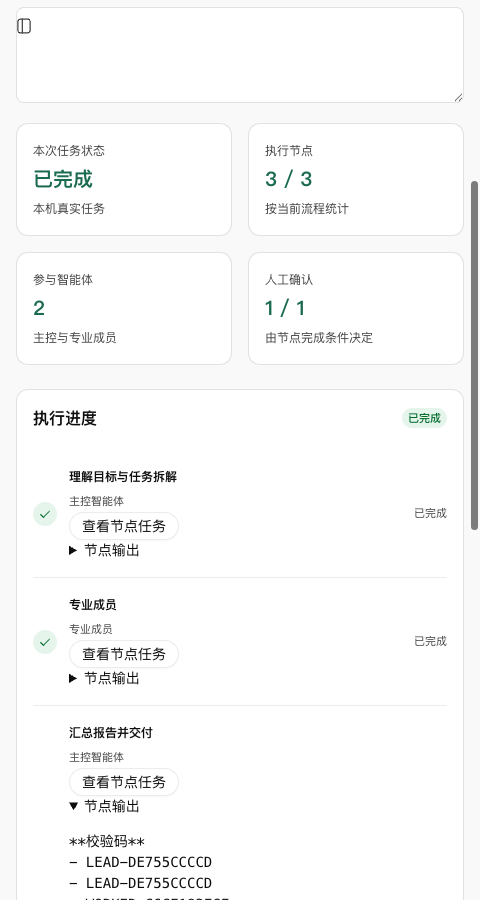

# 2026-11-07 · 智能体工作台后台验收

> 后续已扩展至 15 条 Playwright，并修复后台命令停止问题；最新覆盖和边界见[扩展验收记录](2026-11-07-agent-workspace-playwright-expanded.md)。本篇保留首轮验收事实。

## 实现

按[设计 24](../design/24-agent-workspace.md)将前端评审页接入本机服务。配置与团队运行进入 sqlite 权威 v8 的 `agent_workspace` / `agent_workspace_run`；旧库升级前备份，修订号防止过期覆盖，投影重建不清除配置。团队保存成员及流程快照，删除原单体不隐式改变团队；运行中的团队须先停止才能删除。

单体从真实发送链创建任务，角色说明和工作指令进入 developer instructions，任务级快照用于后续回合、队列与会话通信。配置编辑、删除后，既有任务仍沿用原角色。团队按已保存的协作方式执行批次，每节点创建独立真实任务，团队职责、团队指令、用户需求与前序真实输出共同传给节点；并发最多三路，并遵守用户调低的并发和任务预算。每节点启动前重新检查目录与执行策略。

human / review 条件在真实输出后等待用户确认；失败停止后续批次，停止会中断活动任务及之后返回的在途创建，等创建收尾后才允许新运行。退出或重启标为中断，不自动重投。界面读取真实记录，可打开节点任务查看历史与处理工具审批；长输出在窄窗换行。删除或启动失败在弹窗内显示原因。技能与连接器选择是工作偏好，实际安装、信任和审批仍由原链路判定；未接入的国内连接器不能保存。

## 最终验收

环境：本机 macOS arm64、Node 24.22.1、pnpm 10.30.3、已有发货内核及随包完整办公 Python。未改上游内核、产品版本或已安装应用。

- 完整 `pnpm run check` **退出 0**：**3531 项通过、4 项既有跳过**（221 个测试文件通过、2 个跳过），92.46 秒。格式、lint、类型、内核补丁预算、协议与许可检查均通过。
- 完整 `pnpm run build` **退出 0**；原生 Helper 仍保持 `releaseVerified=false`。
- 最终产物的 Playwright **3/3，49.5 秒，零重试、零跳过**：一条确定性桌面旅程、两条真实 MiMo 旅程。
- 最后独立格式检查与 `git diff --check` 通过。

| Playwright 旅程 | 验证的后果 |
| --- | --- |
| 本机配置与布局 | 初始空列表，UI 创建/保存、刷新恢复、修改、删除；删除单体后团队成员快照保留；1440 / 900 / 600 / 480 宽无横向溢出 |
| MiMo 单体 | 随机角色校验码经真实模型返回；刷新保留配置；编辑并删除角色后，原任务下一回合继续返回原校验码 |
| MiMo 团队 | 三节点真实完成；首节点输出后等待人工确认，后两节点尚未创建；运行中删除被拒绝；刷新恢复等待，确认后交接与汇总；最终输出包含两位成员的随机校验码；节点任务可打开，480 宽展开真实输出无横向溢出 |

指定模型 `mimo-v2.6-flash`，网关实际请求 `https://api.xiaomimimo.com/v1/chat/completions`。最终两条真实旅程共 **17 请求 / 17 响应，均 HTTP 200**，包括后台与策略相关调用；所有请求的型号与端点均核对一致。证据摘要见 [upstream-summary.json](assets/2026-11-07-agent-workspace-backend/upstream-summary.json)。

密钥仅通过隐藏标准输入进入测试进程环境，不填写在测试源码、命令参数或配置文件中。最终扫描源码、桌面/网关构建产物、各轮证据和首轮失败隔离目录，**29821 个文件、2 个压缩包，零密钥命中、零读取错误**；不跟随软链，排除 `.git`、依赖和原生/办公构建目录。见 [credential-audit.json](assets/2026-11-07-agent-workspace-backend/credential-audit.json)。

## 过程中的失败与修复

首次构建在沙箱中因 Swift 缓存和嵌套 `sandbox-exec` 权限失败，使用正常本机权限后完整构建成功。基线 `scripts/build.mjs` 有一处格式错误，只重排该 import。

首次完整检查在办公测试中使用系统 Python，部分直接调用缺少模块；将随包 Python 加入 PATH 后通过。另更新仍要求“只存前端”的旧 App 用例，将渲染层共享模型导入改为无 Node 依赖的纯子路径。既有分享进程测试把 esbuild 原生 CLI 当 JS 交给 Node，改用同一 esbuild 的 `buildSync`，保留真实打包与启动判据。

首轮真实模型验收为 1 失败 / 1 通过：单体用例读取了不存在的 `model` 字段，应为 `modelId`，在模型回复前提前失败；修正字段后通过，未放宽角色或交接断言。其后最终构建曾完成 3/3；最后补充团队目标传递、运行中删除保护及真实输出窄窗换行后，重新运行完整 check、构建和三条 Playwright，得到上面的最终结果。

## 可复现命令与证据

先把已有 Node、pnpm 10.30.3 和随包办公运行时加入 PATH，设置 `EVOWORK_OFFICE_PYTHON`。密钥通过隐藏输入注入 `EVOWORK_UI_MODEL_KEY`，不要写入命令或文件。

```bash
VITEST_MAX_THREADS=1 VITEST_MIN_THREADS=1 VITEST_MAX_FORKS=1 VITEST_MIN_FORKS=1 pnpm run check
pnpm run build
EVOWORK_UI_MODEL_PRESET=mimo-v2.6-flash node node_modules/@playwright/test/cli.js test agent-workspace --project=fake --project=real --retries=0
```

本机原始日志：`/private/tmp/evowork-agent-workspace-check-3.log`、`/private/tmp/evowork-agent-workspace-build-3.log`；最终 Playwright 完整历史、上游元数据、生命周期和截图在 `/private/tmp/evowork-agent-workspace-playwright-verified`。通过的隔离应用目录由夹具正常清理。







## 验证边界

真实模型覆盖文字角色与串行交接，不代表长任务、复杂文件交付、并行架构或工具审批已经通过本轮真实模型验收。并行上限、调低并发/预算传递、确认/停止、在途创建、同批失败收尾、重启不重投及迁移/投影重建由确定性单元测试验证。重启用例未关闭整个真实 App 再开，UI 刷新已验；后台中断的真实崩溃恢复、Windows 与其他架构尚未验收。review 是用户复核真实输出，不是自动质量判定；能力偏好不是工具权限白名单。未打包发布、升级版本或替换安装版。
