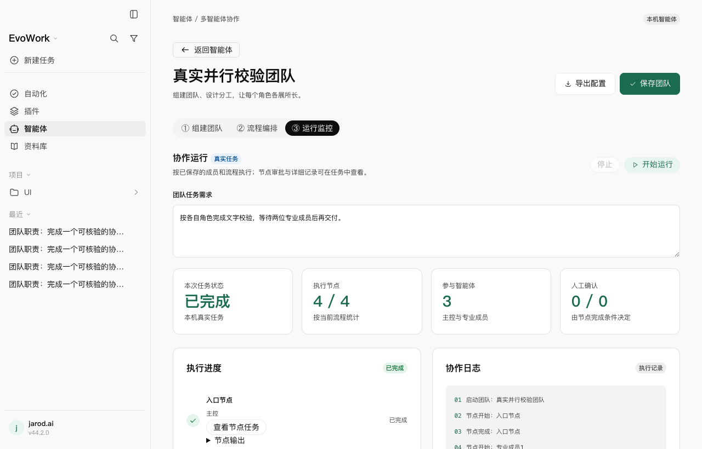
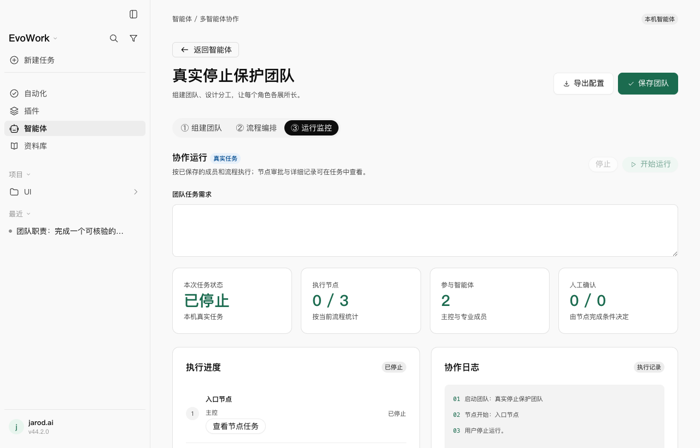
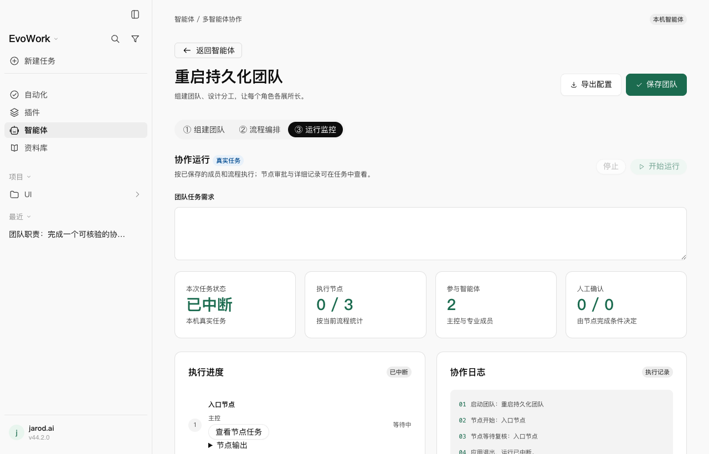

# 2026-11-07 · 智能体工作台扩展 Playwright 验收

本轮按用户要求补充并实际运行更多用例。工作台 Playwright 从 3 条扩为 **15 条，新增 12 条**；新增共享旅程辅助文件和三份 spec，覆盖真实 Electron、preload、sqlite、发货内核与模型网关。

## 最终结果

- **Playwright 15/15 通过（2.6 分钟，单 worker、零 Playwright 重试、零跳过）**：10 条确定性旅程、5 条真实 MiMo 旅程。
- 完整 `pnpm run check` **退出 0**：**3536 项通过、4 项既有跳过**；221 个测试文件通过、2 个跳过，94.37 秒。格式、lint、类型、内核预算、协议及许可检查通过。
- 修复后完整 `pnpm run build` 通过；适配层定向回归 130/130。新增 5 项单元回归覆盖后台终端终止确认、接口缺失和有界失败。
- 五条真实旅程共 **34 请求 / 34 响应**，型号均为 `mimo-v2.6-flash`，实际端点均为 `https://api.xiaomimimo.com/v1/chat/completions`，响应 HTTP 状态均为 200。停止用例的业务判据是本机命令退出、不能再写出文件且不启动后续节点。
- 密钥只经隐藏输入进入测试进程环境；源码、构建产物与本轮各次测试证据扫描 **29845 文件 / 2 压缩包，零命中、零读取错误**，不跟随软链，排除依赖、`.git`、原生/办公构建目录。通过用例的隔离应用目录正常清理。

见[旅程摘要](assets/2026-11-07-agent-workspace-expanded/journey-summary.json)、[上游摘要](assets/2026-11-07-agent-workspace-expanded/upstream-summary.json)与[凭据审计](assets/2026-11-07-agent-workspace-expanded/credential-audit.json)。

## 用例清单

| 范围 | 旅程 | 主要判据 |
| --- | --- | --- |
| 新增 · 确定性 | 筛选、搜索与离开保护 | 大小写搜索和类型筛选组合生效；继续编辑保留草稿，放弃不改权威配置 |
| 新增 · 确定性 | 过期编辑/删除 | 第二写入者更新后，旧表单不能覆盖或删除；错误在表单/危险确认框可见；刷新获得新版本 |
| 新增 · 确定性 | IPC 非法配置 | 未接入连接器、重复主控、悬空节点、未知条件、空成员被拒，配置和任务未增加 |
| 新增 · 确定性 | human 拒绝 | 真实节点输出后等待确认；拒绝后不启动后续；再运行不继承确认；运行中禁删、停后可删 |
| 新增 · 确定性 | review 拒绝 | 与 human 同样检查，防止把模型输出本身当作复核通过 |
| 新增 · 确定性 | 流式响应中停止 | 回合变为 interrupted；迟到响应及刷新不能推进节点 |
| 新增 · 确定性 | 上游明确失败 | 第一节点失败后后续无 threadId；刷新保持失败，仍可修正并保存配置 |
| 新增 · 确定性 | 调低并发 | parallel 架构在用户限为 1 时只启动一路，放行第一位专业成员后才启动下一位；最后汇总含真实前序结果 |
| 新增 · 整进程 | 关闭整个 App 再开 | 权威配置、运行 id 和节点输出保留；waiting 变为 interrupted；不显示继续确认，不重投后续节点 |
| 新增 · MiMo | 两成员并行与快照 | 实际捕捉两节点同时 running，分别返回自己的随机校验码，四节点最终汇合；中途保存 v2 不改变运行的 v1 快照 |
| 新增 · MiMo | 本机文件交付 | 输入只在本机文件；Python 实际计算并写 JSON，人工复核后下一节点接收真实 sum/max；任务 cwd 与选定项目一致 |
| 新增 · MiMo | 运行中停止本机命令 | 受控程序已实际启动；停止后回合中断，释放外部门闩 1.2 秒后完成文件仍不存在，后续节点无 threadId |
| 原有回归 · 确定性 | 保存/刷新/编辑/删除与布局 | 配置恢复、成员快照与 1440 / 900 / 600 / 480 布局 |
| 原有回归 · MiMo | 单体角色快照 | 配置编辑或删除后，已有任务后续回合仍使用原角色 |
| 原有回归 · MiMo | 三节点人工确认交接 | 等待状态刷新恢复、确认后交接、节点任务入口与窄窗真实输出 |

文件计算这轮的本机输入为 9 个随机整数，独立期望为 `sum=44789`、`max=8470`；成品 JSON 与最终交付逐项核对。该用例及停止用例均记录 **0 次工具审批卡批准**，命令在现有任务权限内运行，因此不把本轮称为额外工具审批验收。

## 测试发现并修复的真实问题

首轮新增真实用例 **2 通过 / 1 失败**。停止用例中，回合已是 interrupted，但受控命令仍继续运行；释放门闩后写出了 `workspace-finished`，原断言失败。公开历史还显示命令最终 exitCode 0，见[修复前摘要](assets/2026-11-07-agent-workspace-expanded/stop-before-fix.json)。

核对上游实现后确认：统一执行的后台终端可以跨回合存活，`turn/interrupt` 没有给出后台命令退出保证。工作台经 kernel-adapter 使用官方实验接口 `thread/backgroundTerminals/list` 与 `thread/backgroundTerminals/terminate`，按每个节点的 threadId 枚举不透明 processId、等待终止并重新枚举确认清空；停止、失败收尾、启动恢复和在途创建返回均使用这条链路。只终止节点自己的后台终端。接口缺失、终止未确认或有界复查失败时，工作台标记 failed 并给出明确说明。

未修改上游内核，也不按 OS pid 猜测或调用额外 shell kill。新增协议依赖、参数形状和降级已登记在[总纲](../evowork-on-codex-design.md)、[设计 09](../design/09-service-layer.md)、[设计 24](../design/24-agent-workspace.md)与 `kernel-contract.mjs`；协议形状自检为 54 个请求、30 条通知、5 类回复，全部通过。

保持原失败断言后，修复定向真实用例 **1/1（9.0 秒）**，随后在同一最终构建上完成 **15/15**；全套中该用例再次通过（7.6 秒）。

另有首轮确定性用例 **5 通过 / 3 失败**，原因是新用例把危险确认框定位成了 `dialog`，而基础控件正确使用 `alertdialog`。修正定位后 10 条确定性旅程 10/10；未改变产品危险对话框或放宽冲突/禁删断言。

## 运行与证据

使用已有发货内核、本机 macOS arm64、Node 24.22.1、pnpm 10.30.3 和随包完整办公 Python。先将这些工具加入 PATH，并设置 `EVOWORK_OFFICE_PYTHON`；密钥通过隐藏输入注入 `EVOWORK_UI_MODEL_KEY`，不要写进命令或文件。

```bash
# 10 条确定性窗口旅程
node node_modules/@playwright/test/cli.js test agent-workspace --project=fake --retries=0
# 5 条真实模型旅程；或与 fake 合在一次运行
EVOWORK_UI_MODEL_PRESET=mimo-v2.6-flash node node_modules/@playwright/test/cli.js test agent-workspace --project=fake --project=real --retries=0
VITEST_MAX_THREADS=1 VITEST_MIN_THREADS=1 VITEST_MAX_FORKS=1 VITEST_MIN_FORKS=1 pnpm run check
```

本机最终完整历史、窗口截图、上游元数据和生命周期：`/private/tmp/evowork-workspace-extra-final`。修复前真实失败保留在 `/private/tmp/evowork-workspace-extra-real-first`，定向复验在 `/private/tmp/evowork-workspace-extra-stop-fixed`；完整检查与构建日志分别为 `/private/tmp/evowork-workspace-extra-check-final.log`、`/private/tmp/evowork-workspace-extra-build.log`。







## 边界

真实模型样本覆盖文字并行、受控 Python 文件计算与停止，以及既有角色和串行交接；不代表复杂办公成品质量或所有连接器已验收。重启测试是正常关闭整个 App 再开，不是 SIGKILL、断电或系统崩溃。实验接口缺失和终止失败由单元测试验证，真实内核这一轮使用支持这些接口的发货版本。测试只在本机 macOS arm64 运行；没有新增跳过、改变模型、发布安装包或升级版本。
