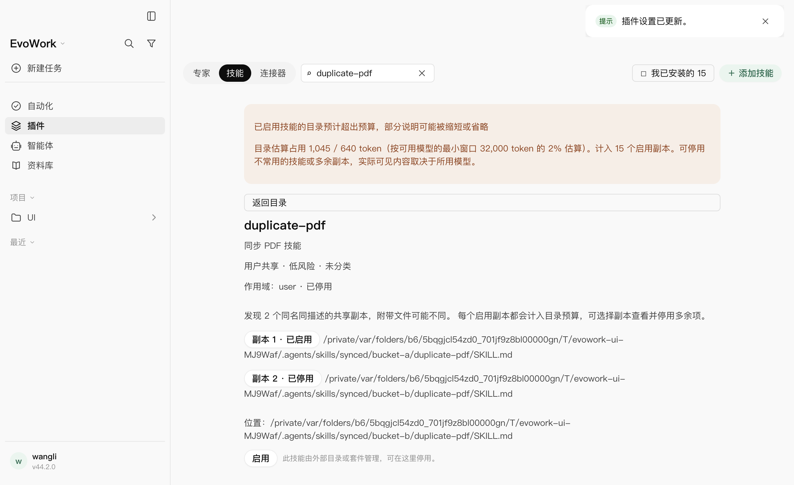
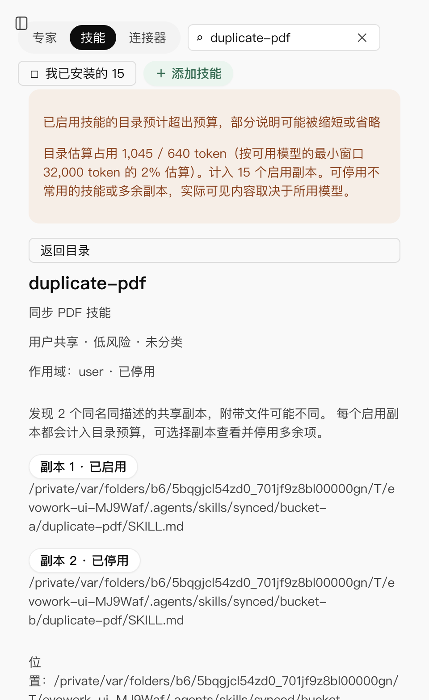

# 2026-11-07：共享技能重复卡片与预算基线修复

## 根因

本机 `~/.agents/skills/synced/` 下有两个同步来源目录（末尾分别为 `2418a3d8`、`181c899e`），各含 9 个技能。内核会扫描用户共享目录（`../codex/codex-rs/ext/skills/src/host_roots.rs:103`），桌面宿主此前按规范化路径保留全部原生发现结果，因此同名条目分别显示。18 个共享条目加上当前 14 个随包技能，与截图中的 32 个安装条目吻合。已确认重复来自现存的两个同步目录，未追溯其创建程序或同步历史。

对全部相对文件名与文件 SHA-256 逐一比较：docs、docx、import-memory、morning、pdf、xlsx 六对完全一致；google-workspace、pptx、skill-creator 三对 frontmatter 相同，但正文、参考资料或辅助脚本不同。不能按名称删掉一份，也不能把两者当作相同执行包。

预算提示的 2,560 来自 `HUB_MIN_CONTEXT_WINDOW = 128_000` 乘以 2%；旧桥接层未传入任何模型窗口。它是历史参考基线，不能证明截图中当前模型已发生截断。估算用量按每个启用且允许隐式调用的技能计算名称、截至 1,024 字符的描述与文件路径，约四字节一个 token；两个启用副本都会计入。

## 修改

- 用户共享项名称、描述、作用域、分类及风险级别相同时，只显示一张卡并注明副本数。详情保留每个文件路径、当前选择和独立启停；不同描述、风险与来源继续分开，内置项不被共享项覆盖。
- 不删除共享文件、不自动停用副本。列表安装数按卡片计，预算仍按所有实际启用副本计，并明确展示副本数量，不能靠隐藏卡片降低预算。
- 模型目录视图保留 `maxContextTokens`；宿主将最近一次已读的可用模型目录供技能预算使用，排除策略停用项，按最小窗口乘 2%。不为技能页新增模型或账号网络请求。
- 模型窗口缺失或模型列表为空时，用 128K 参考基线和信息提示，明确无法判断当前模型是否超限；窗口已知时才使用模型预算警告。仍是估算，不声称内核已实际裁剪。
- 长文件路径允许换行；窄窗技能工具栏自动换行，避免安装数量按钮挤出边界。
- 顺带格式化既有 `scripts/build.mjs` 的一条长 import，使仓库格式检查可继续；没有改变构建行为。

## 验证

- 定向宿主、渲染和模型目录回归 220/220 通过；新增用例覆盖单张卡、来源隔离、按路径切换/停用、1M 窗口不再被 2,560 误报、32K 窗口预算为 640、未知窗口回退、策略停用模型排除、全部副本计入以及技能页零新增模型请求。
- 最终完整构建退出 0。
- 最终真实 Electron + 发货内核 + 本机确定性网关窗口回归 **4/4，20.7 秒，零重试**：共享技能与预算、同步副本分组/独立启停/刷新保留/文件保留、安装更新卸载与候选刷新、原有安装布局。覆盖 480px 的副本详情和工具栏边界，截图已查看。
- 内核补丁预算、协议形状独立检查通过。
- 最终完整 `pnpm run check` 退出 1：格式、lint、33 个包的类型检查通过；218 个测试文件通过、1 个失败、2 个既有跳过，**3,522 项通过 / 2 项失败 / 4 项既有跳过**，123.42 秒。两项失败均为下述未修改的分享服务 esbuild 入口测试。独立许可证检查也未通过（既有 pnpm store 包索引缺失）；不能声称全仓绿。

窗口复验命令（先完整构建）：

```bash
node node_modules/@playwright/test/cli.js test skill-install.spec.mjs skill-install-layout.spec.mjs --project=fake --grep '共享目录技能|共享同步副本|带引号和多行描述|长审计' --retries=0
```

完整检查使用本机已有 pnpm 10.30.3、随包办公解释器与两路测试并发：

```bash
PATH=/Users/wangli/Library/pnpm/.tools/pnpm/10.30.3/bin:$PATH EVOWORK_OFFICE_PYTHON=/Applications/EvoWork.app/Contents/Resources/office/runtime/bin/python3 VITEST_MAX_FORKS=2 VITEST_MIN_FORKS=1 VITEST_MAX_THREADS=2 VITEST_MIN_THREADS=1 pnpm run check
```

## 过程与边界

首轮完整检查停在仓库原有构建脚本格式问题；格式化后继续。首轮窗口结果 1/3，失败分别为断言把精选区与列表的同一停用技能重复计数，以及窄窗刷新后侧栏遮住点击。测试改为搜索共享项后计数、按实际侧栏状态折叠再点击，未放宽断言或时限。最终增加原有安装布局回归后 4/4。

本机原始依赖目录缺少锁文件已声明的 nodemailer 与类型包，已按锁定版本安装到临时验证目录并供本机测试引用；项目依赖声明及锁文件未变。全仓还暴露两项未修改的分享服务入口测试：测试用 Node 执行本机原生 esbuild 二进制，报 SyntaxError。独立许可证检查由于现有 pnpm store 缺少包索引而无法读取依赖树，未重生成许可清单或绕过检查。

只验证 macOS arm64 与确定性模型，不代表真实厂商效果。未修改上游内核、用户共享文件或其同步程序；未自动消除运行时的多个启用副本。修复已进入源码和本次构建，未升级版本、替换已安装应用或发布。




