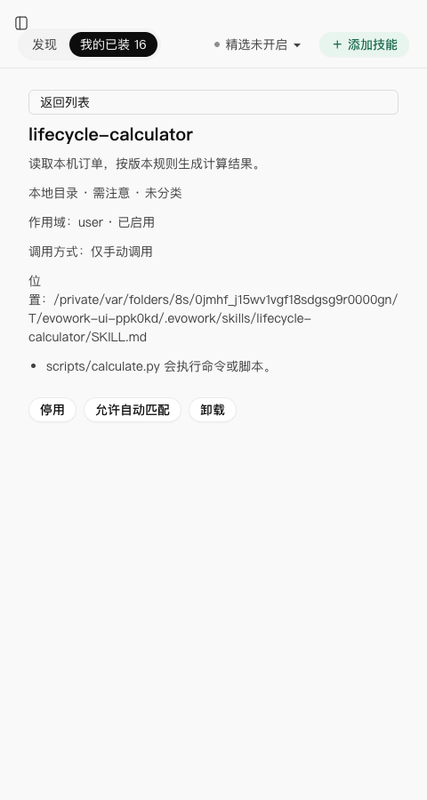

# 2026-11-24：技能安装、兼容路径与调用范围收敛

## 结果

- 本地、Git、Hub 技能安装与更新共用目录暂存、替换和同步失败恢复；Hub 上一版本备份也参与同一次文件事务。卸载与回滚复用相同存储边界。
- 全局技能文件只保存在 `~/.evowork/skills/<id>`；内核原位置保留目录链接。启动仅迁移内容、目录结构及文件执行位一致的旧镜像；冲突保留并显示提示。丢失的受管链接可恢复，吊销内容和未登记文件不因此激活。
- 本地与 Git 审计独立快照，确认不重新克隆或读取另一份源内容；最多保留 8 份、10 分钟，确认凭据绑定来源，消费后失效，退出清理。包限制为 64 MB、4096 个文件、32 层目录，主文件限制为 1 MB。Git 安装记录 URL、提交、子目录与内容哈希；Hub 记录签名包身份与版本，确认绑定包身份和审计结果。
- 技能详情显示自动匹配或仅手动调用。只允许修改本应用管理的可用技能，沿用原生 YAML 策略并保留其他字段；更新及回滚保留用户的调用偏好。共享副本仍按实际路径独立管理，不自动删除或停用。
- Composer 候选最多缓存 32 个工作目录、有效期 2 秒，并合并并发读取。显式刷新、目录读取、安装、启停、Hub 变更、提炼保存、回合结束和技能变化通知绕过或失效缓存。安装结果按真实文件位置核对内核发现状态，同名外部副本不能使安装伪报生效。

## 最终验证

冻结产品源码后完成完整构建。最终真实 Electron、发货内核、随包 MCP 的 Playwright 窗口回归 **11/11，20.1 秒，零重试**，涵盖项目/全局提炼、来源关系、保存后复用、共享副本、附件风险确认、安装、启停、更新、卸载、历史恢复与布局。

指定模型为 `mimo-v2.6-flash`，端点 `https://api.xiaomimimo.com/v1`。最终真实模型生命周期旅程 **1/1，52.0 秒，零重试**，上游 **15 次请求 / 15 次 HTTP 200**，均核对型号与端点，没有在途未决请求或传输错误：

1. 审计目录后改写源脚本，确认安装的仍是审计时版本；原内核位置与用户目录指向同一份文件。
2. 切到仅手动调用，明确从技能候选选择，在独立任务实际执行 v1 脚本。输入订单随机生成，测试独立计算期望值，同时核对脚本私有标记与实际命令历史。
3. 明确更新为 v2，保留仅手动调用偏好；第二个新任务执行新脚本，核对第二份随机输入与新版本结果。
4. 停用后候选消失，启用后恢复；卸载后两处位置与候选均消失。
5. 480px 详情没有横向溢出，截图已查看。密钥只经测试进程输入与子进程环境传递，本轮变更与产物扫描 **34 文件、零密钥命中**；保存验收文档后再次扫描变更、本轮结果与全部验收证据，最终为零命中、零读取错误，见[扫描结果](assets/2026-11-24-skill-lifecycle/credential-scan.json)。

最终完整 `pnpm run check` 中，格式、lint、33 个包的类型检查通过；**3698 项通过 / 2 项失败 / 6 项既有跳过**。关联的 7 个桌面测试文件合计 **414/414** 通过。完整检查仍退出 1：

- 未改动的 Windows 许可文件缺少 UTF-8 BOM；已核对 Git HEAD 中也缺失。
- 未改动的分享服务无效公钥进程入口测试超时。本机普通 Node 加载 Rollup 原生模块发生签名 Team ID 不匹配，本轮改用 Electron 的 Node 模式执行检查；该分享测试对子进程只传有限环境，未带 Node 模式。其临时子进程已清理，未修改分享服务或放宽测试。

内核补丁预算与 54 个请求的协议形状独立检查通过。许可证枚举独立检查失败，本机 pnpm 缺少 `dompurify@3.4.14` 的包索引，无法列出依赖许可；未重新生成许可清单。

## 发现并修复的接缝

扩大窗口回归后首次结果为 9/11：项目提炼后无法立即带入新任务，全局提炼后即时查询缺少候选。新增短缓存漏掉了提炼保存路径的失效。补上提炼保存失效、显式复用强制查询，以及回合结束强制刷新后，原断言定向 3/3、最终完整 11/11 通过，未加等待或放宽断言。

安装来源记录从技能能力审计中排除，避免将 Git 来源 URL 误当成技能出网能力。完整内容指纹比较还包含空目录和执行位，防止不同执行包被误当成可合并镜像。

## 复验与证据

使用仓库锁定的 pnpm 10.30.3、随包办公 Python，并将该解释器放到测试 PATH；测试并发为 2。当前机器的 Node 原生模块兼容问题通过临时 Electron Node 包装器处理，未改动依赖声明、锁文件或签名策略。

```bash
pnpm run build
node node_modules/@playwright/test/cli.js test skill-install.spec.mjs skill-install-layout.spec.mjs skill-extraction.spec.mjs --project=fake --retries=0
# 厂商密钥通过隐藏输入或进程环境传入，不写进命令、源码或配置。
EVOWORK_UI_MODEL_PRESET=mimo-v2.6-flash node node_modules/@playwright/test/cli.js test skill-lifecycle.real.spec.mjs --project=real --retries=0
```

- [模型请求与任务历史](assets/2026-11-24-skill-lifecycle/evidence.json)
- [内核生命周期](assets/2026-11-24-skill-lifecycle/kernel-lifecycle.json)
- [最终窗口回归](assets/2026-11-24-skill-lifecycle/playwright-regression.txt)
- [提炼缓存修复前](assets/2026-11-24-skill-lifecycle/extraction-before-fix.txt)、[修复后](assets/2026-11-24-skill-lifecycle/extraction-fixed.txt)
- [完整检查](assets/2026-11-24-skill-lifecycle/check.txt)、[构建](assets/2026-11-24-skill-lifecycle/build.txt)、[许可检查](assets/2026-11-24-skill-lifecycle/notices.txt)

仅验证 macOS arm64；Windows 目录 junction、进程强杀或断电期间的恢复仍未验证。本次事务保证同步 I/O 失败时恢复旧文件，不声称文件与 Hub 状态跨进程崩溃原子提交。保留兼容路径作为内核发现入口，没有增加用户目录的额外扫描根，维持吊销后保留文件但不被发现的语义。未修改上游内核、升级版本、替换安装或发布。


